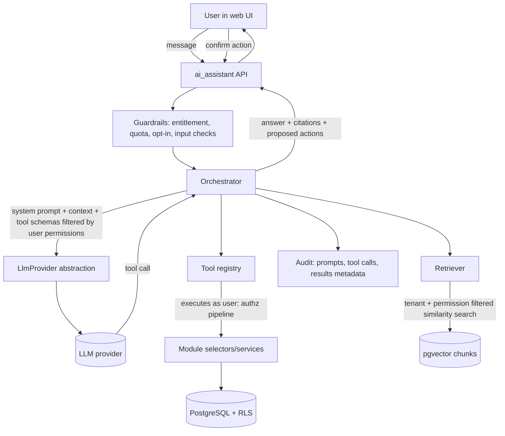

# AI Assistant Architecture

> Module code: `ai_assistant` (paid add-on, Phase 16). **The AI never bypasses authorization** (`CLAUDE.md` §10, §13).

## 1. Goals

- Help users get answers and complete tasks faster: "Which students in Class 8-B were absent 3+ days this month?", "Draft a notice about the exam schedule", "Summarize fee dues for my campus", "How do I configure late fines?".
- Help guardians/students with permitted self-service questions (results, dues, timetable).
- Help admins configure the system (Studio guidance) and use documentation.

Non-goals: autonomous actions without user confirmation; access to data the user cannot see; financial writes by default; grading/admission decisions without human review.

## 2. Architecture

### Components

| Component | Responsibility |
|---|---|
| `LlmProvider` / `EmbeddingProvider` | Abstraction over model vendors (ADR-020 proposes Anthropic Claude as default chat provider). Model IDs, temperature, max tokens are configuration (env/DB), never hardcoded in business code. Embedding model choice and vector dimension decided in Phase 16. |
| Orchestrator | Builds context, runs tool-use loop with step/time/token limits, handles streaming, enforces confirmation for write tools. |
| Tool registry | Each module may register tools in its manifest: name, description, JSON input schema, **required permission(s)**, required module, read/write classification, confirmation requirement, data-sensitivity class. |
| Retriever (RAG) | Tenant documents (policies, handbooks, notices, platform help docs) chunked + embedded into `ai_chunk` with `tenant_id`, source, and access metadata (roles/permissions/scope). Search = vector similarity **filtered by tenant_id (and RLS) and the user's access**. Platform help docs live in a shared, non-tenant corpus. |
| Guardrails | Entitlement + opt-in check, quota/rate limits, input size limits, PII minimization, prompt-injection mitigations, output checks. |
| Audit | Conversation, messages, tool calls (name, arguments, permission decision, result summary), token usage, model ID, latency. Retention configurable per tenant. |

## 3. Authorization model for tools

1. The tool list sent to the model is **pre-filtered** to tools whose required permissions the user holds (and whose module is entitled).
2. On every tool call, the tool **re-runs the full authorization pipeline** as the user (authenticate → tenant → membership → entitlement → permission → scope → field masking). The model's output is untrusted input.
3. Tools call **selectors/services only** — no raw SQL, no ORM access outside selectors, no generic "query anything" tool. A report-style tool may only use the `reports_analytics` permitted-dataset layer.
4. Results are field-masked exactly as the REST API would mask them.
5. **Write tools** (e.g. create notice draft, mark leave approved) return a *proposed action*; execution requires explicit user confirmation in the UI, then runs through the normal service with an `Idempotency-Key`. Financial write tools are **disabled by default** and require a tenant setting + permission even when enabled.
6. AI actions are audited with `actor_type = ai` plus the confirming user.

## 4. Safety & privacy

- **Tenant opt-in** before any tenant data is sent to an external LLM provider; tenant admins see what categories of data may be shared. Provider data-processing terms (no training on customer data, retention) must be verified before launch.
- **PII minimization:** send only fields needed for the question; mask identifiers where feasible; sensitive fields (medical, national ID, salary) are never sent unless the user has `view_sensitive` *and* the tenant enabled it.
- **Prompt-injection defenses:** retrieved documents and tool outputs are wrapped and labeled as untrusted data; system prompt instructs the model to treat them as data; tools cannot widen permissions; no tool fetches arbitrary URLs; write actions need human confirmation.
- **Children's data:** guardian/student assistant mode has narrower toolset and stricter output policy.
- **Hallucination control:** answers about data must come from tool results; responses include citations (record links / document chunks); "I don't know" preferred over guessing.
- **Quotas:** per tenant (plan) and per user; metered into `billing_usagerecord`.
- **Kill switch:** platform-level and tenant-level disable flags.

## 5. Data model (Phase 16 detail)

`ai_conversation` (tenant, user, mode, created_at) · `ai_message` (conversation, role, content (encrypted/retention-bound), tokens) · `ai_toolcall` (message, tool, args (redacted), decision allowed/denied, result_summary, latency) · `ai_document` (tenant, source file/notice, access metadata, status) · `ai_chunk` (document, tenant_id, content, `embedding vector(N)`, metadata JSONB; HNSW index; RLS).

## 6. Evaluation & testing

- Unit tests per tool: permission allowed/denied, scope, masking, tenant isolation.
- Orchestrator tests with a fake provider (deterministic) — no network in CI.
- Red-team test set: prompt injection in documents/notices, cross-tenant probing, privilege-escalation prompts, PII leakage prompts. Must pass before release.
- Quality eval set (golden Q&A per role) run before model/prompt changes.

## 7. Open decisions

- Default provider and model tier per use case (ADR-020); fallback provider.
- Embedding model and dimension; self-hosted embedding option for data residency.
- Bengali/Arabic quality evaluation for chosen models (must be measured, not assumed).
- Conversation retention defaults.

### Change notes
- 2026-11-05 — Initial version (Phase 0).
