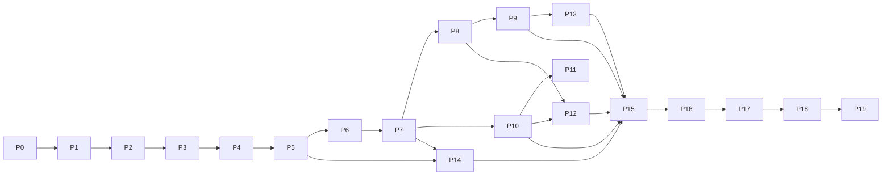

# Development Roadmap

> Phases are sequential unless stated. **Each major phase starts only after owner approval of the previous phase** (`CLAUDE.md` §0, §17).
> Every phase follows the 14-step per-phase procedure in `CLAUDE.md` §17 and must satisfy the global exit criteria below.

## Global exit criteria (every phase)

1. All deliverables implemented (or explicitly deferred with owner agreement and recorded).
2. Tenant isolation and permission checks implemented and tested for all new resources.
3. Tests, lint and type checks pass in CI; results reported.
4. Migrations reviewed; RLS policies for new tenant tables.
5. OpenAPI schema clean; TS client regenerated.
6. Docs updated (`DEVELOPMENT_PROGRESS.md`, relevant docs, ADRs).
7. PR(s) opened for review; owner approval recorded.

---

## Phase 0 — Documentation & architecture baseline — Complete, awaiting owner approval
**Deliverables:** `CLAUDE.md`, `README.md`, all `docs/*.md`, initial ADRs, list of decisions needing approval.
**Exit:** owner reviews and approves/adjusts proposed ADRs.

## Phase 1 — Repository foundation & infrastructure
**Depends on:** Phase 0 approval (ADR-012, ADR-013, ADR-014 **Accepted** 2026-11-05). ADR-015 (REST + OpenAPI + generated client) and ADR-021 (en/bn i18n) are still Proposed, but Phase 1 scaffolds them, so their approval is requested together with the Phase 1 plan.
**Deliverables:**
- Monorepo skeleton: `backend/`, `frontend/`, `packages/api-client/`, `infra/`, `.github/`.
- Django 5.2 project with split settings (base/dev/test/prod), env config, structlog, Sentry init (DSN optional), `/healthz` & `/readyz`, DRF + drf-spectacular, `core` app (`core.ids.new_id()` UUIDv7 abstraction, abstract BaseModel, error handler, pagination, request ID).
- PostgreSQL roles provisioned per ADR-009 (`erp_owner` for migrations, `erp_app` runtime NOBYPASSRLS, `erp_platform` reserved); the app and tests connect as `erp_app`.
- Celery app + beat wiring, Redis, S3-compatible storage config (SeaweedFS in dev — ADR-029).
- Next.js 16 app with TypeScript strict, Tailwind, shadcn/ui init, next-intl (en/bn), base layout, lint/format config, Vitest, Playwright skeleton.
- Docker Compose dev stack (postgres+pgvector, redis, objectstore, mailpit, migrate, api, worker, beat, web, nginx); Dockerfiles; `.env.example`; Makefile.
- CI workflow: lint, type check, tests, migrations check, schema/client drift, Docker build, secret scan.
- Pre-commit hooks (ruff, prettier, gitleaks).
- Dependency/update automation config (Dependabot).
**Exit:** `docker compose up` gives healthy stack; CI green on a sample test; README quick start updated.

## Phase 2 — Authentication, users, roles & permissions
**Depends on:** Phase 1; ADR-011 **Accepted** (Django session auth).
**Deliverables:** `identity` (custom User model — must exist before first migration of other apps; email/phone login, password reset, invitations, MFA TOTP, sessions, login history, throttling), `rbac` (permission registry from manifests, roles, role templates, assignments with scope fields, `has_perm` service, DRF permission classes), `audit` (base append-only events), session auth endpoints (CSRF, login, MFA verify, logout; host-only HttpOnly/Secure/SameSite cookies, `cached_db` sessions, key rotation, revoke-all) + login/MFA/forgot-password UI, `/api/v1/me/`. No token auth (ADR-028 pending).
**Note:** tenant-scoped assignment wiring completes in Phase 3.
**Exit:** auth flows E2E tested; permission evaluation unit-tested; security review of auth.

## Phase 3 — SaaS tenants, institutions & campuses
**Depends on:** Phase 2; ADR-009, ADR-010 **Accepted**.
**Deliverables:** `tenancy` (Tenant, TenantDomain, Institution, Campus, Membership wiring), tenant middleware + context, `TenantScopedModel`/manager (fail closed), RLS migration helper + policies, `core.db.tenant_atomic()` (transaction-scoped `set_config`) + execute-wrapper guard, `platform_scope()` (via `erp_platform` role), Celery tenant-aware base task, tenant-prefixed cache & file keys, `files` module, support sessions, tenant lifecycle states, configurable `max_institutions`/`max_campuses` limit enforcement (ADR-010), Super Admin console (tenants list/create/suspend), tenant onboarding API (without Studio), **shared isolation test suite**.
**Exit:** isolation suite green; RLS verified with raw SQL tests; security review.

## Phase 4 — Module registry & feature entitlement engine
**Depends on:** Phase 3.
**Deliverables:** `module_registry` (manifests, dependency validation, TenantModule resolution + cache, feature flags), `billing` foundations (Plan, Price, AddOn, Subscription, SubscriptionItem, UsageRecord; trial; Super Admin plan management; limits enforcement), `ModuleEntitled` permission class, `/api/v1/me/context/` (entitlements + permissions + terminology placeholder), entitlement-driven navigation in frontend, CI URL-pattern audit.
**Deferred:** live payment gateway integration (needs ADR-017) — may be built later in Phase 10/19.
**Exit:** non-entitled module calls rejected in tests; plan changes update entitlements.

## Phase 5 — Customization Studio & institution configuration
**Depends on:** Phase 4; ADR-016 decided.
**Deliverables:** `customization` (presets loader + initial presets for all six institution types, config sets with versioning/publish/rollback, effective config resolver + cache, terminology, custom field definitions + JSONB validation framework, form definitions + DynamicForm renderer, workflow engine (definitions/instances/transitions), rules evaluator (sandboxed) with tests, template engine (sandboxed) + preview, numbering sequences), Studio UI, onboarding wizard (choose institution type → preset → modules → branding), `notifications_core` minimal (in-app + email) for workflow notifications.
**Exit:** create a tenant per institution type from presets; publish/rollback works; rule & template sandbox security tests pass.

## Phase 6 — Academic structure & student admission
**Depends on:** Phase 5.
**Deliverables:** `academics` (years, terms, structure levels, academic unit tree, subjects/courses, offerings, capability flags), `timetable` (basic: periods, rooms, slots, clash detection), `admissions` (inquiries, cycles, public forms, applications, review workflow, test scheduling, merit list, conversion hook — student creation completes with Phase 7 models, so the student model may be introduced minimally here or conversion is finalized in Phase 7; decide in phase plan).
**Exit:** school/university/madrasa/coaching structures configurable without code changes (tests per preset).

## Phase 7 — Student, teacher & parent management
**Depends on:** Phase 6.
**Deliverables:** `students` (profiles, guardians N–N, enrollments, documents, bulk import, promotion/transfer, TC, ID cards via templates), `staff` (profiles, departments, designations, teaching assignments), `parent_portal` (guardian & student portal shells, child switcher), admission → enrollment conversion completed, scoped selectors (teacher → own sections, guardian → own children).
**Exit:** object-level scope tests pass; import validates and reports errors.

## Phase 8 — Attendance management
**Depends on:** Phase 7.
**Deliverables:** daily/period attendance, mobile quick-mark UI, edits with audit + permission for past dates, staff attendance, leave requests via workflow, thresholds, absence alert events (delivered fully in Phase 14; minimal in-app/email now), attendance reports, device-integration API design (implementation optional).
**Exit:** teacher marks attendance on mobile E2E; partition strategy evaluated for `attendance_record`.

## Phase 9 — Examination & results
**Depends on:** Phase 8 (or Phase 7 minimum).
**Deliverables:** grading schemes (marks/letters/GPA/CGPA/divisions, configurable pass rules), exams & components, marks entry (locking, moderation, optimistic concurrency), result processing (reproducible), publish/unpublish (audited), report cards/transcripts/admit cards via templates + PDF rendering with Bengali/Arabic script verification, merit positions, guardian/student result views.
**Exit:** grading calculators unit-tested for each preset; PDF output verified for all scripts.

## Phase 10 — Fees & financial accounting
**Depends on:** Phase 7; ADR-017 (gateways for fee collection) and ADR-023 decided.
**Deliverables:** `accounting` posting engine (chart of accounts presets, journals, immutability triggers, fiscal periods) + accounting UI (vouchers, ledgers, trial balance, statements) gated by entitlement; `fees` (heads, structures, installments, assignment, invoices, concessions with approval + SoD, payments cash/bank/online, allocations, receipts with gap-free numbering, late-fine rules, refunds via reversal, day-close), payment gateway integration(s) with webhook idempotency, guardian online payment.
**Exit:** full financial test suite (atomicity, idempotency, concurrency, immutability, balanced journals) passes; security review of finance.

## Phase 11 — HR & payroll
**Depends on:** Phase 10.
**Deliverables:** employee contracts, leave types/balances (integrated with attendance), salary structures (rule-based components), payroll runs with review/approval (SoD), payslips (templates/PDF), advances/loans, statutory deductions configurable per country, accounting postings.
**Exit:** payroll reproducibility and posting tests pass.

## Phase 12 — Hostel, transport & library
**Depends on:** Phase 10 (fees integration), Phase 8 (roll-call attendance).
**Deliverables:** **Custom Hostel Engine** (structure, profiles madrasa/university/generic, applications, allocation policies, no-overlap constraint, check-in/out, roll-calls, out-pass with guardian authorization, visitor log, incidents, meal plans, hostel & mess billing via fees); `transport` (vehicles, routes, stops, assignments, fees); `library` (catalog, copies, circulation, reservations, fines).
**Exit:** both hostel profiles demonstrated via configuration only; allocation concurrency tests pass.

## Phase 13 — LMS & online examinations
**Depends on:** Phase 9.
**Deliverables:** `lms` (course spaces, content, assignments, submissions, grading), `online_exams` (question bank, test assembly, scheduling, timer, attempts, auto-grading, manual grading, result publishing into examinations optional, integrity logs).
**Exit:** concurrent test-taking load test on representative volume; timing enforced server-side.

## Phase 14 — Notifications & communication
**Depends on:** Phase 5 (notifications_core), feature modules emitting events.
**Deliverables:** `communication` (notices, targeting, SMS/email/push/in-app providers behind abstraction, templates, scheduling, delivery logs, SMS credit metering, preferences/quiet hours), wiring of events (absence, results, fee due, payment received, out-pass, workflow tasks).
**Exit:** provider fakes in tests; metering accurate under concurrency.

## Phase 15 — Reports & analytics
**Depends on:** Phases 6–14 modules.
**Deliverables:** standard report library, async exports (CSV/XLSX/PDF), role dashboards, permitted-dataset layer + custom report builder, scheduled reports, platform aggregate analytics for Super Admin (no tenant PII), read-replica readiness.
**Exit:** report permission tests; heavy reports run async within limits.

## Phase 16 — AI assistant
**Depends on:** Phase 15 (permitted-dataset layer); ADR-020 decided.
**Deliverables:** `ai_assistant` per `AI_ASSISTANT.md`: provider abstraction, orchestrator, tool registry with module tools, RAG (pgvector), guardrails, confirmation flow, quotas/metering, audit, tenant opt-in, chat UI, red-team & quality evals.
**Exit:** authorization/isolation/prompt-injection test suites pass.

## Phase 17 — Institution-specific extensions & custom module builder
**Depends on:** Phase 5, relevant modules.
**Deliverables:** `ext_hifz_tracking`, `ext_course_registration`, `ext_batch_management`, `ext_certification` (with public verification), `custom_module_builder` (custom entities, screens, permissions, workflows, reports), enterprise SSO (if approved), extension versioning/upgrade tooling.
**Exit:** extensions installable/uninstallable via entitlements without code changes for tenants.

## Phase 18 — Security, performance & production readiness
**Depends on:** Phases 1–17.
**Deliverables:** threat-model review, ASVS L2 checklist, penetration test (external, recommended), ZAP baseline, load/performance testing & query optimization, partitioning where needed, PgBouncer, caching review, data export/deletion tooling, retention jobs, incident response & DR runbooks, restore drill, accessibility audit, custom-domain TLS solution (ADR-027).
**Exit:** all critical/high findings fixed; performance targets met; restore drill succeeded.

## Phase 19 — Docker production deployment & CI/CD
**Depends on:** Phase 18; ADR-019 decided.
**Deliverables:** production images & compose (or orchestrator per ADR), Nginx production config, TLS, registry, CD workflows (staging auto, production tag + approval), migrations in deploy, backups (pgBackRest/WAL-G) with off-site storage, monitoring/alerting, log aggregation, Sentry releases, runbooks, go-live checklist.
**Exit:** staging and production deployed via CD; rollback tested; backup restore tested; go-live approved by owner.

---

## Dependency overview

> Phases 11–14 can be partially parallelized after Phase 10 if the owner approves; the default is sequential execution with approval gates.

## Suggested MVP cut (proposal for owner)

A sellable MVP for schools/madrasas/coaching centers = Phases 1–10 + minimal Phase 14 (SMS for absence/fees) + minimal Phase 15 (core reports) + production hardening subset of 18–19. This is a recommendation; the formal phase order above remains unless the owner approves a change (record in DECISION_LOG).

### Change notes
- 2026-11-05 — Initial version (Phase 0).
- 2026-11-05 — Updated for owner-approved ADR-009/010/011/012/013/014 (session auth, transaction-scoped RLS context, DB roles, UUIDv7 abstraction, tenant-level subscription with campus limits, uv/pnpm, layout).
- 2026-11-05 — Phase 1: updated for the implemented foundation (S3-compatible SeaweedFS dev storage per ADR-029, pinned toolchain per ADR-030).
