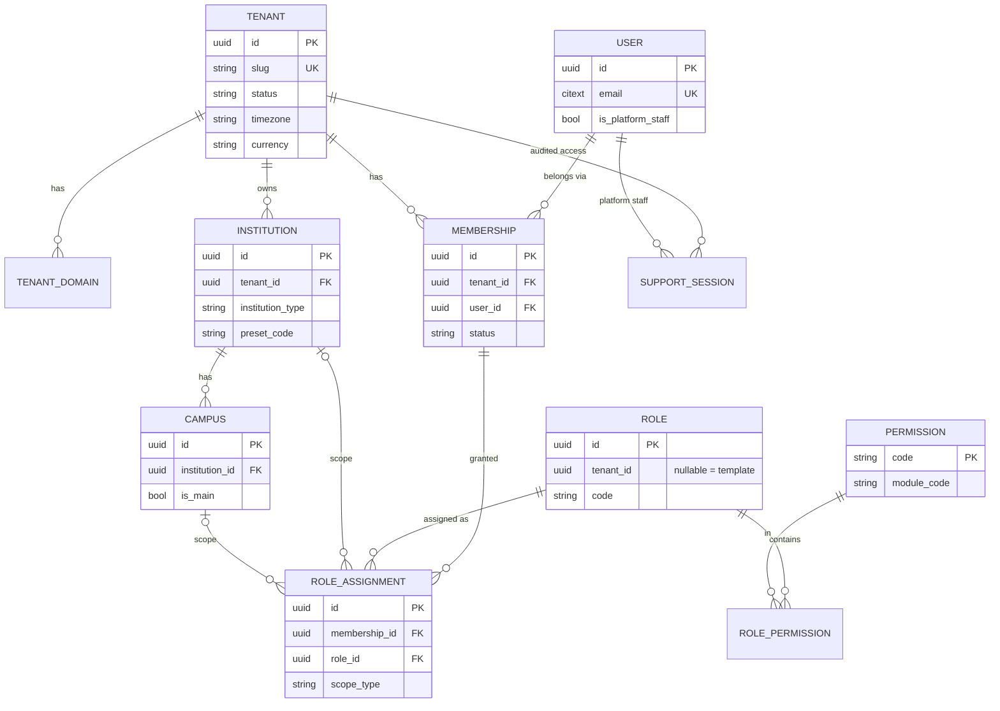
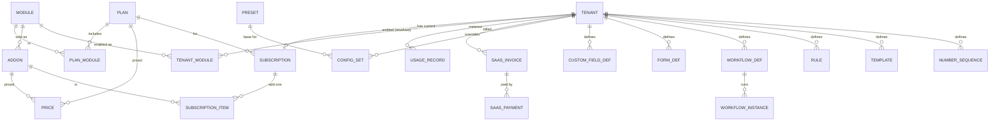
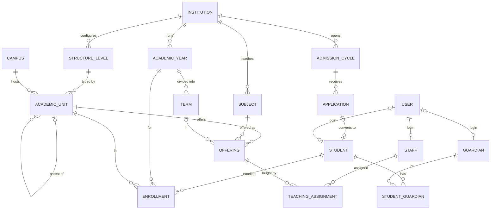
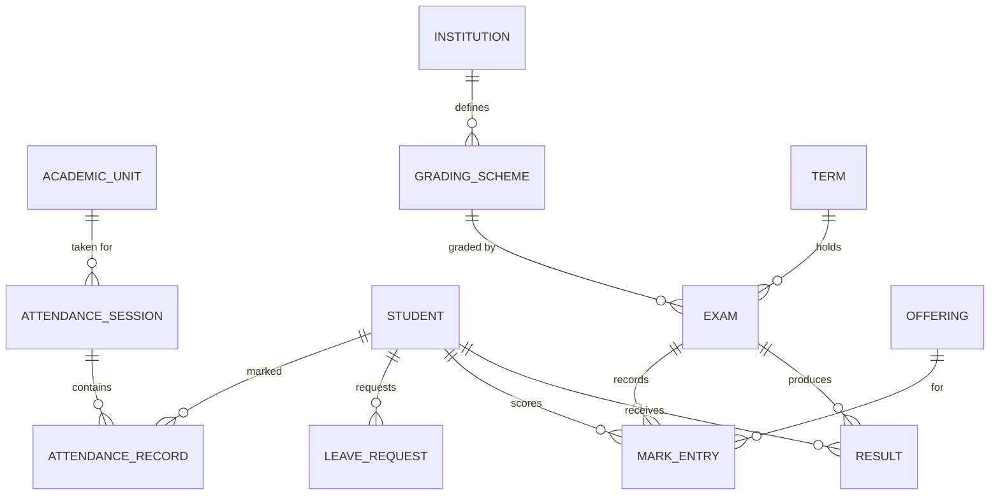
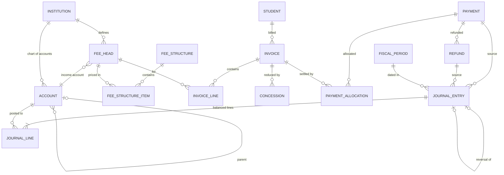
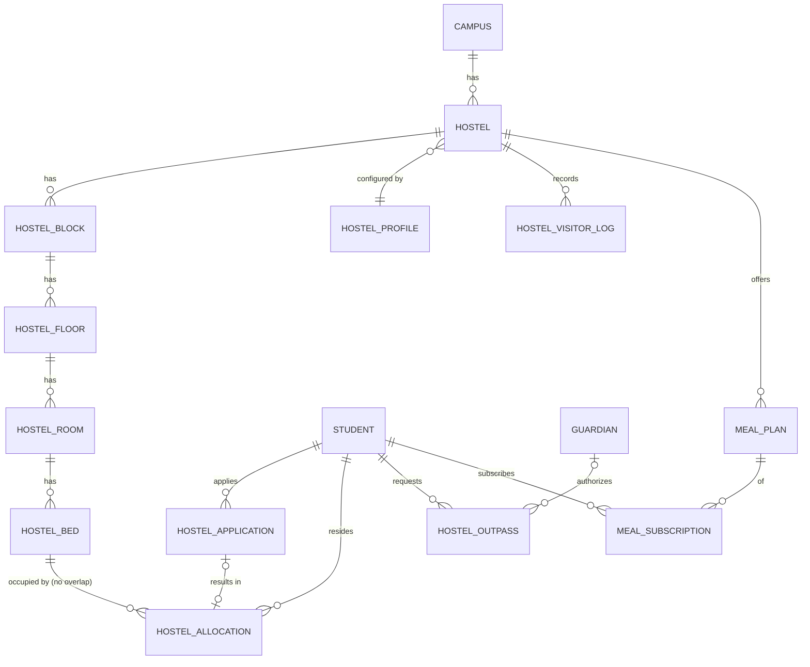
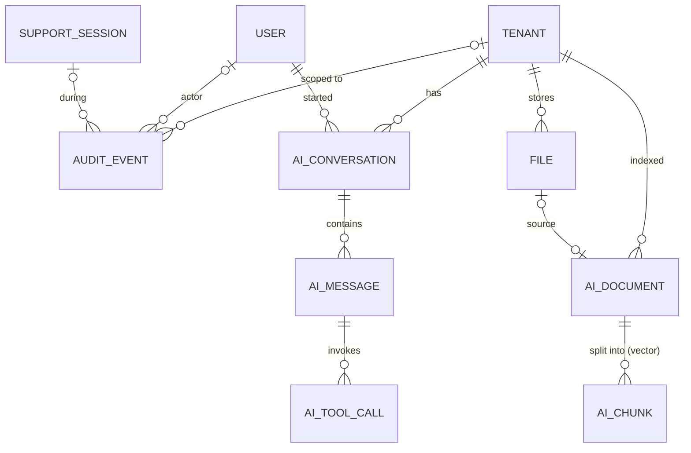

# Entity-Relationship Diagrams

> Target design (Mermaid). Tables are implemented phase by phase. Column details: `DATABASE_DESIGN.md`.
> Every tenant-owned entity has `tenant_id` (omitted from some diagrams for readability, but always present).

## 1. Platform: tenancy, identity, RBAC

## 2. Module registry, billing, customization

## 3. Academics, admissions, people

## 4. Attendance and examinations

## 5. Fees and accounting

## 6. Hostel engine

## 7. Audit, files, AI

### Change notes
- 2026-11-05 — Initial version (Phase 0).
- 2026-11-06 — Phase 2 implemented the identity/RBAC/audit tables exactly as designed in `plans/PHASE_02_PLAN.md` §7, plus `identity_sessionrecord.session_key_encrypted` (plan §18 D4). Dual-scope `tenant_id` columns exist on `rbac_role`, `rbac_rolepermission` and `audit_auditevent`; their RLS policies arrive in Phase 3.
