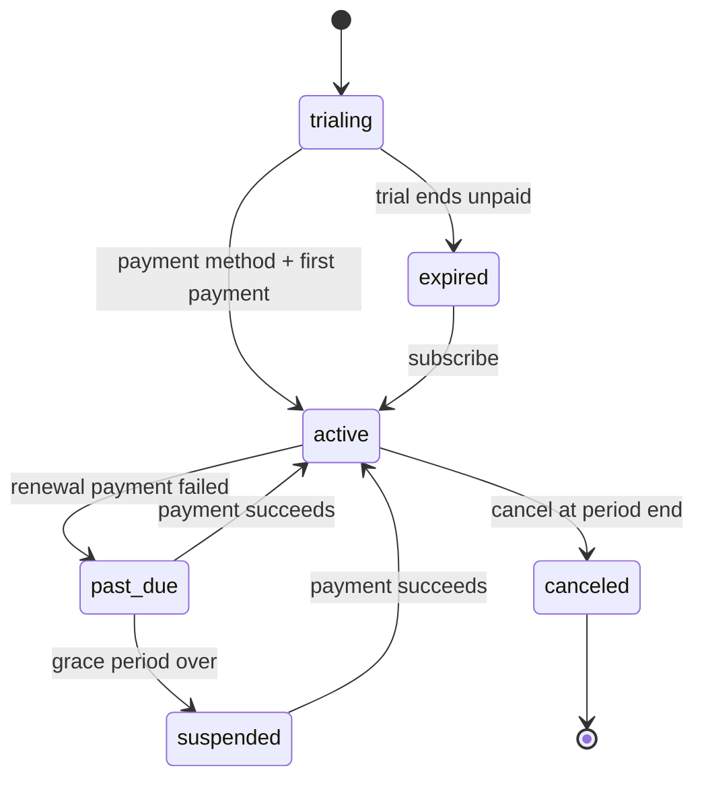

# Subscription and Billing

> Covers **SaaS billing between the platform and tenants**. Student fee collection by institutions is the `fees` module (`MODULE_CATALOG.md`).
> **No price numbers are decided.** All amounts below are placeholders (`TBD`) pending market research and owner approval (ADR-024).

## 1. Plans

| Plan code | Target | Included modules (proposed) | Limits (proposed, TBD) | Support |
|---|---|---|---|---|
| `trial` | Evaluation (e.g. 14–30 days, TBD) | Same as `growth` | Small student cap, 1 institution, 1 campus, limited SMS/AI | Self-serve docs |
| `starter` | Small schools, madrasas, coaching centers | academics, admissions (basic), students, staff, parent_portal, attendance, examinations, fees, communication, reports (basic) | Student tier, 1 institution, 1 campus, storage TBD | Email |
| `growth` | Growing institutions | Starter + timetable, accounting, online admission forms, advanced customization (workflows, more custom fields) | Higher tiers, up to N campuses | Email + chat |
| `professional` | Large / multi-campus | Growth + hr_payroll, library, advanced reports & custom report builder, API access | Multiple institutions/campuses | Priority |
| `enterprise` | Universities, groups, governments | Everything + custom extensions, custom_module_builder, SSO, dedicated infra option, data residency, SLA | Contracted | Dedicated / SLA |

**Paid add-ons (proposed):** `hostel`, `transport`, `library` (below professional), `lms`, `online_exams`, `hr_payroll` (below professional), `ai_assistant`, institution extensions (`ext_hifz_tracking`, `ext_course_registration`, `ext_certification`), extra SMS credit packs, extra storage, extra campuses.

Plan/module packaging is data (`billing_plan`, `billing_planmodule`, `billing_addon`) and can be changed by Super Admin without code changes.

## 2. Pricing model (ADR-024 — Proposed)

- **Base:** per plan, tiered by **active students** (students with an active enrollment in the current academic year). Tier boundaries TBD.
- **Add-ons:** flat per tenant or per active-student tier.
- **Usage-based:** SMS (credits), storage above quota, AI usage above quota.
- **Billing intervals:** monthly and annual (annual discount TBD).
- **Currency:** price books per currency (e.g. BDT for Bangladesh, USD for international) — `billing_price` rows per currency; no FX conversion at runtime for invoices.
- **Enterprise:** quotation-based; contract terms recorded in subscription metadata.
- **Taxes:** VAT/GST handling per country is required before charging customers in that country (needs accounting/legal input — open question).

> Rationale for per-active-student: aligns price with institution size and value, common in education SaaS. Risks: institutions may under-report; mitigated because the count comes from system data. Alternative: flat per-institution pricing (simpler, less fair for large tenants). **Owner decision required.**

## 3. Entitlement engine

```
entitled_modules(tenant) =
    platform_modules
  ∪ plan.included_modules
  ∪ active subscription add-ons
  ∪ active overrides (Super Admin grants, promos, trials of add-ons)
  − suspended/disabled overrides
  (then dependency closure validated: a module is enabled only if its dependencies are enabled)
```

- Resolved into `module_registry_tenantmodule` + cache; recomputed on subscription change/override change.
- **Enforcement:** DRF permission class `ModuleEntitled("hostel")` on every module view; service functions also assert entitlement (so Celery jobs and AI tools are covered). Error: HTTP 403 `module_not_entitled`.
- **Limits:** checked at the write that would exceed them (e.g. creating the N+1th campus, enrolling students beyond tier → configurable: hard block vs. soft limit with upgrade prompt and grace — decision per limit, default soft for students, hard for campuses).
- **Downgrade/expiry:** data is never deleted on downgrade; module becomes read-only or hidden (configurable), export remains possible.
- **Feature flags** are separate from entitlements (rollout control, not commercial).

## 4. Subscription lifecycle



Tenant lifecycle states (`MULTI_TENANT_ARCHITECTURE.md` §6) follow subscription state.

- Plan changes: upgrades immediate with proration (proration method TBD); downgrades at period end.
- Dunning: reminder schedule (e.g. T-7, T-1, T+1, T+3, T+7 — TBD) via `communication`.

## 5. Payments for SaaS billing (ADR-017 — Proposed)

- `PaymentGateway` abstraction. Candidates: **Stripe** (international cards, subscriptions) and **Bangladesh gateways** (e.g. SSLCommerz, bKash, Nagad) for local tenants; manual bank transfer with Super Admin confirmation for enterprise.
- Gateway availability, merchant onboarding, fees and recurring-payment support must be verified before selection — **not assumed**.
- Webhooks: signature verification, idempotent by event ID, async processing, reconciliation job.
- SaaS invoices are immutable, numbered gap-free, with tax lines when applicable; credit notes for corrections.

## 6. Usage metering

| Metric | Source | Frequency |
|---|---|---|
| `active_students` | Count of active enrollments | Daily snapshot; billing uses max or period-end (TBD) |
| `campuses`, `institutions` | Tenancy tables | On change |
| `sms_credits` | `communication` deliveries | Real time (pre-paid credit decrement under lock) |
| `storage_gb` | `files` sizes | Daily |
| `ai_usage` | `ai_assistant` tokens/requests | Real time with quota check |

## 7. Super Admin capabilities

Create/edit plans, prices, add-ons; assign/override plans; grant trials/promos; view MRR/ARR, churn, usage; issue credit notes; suspend/reactivate tenants. All actions audited; billing roles separated from support roles.

## 8. Open questions (owner input required)

1. Actual prices, tier boundaries, annual discount, trial length.
2. Which gateways first (Stripe availability/eligibility for the business entity; Bangladesh gateway(s)).
3. Tax/VAT registration and invoicing requirements per country.
4. Hard vs. soft limits per metric.
5. Proration policy.

### Change notes
- 2026-11-05 — Initial version (Phase 0).
