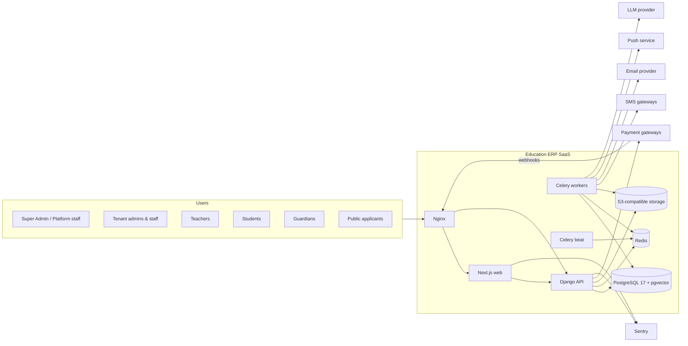

# System Architecture

## 1. Architectural style

- **Monorepo** containing backend, frontend, generated API client, infrastructure and docs (ADR-001).
- **Modular monolith** (ADR-002): one deployable Django backend composed of strictly bounded modules (Django apps), one Next.js frontend. Extraction into services is allowed only via an accepted ADR backed by measured need (e.g. independent scaling of AI or notification workers — which Celery queues already cover).
- **Configuration-driven** behavior (ADR-005): institution-type presets and tenant extensions are data, versioned, validated, never code forks.

## 2. Context diagram



## 3. Runtime components

| Component | Responsibility | Scaling |
|---|---|---|
| `nginx` | TLS termination, routing (`/` → web, `/api` → api), static/media headers, request size limits, basic rate limiting | Stateless |
| `web` (Next.js) | UI rendering (RSC + client components), i18n. No credential handling: forwards the Django session cookie server-side (ADR-011) | Stateless, horizontal |
| `api` (Django + DRF, Gunicorn/Uvicorn) | Business logic, authorization, REST API, webhooks | Stateless, horizontal |
| `worker` (Celery) | Async jobs: notifications, report generation, imports, payroll runs, embeddings, exports | Horizontal, separate queues |
| `beat` (Celery beat) | Scheduled jobs (fee reminders, late fines, usage metering, backups verification) | Single instance |
| `postgres` | Primary data, JSONB, RLS, pgvector | Vertical; read replicas later |
| `redis` | Cache, Celery broker/results, rate-limit counters, locks | Managed/HA later |
| `objectstore` / S3 | Files, generated documents, exports (SeaweedFS in dev, ADR-029) | Managed S3 in production (decision ADR-019) |

**Celery queues (proposed):** `default`, `notifications`, `reports`, `imports`, `finance` (low concurrency, strict ordering where needed), `ai`.

## 4. Backend module architecture

Each module (`backend/apps/<module>/`) has a consistent internal structure:

```
apps/<module>/
  manifest.py        module code, version, dependencies, permissions, settings schema, menu
  models.py          (or models/ package) — tenant-scoped models
  selectors.py       read/query functions (tenant + permission aware)
  services.py        write/business operations (transactions, validation, events)
  events.py          domain events emitted/handled
  api/
    serializers.py
    views.py
    urls.py
    permissions.py
  tasks.py           Celery tasks (always receive tenant_id)
  admin.py           Django admin (platform staff only)
  migrations/
  tests/
```

**Dependency rules:**
1. Platform modules (`core`, `tenancy`, `identity`, `rbac`, `module_registry`, `billing`, `customization`, `audit`, `files`, `notifications_core`) may be imported by any module.
2. ERP modules may depend only on modules declared in their `manifest.dependencies`, and only through the other module's `services`/`selectors` public functions or domain events.
3. No module imports another module's models for writes. Cross-module foreign keys are allowed when declared as a dependency (e.g. `fees.Invoice → students.Student`).
4. Circular dependencies are forbidden; enforce with an import-linter contract in CI (proposed, Phase 1).

**Domain events:** in-process event bus (synchronous handlers inside the transaction for consistency-critical reactions; `transaction.on_commit` → Celery for side effects like notifications). Example: `admissions.application_approved` → `students` creates student → `fees` assigns fee structure → `communication` notifies guardian.

## 5. Request lifecycle

```mermaid
sequenceDiagram
  participant B as Browser
  participant N as Nginx
  participant W as Next.js
  participant A as Django API
  participant DB as PostgreSQL
  B->>N: HTTPS request (tenant.example.com)
  N->>W: page request
  W->>A: API call (session cookie forwarded, Host preserved, X-Request-ID)
  A->>A: RequestID + structured logging context
  A->>A: Authenticate user
  A->>A: Resolve tenant (host → tenant) + verify membership
  A->>DB: tenant_atomic: BEGIN; SELECT set_config('app.tenant_id', tenant, true)
  A->>A: Check module entitlement
  A->>A: Check permission + scope
  A->>DB: Service/selector queries (tenant-scoped manager + RLS)
  A->>A: Serialize + field masking
  A->>DB: Audit log entry (if security/financial/sensitive)
  A->>DB: COMMIT
  A-->>W: JSON response
  W-->>B: Rendered UI
```

## 6. Configuration resolution

`Core defaults → Institution-type preset (L2) → Tenant (L3) → Institution → Campus`, resolved by `customization.selectors.get_effective_config(scope, key)` and cached per tenant (cache key includes config version; invalidated on publish). Details: `CUSTOMIZATION_ENGINE.md`.

## 7. Cross-cutting concerns

| Concern | Approach | Doc |
|---|---|---|
| Tenant isolation | Tenant context middleware, tenant-scoped managers (fail closed), RLS, isolation tests | `MULTI_TENANT_ARCHITECTURE.md` |
| Authorization | Entitlement → permission → scope pipeline in DRF permission classes and services | `SECURITY.md` |
| Auditing | `audit` module, append-only, partitioned | `SECURITY.md` |
| Files | `files` module, tenant-prefixed keys, presigned URLs | `DATABASE_DESIGN.md` |
| i18n | Django translations for server messages; `next-intl` for UI; terminology overrides from config | `FRONTEND_STANDARDS.md` |
| Time | Store UTC; render in tenant/campus timezone; academic dates as `date` | `DATABASE_DESIGN.md` |
| Money | Decimal + currency; ledger; atomic + idempotent | `DATABASE_DESIGN.md` |
| Observability | structlog JSON, Sentry, health endpoints, metrics | `DOCKER_DEPLOYMENT.md` |
| Integrations | Provider abstractions (payments, SMS, email, push, LLM) with per-tenant credentials stored encrypted | `SECURITY.md` |

## 8. Integration abstractions

Every external provider is accessed through an interface in the platform core, with per-environment and (where applicable) per-tenant configuration:

- `PaymentGateway` — initiate payment, verify, refund, webhook verification (candidates: Stripe for SaaS billing globally; SSLCommerz / bKash / Nagad for Bangladesh fee collection — ADR-017).
- `SmsProvider`, `EmailProvider`, `PushProvider`.
- `LlmProvider`, `EmbeddingProvider` (ADR-020).
- `StorageBackend` (any S3-compatible service).

Webhooks: signature verification, idempotent processing (event ID stored), replay protection, processed asynchronously.

## 9. Scalability path (no premature optimization)

1. Single host Compose (dev/staging) → multiple `api`/`worker` replicas behind Nginx.
2. Managed PostgreSQL with PITR; PgBouncer for connection pooling; read replica for reports/analytics.
3. Table partitioning for very large append-only tables (audit log, attendance records, notification logs).
4. Dedicated database for large enterprise tenants (same code, routing by tenant — ADR-009 option).
5. Orchestrator (e.g. Kubernetes) only when operations require it (new ADR).

### Change notes
- 2026-11-05 — Initial version (Phase 0).
- 2026-11-05 — Updated for owner-approved ADR-009/010/011/012/013/014 (session auth, transaction-scoped RLS context, DB roles, UUIDv7 abstraction, tenant-level subscription with campus limits, uv/pnpm, layout).
- 2026-11-05 — Phase 1: updated for the implemented foundation (S3-compatible SeaweedFS dev storage per ADR-029, pinned toolchain per ADR-030).
