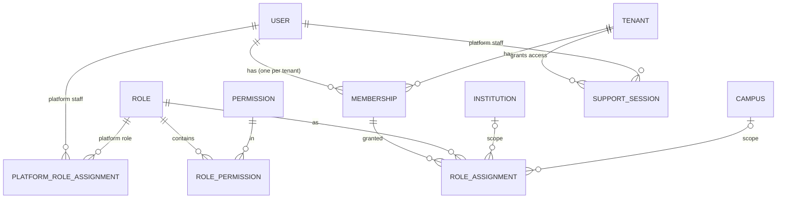

# Phase 2 Implementation Plan — Authentication, Users, Roles & Permissions

- **Status:** **Approved** (revision 3) by the owner on 2026-11-06, together with Phase 1 (merged in PR #13, squash commit `7d860b0`). **Implemented** on `feat/phase-02-auth-rbac`, [PR #15](https://github.com/shafikcmt/education-erp-platform/pull/15); see §18 "Implementation outcome". Not merged without owner approval.
- **Prepared:** 2026-11-05 (rev. 1); revised 2026-11-05 (rev. 2: approvals, owner conditions, additional requirements, Phase 3 consistency review); revised 2026-11-06 (rev. 3: Q10 manual MFA key with strict conditions, Q11 `@hookform/resolvers`, PR #12 merged)
- **Roadmap reference:** `DEVELOPMENT_ROADMAP.md` → Phase 2
- **Governing decisions (Accepted):**
  - ADR-009 (tenancy/RLS), ADR-010 (hierarchy), ADR-011 (session auth), ADR-012 (UUIDv7), ADR-015 (REST/OpenAPI), ADR-021 (en/bn), ADR-030 (pins).
  - **ADR-031** (field encryption), **ADR-032** (membership in Phase 3), **ADR-033** (custom business RBAC + reuse of Django security primitives), **ADR-034** (email-link tokens), **ADR-035** (step-up + privileged-account MFA), **ADR-036** (IP privacy), **ADR-037** (Q2–Q9 scope decisions), **ADR-038** (manual MFA key exception, Q10), **ADR-039** (`@hookform/resolvers`, Q11).
- **Still open:** none. All questions are answered (§13); only final plan approval remains.

---

## 1. Goal

Deliver secure, production-grade **identity and authorization primitives** for every later phase:

1. **Authentication.** Email + password login using Django's session framework, MFA (TOTP + recovery codes) for privileged accounts, logout, session listing and revocation, a 30-minute idle timeout and a 12-hour absolute lifetime.
2. **Account lifecycle (administrative only; no public registration).**
   - Account creation by authorized administrators, then activation (verifies the email and sets the first password).
   - Password change, password reset, and email change with re-verification.
   - Deactivation and reactivation.
3. **RBAC foundation.**
   - A permission registry built from module manifests.
   - Roles as permission bundles, with system role templates for every `CLAUDE.md` §9 role.
   - Platform roles and their assignments.
   - A scope-aware `has_perm` engine with **pluggable permission sources**, so Phase 3 adds tenant memberships without rewriting it (ADR-032 condition).
4. **Audit.** An append-only `AuditEvent` log (DB-enforced) of all security events. Passwords, tokens, MFA secrets, recovery codes and session keys are **never** logged. IPs are kept in a separate encrypted table so retention and anonymization work (ADR-036).
5. **Frontend.** English and Bengali authentication screens, an account security page, and a minimal platform console (users, roles, audit).
6. **Designs for Phase 3.** The tenant-aware membership architecture and audited, time-limited support access are fully designed here and **implemented in Phase 3 with RLS** (§4).

## 2. Scope boundary with Phase 3 (ADR-032, Accepted)

| Item | Phase 2 | Phase 3 |
|---|---|---|
| Users, auth, MFA, sessions, password/email flows, throttling | ✅ | — |
| Permission registry, roles, role templates, `has_perm` engine + platform permission source | ✅ | Tenant permission source plugged in |
| Platform roles + assignments, platform console | ✅ | — |
| Audit log + IP side table | ✅ (platform rows) | Tenant rows under the dual-scope RLS policy (§4.6) |
| `Tenant`, `Institution`, `Campus`, `Membership`, tenant `RoleAssignment`, tenant invitations | ❌ (designed §4) | ✅ |
| Audited, time-limited **support access** | ❌ (designed §4.5) | ✅ |
| Object scopes (teacher → own sections, guardian → own children) | Hook interface only | Phase 7 |

Phase 2 serves **only the platform host** (`admin.<platform-domain>`; `localhost:8080` in dev).

## 3. Prerequisites checklist

| Item | State |
|---|---|
| Phase 1 foundation on `main` (PR #2) | ✅ Merged 2026-11-05 18:42:43 UTC |
| **Phase 1 review follow-up PR #12** (prod guards, DB hardening, ADR-029/030, S3 suite, Dependabot guards) | ✅ **Merged** 2026-11-06 by squash, commit `d80f576554937f95c214b08a8f5d7c883ec721a9` (owner-authorized; 8/8 CI green). This plan's PR #13 is rebased onto `main` |
| Phase 1 marked `Approved` | ⏳ Owner |
| ADR-031 to ADR-037 | ✅ Accepted 2026-11-05; ADR-038/039 Accepted 2026-11-06 |
| Q10, Q11 (§13) | ✅ Approved 2026-11-06 (ADR-038, ADR-039) |
| Final approval of this plan (rev. 2) | ⏳ Owner |
| Dependabot PRs #5, #10, #11 closed (they conflict with ADR-003/030) | ⏳ Owner (recommended) |

---

## 4. Tenant-aware membership and support-access architecture (designed now; built in Phase 3)

### 4.1 Principles (owner requirements 1–4)
1. **One person = one global `User`.** A user can **belong to multiple institutions**, within one tenant or across tenants, through memberships.
2. **`Membership`** (tenant-owned, RLS) links a user to a tenant: one per (tenant, user).
3. **`RoleAssignment`** (tenant-owned, RLS) gives a membership a role at **tenant, institution or campus scope**. The same user can have **different roles in different institutions and campuses** (e.g. `teacher` at campus A, `institution_admin` at institution B, `guardian` in another tenant).
4. **Platform power is separate.** `PlatformRoleAssignment` grants **platform** permissions only. **A Super Admin has no implicit access to tenant data.** Tenant data needs an audited, time-limited support session (§4.5).
5. Authorization checks **permissions, never role names**.

### 4.2 Entities



| Model | Phase | Key fields | Constraints |
|---|---|---|---|
| `rbac.Permission` | **2** | `code`, `module_code`, `description`, `is_sensitive`, `requires_mfa`, `requires_step_up`, `deprecated_at` | `UNIQUE(code)` |
| `rbac.Role` | **2** | `tenant_id` (NULL = platform role or system template), `code`, `name`, `name_i18n`, `kind` (`platform`/`template`/`tenant`), `institution_types[]`, `is_system` | `UNIQUE(tenant_id, code)` with NULLs treated as equal (`NULLS NOT DISTINCT`, PG15+) |
| `rbac.RolePermission` | **2** | `role`, `permission`, **`tenant_id` (nullable, mirrors the role's tenant)** | `UNIQUE(role, permission)`; tenant equality enforced by the service and by a trigger (§4.6) |
| `rbac.PlatformRoleAssignment` | **2** | `user`, `role` (kind = platform), `granted_by`, `granted_at`, `reason` | `UNIQUE(user, role)` |
| `tenancy.Membership` | 3 | `tenant`, `user`, `status` (`invited`/`active`/`suspended`/`left`), `invited_by`, `joined_at`, `last_seen_at` | `UNIQUE(tenant, user)`; RLS |
| `rbac.RoleAssignment` | 3 | `tenant`, `membership`, `role`, `scope_type` (`tenant`/`institution`/`campus`), `institution`, `campus`, `valid_from`, `valid_until`, `granted_by` | CHECK scope consistency; role ∈ same tenant; RLS |
| `tenancy.Invitation` | 3 | `tenant`, `email`, `role`, `scope…`, `token_hash`, `expires_at`, `used_at` | Uses the Phase 2 `core.tokens` utility; RLS |
| `tenancy.SupportSession` | 3 | `tenant`, `staff_user`, `reason`, `ticket_ref`, `access_level` (`read_only` default), `starts_at`, `ends_at` (≤ 2 h), `approved_by` (tenant admin, if the tenant requires consent), `revoked_at` | RLS |

### 4.3 Request flow

```
Request → RequestID → Django session auth
  → host resolution
     ├── platform host → PlatformPermissionSource                                   [Phase 2]
     └── tenant host   → tenant = resolve(host)
                          → active Membership OR active SupportSession              [Phase 3]
                          → tenant_atomic(tenant)  (app.tenant_id set per transaction)
  → ModuleEntitled (Phase 4) → HasPermission(code, scope) → object policy → field masking → audit
```

- Each host has its own session, because the cookie is host-only (ADR-011).
- An inactive membership → `403 membership_inactive`.

### 4.4 Permission engine and pluggable sources (ADR-032 condition: no rewrite in Phase 3)

```python
@dataclass(frozen=True)
class ScopeTarget:
    tenant_id: UUID | None = None
    institution_id: UUID | None = None
    campus_id: UUID | None = None

class PermissionSource(Protocol):          # Phase 2 defines; Phase 3 adds implementations
    def grants(self, actor: User, target: ScopeTarget) -> frozenset[str]: ...

def has_perm(actor, code: str, *, target: ScopeTarget = PLATFORM, obj=None) -> bool: ...
def require_perm(actor, code: str, *, target=PLATFORM, obj=None) -> None   # raises PermissionDenied
```

| Source | Phase | Grants |
|---|---|---|
| `PlatformRoleSource` | 2 | Union of platform-role permissions, **only for `target.tenant_id is None`** |
| `TenantMembershipSource` | 3 | Union of currently valid assignments whose scope **covers** the target (tenant ⊇ institution ⊇ campus; never sideways) |
| `SupportSessionSource` | 3 | Fixed read-only set for an active support session on `target.tenant_id` |

**Phase 3 compatibility points:**
- `has_perm` and the DRF classes `HasPermission(code)` / `HasAnyPermission(...)` take the scope from `request.scope_target`. Phase 2 sets it to `PLATFORM` in middleware; Phase 3 middleware sets the tenant/institution/campus. **Views and services don't change.**
- Object policies: `rbac.policies.register("students.student", fn)` (Phase 7).
- Cache:
  - Phase 2 key: `perm:platform:{user}:v{ver}`.
  - Phase 3 key: `t:{tenant}:perm:{user}:v{ver}` (tenant-prefixed per CLAUDE.md §10.7).
  - The version is bumped on any role/permission/assignment change; TTL is 300 s; security-critical writes re-check without the cache.

### 4.5 Audited, time-limited support access (owner requirement 5; built in Phase 3)

1. A platform staff member with `platform.support_session.request` (registered in Phase 3; MFA + step-up required) requests access to a tenant. The request records a reason, a ticket reference, a duration (max 2 h) and an access level (read-only by default).
2. If the tenant's setting requires consent, a tenant admin approves it in-app. Either way, the tenant admin sees the session and can **revoke** it at any time.
3. During the session, requests run **inside the tenant context** (`tenant_atomic`, normal RLS as `erp_app`; **not** the `BYPASSRLS` role). Permissions come only from `SupportSessionSource`.
4. **Every request** in the session is audited with `actor_type = support` and `support_session_id`. Starting, approving, revoking and expiring the session are also audited.
5. The session ends automatically at `ends_at`. Further requests get `403 support_session_expired`.

Phase 2 already provides the audit columns (`actor_type`, `support_session_id`), step-up and mandatory MFA for platform staff.

### 4.6 Consistency review with Phase 3 RLS (owner action 3)

| Concern | Resolution in this plan |
|---|---|
| Tenant-owned tables must have RLS from day one | No tenant-owned tables in Phase 2 (ADR-032) |
| **Dual-scope tables** (`rbac_role`, `rbac_rolepermission`, `audit_auditevent`) hold both platform rows (`tenant_id IS NULL`) and, from Phase 3, tenant rows | Phase 3 RLS policies (ENABLE + FORCE), with `ctx = NULLIF(current_setting('app.tenant_id', true), '')::uuid`: **writes** `WITH CHECK (tenant_id IS NOT DISTINCT FROM ctx)`, so without a tenant only platform rows can be written and with a tenant only that tenant's rows. **Reads:** `rbac_*` `USING (tenant_id IS NULL OR tenant_id = ctx)` (tenants see system templates); `audit_auditevent` `USING (tenant_id IS NOT DISTINCT FROM ctx)` (tenants never see platform events and vice versa; cross-tenant platform reports use `platform_scope`). A tenant context still never sees another tenant's rows. These tables go on an explicit **dual-scope allowlist** in the Phase 3 CI check "every table with `tenant_id` has RLS" |
| `RolePermission` rows for tenant roles are tenant data | `tenant_id` is added in Phase 2 (NULL for now). A trigger keeps it equal to `role.tenant_id`, so Phase 3 needs no backfill |
| Platform-only tables (`identity_*`, `rbac_permission`, `rbac_platformroleassignment`) | No `tenant_id` and no tenant data: user-owned or platform reference data |
| `SessionRecord` must work for tenant hosts | Stores `host` (no `tenant_id`), so it stays a platform table. In Phase 3, tenant admins revoke member sessions through a membership-checked service |
| Invitation tokens are tenant data | Phase 3 `tenancy.Invitation` (RLS) stores its own token hash using the Phase 2 `core.tokens` utility. The platform `AccountToken` table is not reused for tenant data |
| Audit writes inside tenant transactions | `audit.record()` takes `tenant`; it is called inside `tenant_atomic` in Phase 3, so the RLS `WITH CHECK` passes. Platform events are written with no tenant context |
| Celery | Phase 2 email tasks are **declared platform tasks** (no tenant data). Phase 3 invitation emails are tenant tasks carrying `tenant_id` |
| Support access must not use BYPASSRLS | §4.5: runs as `erp_app` inside the tenant context |

---

## 5. Roles and permissions

### 5.1 Permission catalog delivered in Phase 2

| Code | Meaning | Flags |
|---|---|---|
| `identity.account.view_own` / `identity.account.update_own` | Own profile | — |
| `identity.session.view_own` / `identity.session.revoke_own` | Own sessions | — |
| `identity.mfa.manage_own` | Enroll or remove own MFA | step-up |
| `identity.user.view` / `identity.user.create` / `identity.user.update` | Platform user administration | MFA |
| `identity.user.deactivate` | Deactivate/reactivate users | MFA, step-up |
| `identity.user.view_sensitive` | MFA state and session details of others | MFA, sensitive |
| `identity.session.revoke_any` | Revoke another user's sessions | MFA, step-up |
| `identity.mfa.reset` | Reset another user's MFA (reason required) | MFA, step-up |
| `rbac.permission.view` | Permission catalog | MFA |
| `rbac.role.view` / `rbac.role.create` / `rbac.role.update` / `rbac.role.delete` | Platform roles (tenant roles in Phase 3) | MFA; create/update/delete also step-up |
| `rbac.platform_role.assign` | Grant or revoke platform roles | MFA, step-up |
| `audit.event.view` | Audit log (platform scope) | MFA |
| `audit.event.view_ip` | Reveal decrypted IPs in audit and session views (each reveal audited, ADR-036) | MFA, step-up, sensitive |

**Guard rails:**
- No self-escalation: nobody can grant permissions they don't hold, or grant in a scope they don't control.
- Only an existing `super_admin`, in step-up mode, can grant `super_admin`.
- The last active `super_admin` can't be deactivated or demoted.
- Every grant and revoke is audited.

### 5.2 Role templates (seeded as data in Phase 2; used by tenants from Phase 3)

Permissions of modules not yet built are **planned codes** (registered when the module ships). Scope: **P** platform, **T** tenant, **I** institution, **C** campus, **A** assigned objects, **O** own/linked records.

| Role | Kind | Scope | Permissions (summary) | MFA (ADR-035) |
|---|---|---|---|---|
| **Super Admin** `super_admin` | platform | P | All Phase 2 codes. `platform.*` (Phase 3+: tenants, plans, support-session request/approve). **No tenant data** except via an audited support session | **Required** |
| Platform Support `platform_support` | platform | P | `identity.user.view`, `identity.session.revoke_any`, `identity.mfa.reset`, `audit.event.view`; support-session request (Phase 3) | **Required** |
| Platform Billing `platform_billing` | platform | P | Own account; `billing.*` (Phase 4) | **Required** |
| Platform Onboarding `platform_onboarding` | platform | P | `identity.user.create`, `identity.user.view`; `tenancy.tenant.create` (Phase 3) | **Required** |
| **Institution Admin** `institution_admin` | template | I | Institution/campus settings, tenant roles and assignments within the institution, member invitations, institution audit view, and view/manage for all entitled ERP modules in the institution (segregation-of-duties exceptions such as refund approval) | **Required** (Phase 3) |
| **Campus Admin** `campus_admin` | template | C | The Institution Admin families **limited to their campus**; no institution-level settings, roles or other campuses | **Required** (holds assignment permissions, which are flagged `requires_mfa`) |
| **Teacher** `teacher` | template | A | View assigned offerings; mark/view attendance (assigned); enter marks (assigned, until locked); results (assigned); LMS content (assigned); view assigned students' non-sensitive data; message own classes/guardians | Optional (tenant-configurable) |
| **Staff** `staff_member` | template | C | Own staff profile, own attendance, own payslips, own leave requests, notices. Specialised roles add scopes: `accountant`, `cashier`, `librarian`, `hostel_warden`, `transport_manager`, `front_desk`, `admission_officer`, `exam_controller`, `hr_manager` | Optional; **Required** where the role holds `requires_mfa` permissions (e.g. refunds, payroll approval, period close) |
| **Student** `student` | template | O | Own profile, timetable, attendance, published results, invoices, enrolled LMS courses, own online exam attempts, notices | Optional |
| **Parent / Guardian** `guardian` | template | O (linked children) | For each linked child: profile, attendance, published results, invoices + online payment, leave requests; notices | Optional |

**"Privileged account" (ADR-035) is defined by data, not role names.** A user must have MFA if **any** permission in their effective set has `requires_mfa = true`. Every platform role meets this. So do tenant roles holding role/assignment management, financial approvals or other permissions flagged later. Ordinary teacher, student and guardian accounts are not forced, but tenants may require MFA for more roles.

`staff_member` is the role code for generic non-teaching staff, because `staff` already names the HR/staff module. CLAUDE.md §9 is updated in this revision.

---

## 6. Authentication, session and security design

### 6.1 Login (session-based; MFA step when the account has or requires MFA)

```mermaid
sequenceDiagram
  participant B as Browser
  participant A as API
  B->>A: GET /api/v1/auth/csrf/
  B->>A: POST /auth/login/ {email, password} + X-CSRFToken
  A->>A: throttle (IP-hash + email-hash) → django.contrib.auth.authenticate() (Argon2); dummy hash on unknown user
  alt MFA enrolled
    A->>A: session["pending_auth"] = {user_id, started_at, attempts}   (not logged in)
    A-->>B: 200 {status:"mfa_required"}
    B->>A: POST /auth/mfa/verify/ {code}
  else MFA required but not enrolled
    A-->>B: 200 {status:"mfa_enrollment_required"}  (restricted session: MFA setup, step-up, logout only)
  end
  A->>A: django.contrib.auth.login() (cycle_key) → SessionRecord → audit
  A-->>B: 200 {status:"authenticated"}  (HttpOnly/Secure/SameSite=Lax host-only cookie)
```

**No user enumeration (owner requirement 7).**
- Unknown email, wrong password, inactive account and unactivated account all return the same `401 invalid_credentials`, with equalized timing (a dummy password hash runs for unknown users).
- Password-reset and activation-resend requests always return `202` with the same body.
- Throttle responses are identical whether or not the account exists.
- There is no registration endpoint in Phase 2 (ADR-037). Phase 3 invitation flows follow the same rules.

The pending-MFA state expires after 5 minutes or 5 failed codes.

### 6.2 Brute-force protection (owner requirement 8)

Implemented with Redis counters, with no new dependency. Keys use **HMACs** of the IP and the normalized email, never plaintext (ADR-036).

| Bucket | Default (configurable) | On exceed |
|---|---|---|
| Login per IP | 20 / 5 min | `429` + `Retry-After` |
| Login failures per email | 5 / 15 min | Progressive delay → temporary lock 15 min; notice to the account owner (no sensitive data) |
| MFA codes per pending login | 5 | Pending state cleared |
| Reset / activation resend per email | 3 / hour | Silent (still `202`) |
| Reset / resend per IP | 10 / hour | `429` |
| Step-up attempts per session | 5 / 15 min | Step-up locked; sensitive action denied |

All locks and throttle events are audited.

### 6.3 Passwords
- **Django password hashers and validators** (ADR-033): Argon2id; minimum length 10, attribute similarity, common passwords, not all-numeric; maximum length 128.
- **Breached-password check (ADR-037):** a Django `AUTH_PASSWORD_VALIDATORS` entry `BreachedPasswordValidator`, **disabled by default** (`PASSWORD_BREACH_CHECK_ENABLED=false`).
  - When enabled, it uses the HIBP range API (k-anonymity: only a 5-character SHA-1 prefix is sent, with `Add-Padding`), a 2 s timeout and the standard library HTTP client.
  - If the service is unreachable it **fails open** by default (`PASSWORD_BREACH_CHECK_FAIL_CLOSED=false`), logging a warning without the password.
  - Its outbound host is documented for network allow-listing.
- **Password change** requires the current password and step-up. Other sessions are revoked and a notification email is sent.

### 6.4 Email-link tokens (ADR-034)
- `core.tokens` utility, reused in Phase 3:
  - generates tokens with `secrets.token_urlsafe(32)` (256 bits);
  - stores only the **SHA-256 hash**;
  - looks tokens up by hash; the raw token is never stored or logged.
- `identity.AccountToken`: `purpose` (`activation` / `email_verification` / `password_reset` / `email_change`), `user`, `token_hash` (unique), `expires_at`, `used_at`, `payload` (e.g. the new email address).
- **Expiry:** activation 72 h; email verification 24 h; password reset **30 min**; email change 24 h.
- **Single use.** A new token of the same purpose **invalidates** older unused ones. Requests are rate-limited (§6.2).
- **Delivery.** Links are `/{locale}/reset-password#token=…`. The token is in the URL fragment, so it doesn't reach server logs or `Referer` headers. The page POSTs it to the API and clears the fragment.
- **Password reset completes by revoking all sessions** and sends a confirmation email.

### 6.5 Account creation, activation, email verification (ADR-037: administrative workflows only)
- Platform users are created by holders of `identity.user.create`; tenant members are invited in Phase 3.
- Creation sends an **activation** email: the link verifies the email, the user sets a password, and MFA enrollment follows if required.
- An unactivated account can't log in. The response is the generic `invalid_credentials`, and the activation resend is enumeration-safe.
- **Email change:** step-up → verification link to the new address → notice to the old address → applied after verification → other sessions revoked.

### 6.6 MFA and step-up (ADR-035)

**TOTP (RFC 6238):** 30 s steps, 6 digits, ±1 step tolerance. The last used step is stored to **block replay**.

**Secret encrypted at rest (ADR-031).**

**Raw secret exposure is minimized (ADR-037 / Q5, amended by ADR-038 / Q10):**
- `POST /me/mfa/totp/setup/` returns **only a server-rendered SVG QR code** (via `segno`) and a device ID. There is no `otpauth://` URI and no secret field.
- The QR image inevitably encodes the secret, because the authenticator app needs it. It is shown only during unconfirmed enrollment, which expires after 10 minutes.
- Responses carry `Cache-Control: no-store`, and response bodies are never logged.

**Manual-entry key, an accessibility alternative to scanning (ADR-038, owner's strict conditions):**
1. **When:** only during **initial enrollment**, for an **unconfirmed** device inside its 10-minute enrollment window. It is never available for a confirmed device or after enrollment completes.
2. **Re-authentication first:** `POST /me/mfa/totp/setup/{device_id}/manual-key/` requires a **fresh step-up** (password re-entered within the last 10 minutes; the login itself does not count). Without it the response is `403 step_up_required`. In the restricted *enrollment-required* session (§6.1), `POST /auth/step-up/` is permitted (password-only, because no MFA exists yet), alongside the MFA-setup endpoints and logout.
3. **Shown once:** the first successful call returns the base32 key, grouped for readability (e.g. `ABCD EFGH …`), and marks the device `manual_key_revealed_at`. **Every later call returns `410 manual_key_already_shown`**, and no other endpoint ever returns it.
4. **Lost before confirming → restart:** the user must restart setup (`DELETE` the pending device or start a new setup). That generates a **new secret**, invalidates the old pending device, and allows one new reveal.
5. **Never exposed elsewhere:**
   - not in logs (structlog redaction plus no response-body logging);
   - not in Sentry (`send_default_pii=False`, and a `before_send` scrubber drops MFA payloads);
   - not in analytics (the app has none; the CSP blocks third-party scripts);
   - not in emails or audit metadata;
   - not in any later API response (including `GET /me/mfa/`).
6. **Frontend handling:**
   - the key stays only in component state for the reveal mutation, outside the TanStack Query cache;
   - it is cleared on unmount, never written to any browser storage, and never put in a URL;
   - a "copy" button uses the clipboard API, with a warning to clear the clipboard afterwards.
7. **Audit:** `identity.mfa.manual_key_revealed` (actor, device ID, outcome; **no key material**). It is rate-limited with the step-up limits.
8. **Storage:** the secret is stored encrypted at rest (ADR-031), as for QR enrollment.

**Confirmation:** `POST /me/mfa/totp/confirm/` with a valid code activates the device and returns **10 recovery codes** once.
- Each code is 16 base32 characters (80 bits).
- **Only SHA-256 hashes are stored**, never plaintext (ADR-031 condition).
- Each code is single use; regenerating requires step-up and invalidates the old set.

**MFA required** for privileged accounts (data-driven `requires_mfa`, §5.2):
- they can't disable MFA;
- they can't use any endpoint except MFA setup until they enroll;
- they can't use any permission flagged `requires_mfa` unless the session completed MFA.

**Step-up (sudo) mode** applies to:
- password change, email change, MFA disable or recovery regeneration;
- platform role grants, user deactivation, admin MFA reset, revoking others' sessions;
- IP reveal;
- every future permission flagged `requires_step_up` (e.g. refunds, period close).

How it works:
- Re-entering the password + a current MFA code (if enrolled) sets `session["step_up_at"]`, valid for **10 minutes**.
- Without it, protected endpoints return `403 step_up_required`.
- **Ordinary actions never ask for MFA again** (ADR-035).

**Admin MFA reset:** `identity.mfa.reset` + step-up + a reason. It revokes the user's sessions, emails the user and is audited.

**Later:** WebAuthn/passkeys (Phase 18; the device model allows more kinds).

### 6.7 Sessions (ADR-037 timeouts)
- **Django session framework** (`cached_db`) stores the session.
- `identity.SessionRecord` is the per-user index Django lacks:
  - `user`, `session_key_hash` (SHA-256), `host`, `created_at`, `last_seen_at` (written at most once per minute), `mfa_verified_at`, `step_up_at`, `user_agent_summary` (browser/OS family only), `revoked_at`, `revoke_reason`;
  - the IP is stored only through the encrypted IP fields (§6.9).
- **Timeouts:**
  - **idle 30 min**, enforced by middleware using `session["last_activity"]`;
  - **absolute 12 h**, using `session["auth_at"]`;
  - both are platform settings now and tenant-configurable within bounds in Phase 3.
- **Revocation (owner requirement 8):**
  - a user can revoke one of their own sessions, or all others;
  - holders of `identity.session.revoke_any` can revoke all of a user's sessions (step-up);
  - revocation deletes the Django session and marks the record.
- **Automatic revocation:**
  - **all** sessions on password reset, deactivation and admin MFA reset;
  - **other** sessions on password change, email change and MFA disable.
- The session key rotates (`cycle_key`) on login, MFA completion and privilege change.

### 6.8 Audit logging (owner requirement 9)
- **`audit.AuditEvent`:**
  - `id` (UUIDv7), `occurred_at`, `tenant_id` (nullable; dual-scope §4.6);
  - `actor_user_id`, `actor_type` (`user`/`system`/`support`/`ai`), `support_session_id`;
  - `action`, `outcome` (`success`/`failure`/`denied`), `target_type`, `target_id`;
  - `metadata` (JSONB, redacted), `user_agent_summary`, `request_id`.
  - **There is no IP column on this table** (§6.9).
- **Immutability (DB-enforced).** A `RestrictTableGrants` migration gives `erp_app` only `SELECT, INSERT`. A trigger rejects UPDATE/DELETE for every role and can be removed only by a reviewed migration. The same helper makes `django_migrations` SELECT-only for `erp_app` (closing a Phase 1 gap).
- **Never logged anywhere (audit, structlog, Sentry, emails):** passwords, password hashes, email-link tokens, TOTP secrets/QR payloads, MFA codes, recovery codes, session keys, CSRF tokens.
  - The redaction key list is extended (`password`, `token`, `secret`, `otp`, `code`, `recovery`, `session`, `csrf`, `authorization`, `cookie`).
  - Audit `metadata` is built from an **allow-list** per event type, never from raw request data.
  - Tests assert that the sensitive values used in each flow do not appear in captured logs, audit rows or emails (§10).
- **Events:**
  - `identity.login.succeeded|failed|locked|throttled`, `identity.logout`;
  - `identity.mfa.enrolled|challenge_failed|disabled|reset|recovery_code_used|recovery_codes_regenerated`;
  - `identity.step_up.succeeded|failed`;
  - `identity.password.changed|reset_requested|reset_completed`;
  - `identity.email.change_requested|changed`;
  - `identity.account.created|activated|deactivated|reactivated`;
  - `identity.session.revoked|expired_idle|expired_absolute`, `identity.signin.new_device_notified`;
  - `rbac.role.created|updated|deleted|permissions_changed`, `rbac.platform_role.granted|revoked`;
  - `audit.ip.revealed`;
  - `authz.denied` (aggregated: at most 1 row per actor + code per minute).
- **Transactions.** Events are written in the same transaction as the action. Failed logins are written in their own transaction. An audit write failure fails the security action (fail closed).
- **Partitioning:** Phase 18 (indexes are partition-friendly).

### 6.9 IP address privacy (ADR-036; owner Q7 conditions)

| Requirement | Design |
|---|---|
| Encrypted at rest | `ip_encrypted` (AES-GCM via the ADR-031 key ring) in `identity_sessionrecord` and in a separate **`audit_auditeventip`** table (`event_id`, `ip_encrypted`, `ip_index`, `ip_prefix`, `created_at`). The audit event itself stays fully immutable |
| Searchable for forensics without decryption | `ip_index = HMAC-SHA256(IP_INDEX_KEY, normalized_ip)`; exact-match search by an investigator's IP |
| Restricted access | API responses show a **masked** IP by default (`203.0.113.•` / `2001:db8::•`). Decryption needs `audit.event.view_ip` + MFA + step-up, and each reveal writes `audit.ip.revealed` |
| Configurable retention | `SECURITY_IP_RETENTION_DAYS` (default **365**, pending legal review). A daily Celery beat job **anonymizes** expired rows: it deletes `ip_encrypted` and `ip_index` and keeps only `ip_prefix` (IPv4 /24, IPv6 /48) for abuse statistics. Audit IP rows are deleted from the side table (`erp_app` may DELETE there, not on `audit_auditevent`) |
| Deletion / anonymization procedure | `manage.py erase_ip_data --user <id> [--before <date>]` for data-subject requests, documented in `SECURITY.md`; the run itself is audited |
| Throttling | Redis keys use the IP HMAC, never the plaintext IP; short TTLs |
| Not stored elsewhere | structlog request logs don't include IPs. **Nginx access logs** do include `remote_addr`, so log retention is set in Phase 19, and this is listed as a known gap |
| Legal | Retention period and lawful basis **pending legal review before production** (Known gaps) |

Keys: `FIELD_ENCRYPTION_KEYS` (ADR-031 key ring) and `IP_INDEX_KEY` (separate HMAC key). Dummy values go in `.env.example`; production keys go in a secret manager (ADR-019). Commands: `rotate_field_encryption` re-encrypts, and `rebuild_ip_index` handles HMAC key rotation.

### 6.10 Reuse of Django security primitives (ADR-033 condition)

| Concern | Reused from Django | Custom (why) |
|---|---|---|
| Password hashing | `PASSWORD_HASHERS` (Argon2), `make_password`, `check_password`, `set_password` | — |
| Password rules | `AUTH_PASSWORD_VALIDATORS` + `validate_password` | `BreachedPasswordValidator` plugs into the same framework |
| Credential check | `django.contrib.auth.authenticate()` + `ModelBackend` | Throttling wrapper (Django has none) |
| Login / logout | `django.contrib.auth.login()` / `logout()` (session fixation protection via `cycle_key`) | Two-step MFA state stored **in the Django session** |
| Session storage | `django.contrib.sessions` (`cached_db`), `SessionMiddleware` | `SessionRecord` index (Django can't list sessions per user); idle/absolute timeout middleware |
| CSRF | `CsrfViewMiddleware`, DRF `SessionAuthentication` | — |
| Constant-time compare and randomness | `django.utils.crypto.constant_time_compare`, `secrets` | — |
| Email | `django.core.mail` + Django templates | Celery task wrapper; en/bn templates |
| Tokens | — (`PasswordResetTokenGenerator` can't be individually revoked or audited) | `core.tokens` + `AccountToken` (ADR-034) |
| MFA | — (none in Django) | `pyotp` + encrypted device (ADR-031) |
| Authorization | Not `auth.Group`/`auth.Permission` for app logic (kept only because `PermissionsMixin` exists) | `rbac` tables (ADR-033) |
| Django admin | **Disabled** (`django.contrib.admin` not installed; ADR-037) | Platform console + audited APIs |

### 6.11 New sign-in notifications (ADR-037)
- Setting `SECURITY_NOTIFY_NEW_SIGNIN = platform_staff` (default); alternatives are `privileged` (all users with `requires_mfa` permissions), `all` or `off`. Phase 3 makes it tenant-configurable.
- A sign-in counts as new when the (browser/OS family, IP HMAC) pair hasn't been seen for this user in the last 90 days.
- **Email content:** time (UTC + the user's locale), browser/OS family, a link to the account security page and a "reset your password" page link.
- The email has **no** IP address, location, session key or token.

---

## 7. Database models and migrations (Phase 2)

| App | Model / table | Notes |
|---|---|---|
| `core` | `RestrictTableGrants` migration operation; `core.crypto` (ADR-031 key ring), `core.tokens` | Reusable helpers |
| `identity` | `User` (**alter**) | Add `email_verified_at`, `activated_at`, `last_password_change_at`, `deactivated_at`, `locale`, `display_name`. Additive, nullable |
| `identity` | `MFADevice` | `user`, `kind` (`totp`), `secret_encrypted`, `confirmed_at`, `enrollment_expires_at`, `last_used_step`, `last_used_at` |
| `identity` | `RecoveryCode` | `user`, `code_hash` (SHA-256, unique), `used_at`, `generation` |
| `identity` | `AccountToken` | §6.4 |
| `identity` | `SessionRecord` | §6.7 + encrypted IP fields §6.9 |
| `identity` | `SeenDevice` | `user`, `fingerprint_hmac`, `first_seen_at`, `last_seen_at` (new sign-in detection) |
| `rbac` | `Permission`, `Role`, `RolePermission` (+ nullable `tenant_id` and consistency trigger), `PlatformRoleAssignment` | §4.2 |
| `audit` | `AuditEvent` (+ grants + immutability trigger), `AuditEventIP` (encrypted, deletable) | §6.8, §6.9 |

- No tenant-owned tables (ADR-032). The dual-scope tables get their RLS policies in Phase 3 (§4.6).
- Migrations: new tables plus one additive `ALTER` on the small `identity_user` table. All are reviewed for lock impact.

## 8. API endpoints (`/api/v1`; OpenAPI; Problem Details)

**Every protected endpoint enforces server-side authorization (owner requirement 6).** A CI test enumerates all URL patterns and fails if a view lacks `HasPermission`/`HasAnyPermission`, unless it is on a reviewed allow-list of anonymous auth endpoints. Services also call `require_perm` (defense in depth).

| Method & path | Auth | Permission / notes |
|---|---|---|
| `GET /auth/csrf/` | anon | — |
| `POST /auth/login/` | anon | throttled; enumeration-safe |
| `POST /auth/mfa/verify/` | pending | throttled |
| `POST /auth/logout/` | user | — |
| `POST /auth/password/reset/` | anon | always `202`; throttled |
| `POST /auth/password/reset/confirm/` | token | revokes all sessions |
| `POST /auth/activate/` | token | sets first password |
| `POST /auth/activation/resend/` | anon | always `202`; throttled |
| `POST /auth/email/verify/` | token | applies email change |
| `POST /auth/step-up/` | user | password + MFA → step-up for 10 min |
| `GET/PATCH /me/` | user | `identity.account.view_own` / `update_own` |
| `POST /me/password/` | user | step-up |
| `POST /me/email/` | user | step-up |
| `GET /me/mfa/` | user | `identity.mfa.manage_own` |
| `POST /me/mfa/totp/setup/` | user | Returns **QR SVG only**; `no-store`; replaces any pending (unconfirmed) device |
| `POST /me/mfa/totp/setup/{device_id}/manual-key/` | user | **Fresh step-up**; unconfirmed device only; returns the key **once** (then `410`); `no-store`; audited (ADR-038) |
| `DELETE /me/mfa/totp/setup/{device_id}/` | user | Cancel/restart a pending enrollment (destroys the pending secret) |
| `POST /me/mfa/totp/confirm/` | user | Returns recovery codes once; `no-store` |
| `DELETE /me/mfa/totp/` | user | step-up; blocked if MFA required |
| `POST /me/mfa/recovery-codes/` | user | step-up; regenerate |
| `GET /me/sessions/` | user | `identity.session.view_own` (masked IPs) |
| `DELETE /me/sessions/{id}/` | user | `identity.session.revoke_own` |
| `POST /me/sessions/revoke-others/` | user | `identity.session.revoke_own` |
| `GET/POST /platform/users/` | platform, MFA | `identity.user.view` / `create` |
| `GET/PATCH /platform/users/{id}/` | platform, MFA | `identity.user.view` / `update` |
| `POST /platform/users/{id}/deactivate/` · `/reactivate/` | platform, MFA | `identity.user.deactivate` + step-up |
| `POST /platform/users/{id}/sessions/revoke/` | platform, MFA | `identity.session.revoke_any` + step-up |
| `POST /platform/users/{id}/mfa/reset/` | platform, MFA | `identity.mfa.reset` + step-up + reason |
| `POST /platform/users/{id}/activation/resend/` | platform, MFA | `identity.user.create` |
| `GET /platform/permissions/` | platform, MFA | `rbac.permission.view` |
| `GET/POST /platform/roles/` · `GET/PATCH/DELETE /platform/roles/{id}/` | platform, MFA | `rbac.role.*` (system roles read-only) |
| `GET/POST /platform/users/{id}/platform-roles/` · `DELETE …/{assignment_id}/` | platform, MFA | `rbac.platform_role.assign` + step-up |
| `GET /platform/audit-events/` | platform, MFA | `audit.event.view` (cursor pagination; filters) |
| `POST /platform/audit-events/{id}/reveal-ip/` | platform, MFA | `audit.event.view_ip` + step-up; audited |

## 9. Frontend screens (English + Bengali; mobile-first; owner requirement 10)

| Route | Screen |
|---|---|
| `/[locale]/login` | Email + password; generic errors; throttle message with retry time |
| `/[locale]/login/mfa` | TOTP code or "use a recovery code" |
| `/[locale]/login/mfa-setup` | Forced enrollment: QR (server SVG); **"Can't scan? Enter the key manually"** → step-up dialog → key shown once with a warning and copy button (ADR-038); confirm code; recovery codes shown once with copy/download and an acknowledgement checkbox |
| `/[locale]/forgot-password` | Request reset (identical confirmation for all inputs) |
| `/[locale]/reset-password` | Reads `#token`; new password with validation feedback |
| `/[locale]/activate` | Reads `#token`; set first password → MFA setup if required |
| `/[locale]/verify-email` | Confirm email change |
| `/[locale]/account/security` | Change password, email, MFA, recovery codes; active sessions with revoke (masked IPs) |
| `/[locale]/platform/users` (+ `/[id]`) | Create user, deactivate, revoke sessions, reset MFA, platform roles |
| `/[locale]/platform/roles` | Roles + permission catalog (system roles read-only) |
| `/[locale]/platform/audit` | Audit log with filters; IP reveal (permission + step-up) |
| App shell | Server-side `/me/` check; redirect to login; permission-driven navigation; step-up dialog; idle-timeout warning before expiry |

- **Tech:** TanStack Query; react-hook-form + zod via the official `@hookform/resolvers/zod` integration (ADR-039); generated API client; shadcn/ui.
- **i18n:**
  - every string lives in `en.json` and `bn.json` (parity test);
  - emails come in `en` and `bn` (Django templates, chosen by user locale);
  - Bengali copy is reviewed for natural wording, not literal translation.
- **Security:**
  - no tokens in JS storage; CSRF header via the existing client;
  - `autocomplete` set to `current-password` / `new-password` / `one-time-code` as appropriate;
  - no messages that reveal account existence.

## 10. Tests (definition of done)

| Area | Tests |
|---|---|
| Enumeration (req. 7) | Login (unknown, wrong password, inactive, unactivated) → identical status, body and timing band. Reset/resend → identical `202`. Throttle responses identical for existing and non-existing accounts |
| Brute force (req. 8) | Per-IP and per-email limits; progressive delay and lock; MFA attempt limit; step-up attempt limit; locks audited; Redis keys contain no plaintext IP or email |
| Sessions (req. 8) | Idle 30 min and absolute 12 h (time-frozen); list/revoke own; revoke-others; admin revoke-any with step-up; automatic revocation on reset/deactivation/MFA reset; `cycle_key` on login/MFA/privilege change |
| MFA / step-up | Enrollment; replay rejected; ±1 window; recovery code single use and hashed; enrollment gate for privileged users; cannot disable when required; step-up required and expires after 10 min; **no API response contains an `otpauth://` URI**; the TOTP secret appears **only** in the single manual-key response. **Manual key (ADR-038):** without fresh step-up → `403`; first call returns the key; second call → `410`; confirmed device → never; restart issues a new secret and invalidates the old one; the key is absent from logs, Sentry payloads, audit rows, emails and `GET /me/mfa/` |
| Tokens (ADR-034) | 256-bit randomness; hash-only storage; single use; expiry; purpose binding; new token invalidates old; rate limited |
| Secrets at rest (ADR-031/036) | Raw DB values of MFA secrets and IPs differ from the plaintext; decryption round-trip; key-ring rotation; blind-index search; anonymization job; `erase_ip_data` |
| No secrets in logs (req. 9) | For each flow, capture structlog, audit rows (incl. metadata), Sentry events (stubbed) and outgoing emails, and assert that the password, raw token, TOTP secret, MFA code, recovery codes, session key and CSRF token never appear |
| RBAC (req. 1–4, 6) | `has_perm` allow/deny matrix incl. scope-coverage rules (unit-tested against a fake tenant source to prove Phase 3 pluggability); Super Admin denied on a simulated tenant target without a support session; unknown code raises; no self-escalation; last super admin protected; cache invalidation |
| API authz (req. 6) | URL-pattern audit; allowed + denied tests for every platform endpoint |
| Audit | All §6.8 events written with allow-listed metadata; `erp_app` UPDATE/DELETE → permission denied; trigger blocks owner UPDATE/DELETE; IP side table deletable; dual-scope RLS policy **prototype test** (throwaway table, §4.6 policy) passes |
| DB | `django_migrations` SELECT-only for `erp_app`; additive migrations |
| Frontend (req. 10) | Vitest: forms, validation, auth client, en/bn parity. Playwright (desktop + mobile, en + bn): activation via Mailpit → MFA setup → logout → login with MFA → recovery code → password reset via Mailpit → session revoke → step-up dialog → idle-timeout warning; axe on all auth pages |
| Regression | All Phase 1 checks unchanged (ruff, mypy, import-linter, pip-audit, Trivy, gitleaks, S3 suite) |

Coverage: ≥ 85% overall; **≥ 90%** for `identity`, `rbac` and `audit` services.

## 11. Dependencies (owner-approved; pinned; recorded in `TECH_STACK.md`)

| Package | Version to pin | License | Notes |
|---|---|---|---|
| `pyotp` | `>=2.10,<3` (2.10.0, released 2026-06-14) | MIT | TOTP (RFC 6238) |
| `cryptography` | `>=50.0.2,<51` (50.0.2, 2026-09-30) | Apache-2.0 / BSD | AES-GCM field encryption, HMAC |
| `segno` | `>=1.6.6,<2` (1.6.6, 2025-03-12) | BSD | Server-side SVG QR; zero runtime deps on Python 3.13. Low release cadence noted (QR encoding is a stable standard); Dependabot watches it |
| `@tanstack/react-query` | `5.106.1` | MIT | Server state |
| `react-hook-form` | `7.91.0` | MIT | Forms |
| `zod` | `4.6.7` | MIT | Validation |
| `@hookform/resolvers` | `7.0.3` | MIT | **Approved (Q11, ADR-039).** Official react-hook-form ↔ zod integration (`@hookform/resolvers/zod`); peer ranges `zod ^3.25 \|\| ^4`, `react-hook-form ^7.55`, compatible with the pinned versions |

Exact versions are re-checked at install time and locked in `uv.lock` / `pnpm-lock.yaml`. Not added: `django-axes`, `django-otp`, JWT/OAuth libraries (ADR-028 pending), any GeoIP database.

## 12. Decisions (all Accepted 2026-11-05)

| ADR | Decision |
|---|---|
| ADR-031 | Secrets encrypted at rest with `cryptography`; key ring + rotation; recovery codes hashed only |
| ADR-032 | Memberships/tenant roles/tenant records in Phase 3 with RLS; clean interfaces (§4.4, §4.6) |
| ADR-033 | Custom business RBAC; reuse Django hashing, auth primitives, sessions and CSRF (§6.10) |
| ADR-034 | Random, single-use, hashed, expiring, invalidated, rate-limited tokens |
| ADR-035 | Step-up for sensitive operations; MFA for privileged accounts (data-driven), not for every action |
| ADR-036 | Encrypted IPs, restricted access, configurable retention and anonymization (legal review pending) |
| ADR-037 | Q2–Q9 scope decisions |
| ADR-038 | Manual MFA key entry during initial enrollment, with strict conditions (amends ADR-037's Q5 line for this case only) |
| ADR-039 | `@hookform/resolvers` (official Zod integration) approved |

## 13. Owner answers and open questions

| # | Topic | Answer |
|---|---|---|
| Q1 | ADR-031 to ADR-035 | **Approved** (033 with conditions) |
| Q2 | Phone/SMS login | **Approved:** moves to Phase 14 |
| Q3 | Public registration | **Approved:** none in Phase 2; administrative workflows only |
| Q4 | Breached-password check | **Approved:** off by default; optional integration (§6.3) |
| Q5 | QR code | **Approved:** server-side; raw secret never in API responses or logs (§6.6) |
| Q6 | Timeouts | **Approved:** 30 min idle / 12 h absolute |
| Q7 | IP storage | **Approved with privacy conditions:** encrypted, restricted, retention + anonymization, legal review pending (§6.9, ADR-036) |
| Q8 | New sign-in notices | **Approved:** platform staff by policy; no sensitive data (§6.11) |
| Q9 | Django admin | **Approved:** disabled; application interfaces and audited APIs only |
| Q10 | Manual-entry key for TOTP enrollment | **Approved with strict conditions (2026-11-06, ADR-038):** only during initial enrollment, after successful re-authentication, shown once; never in logs, analytics, emails or later responses; restart setup if lost; secret encrypted at rest (§6.6) |
| Q11 | `@hookform/resolvers` | **Approved (2026-11-06, ADR-039):** use its official Zod integration; pinned and documented in `TECH_STACK.md` |

## 14. Owner additional requirements: traceability

| # | Requirement | Where satisfied | Phase |
|---|---|---|---|
| 1 | User can belong to multiple institutions | §4.1–4.2 (Membership per tenant, RoleAssignment per institution/campus) | Designed 2 / built 3 |
| 2 | Different roles in different institutions | §4.2 RoleAssignment scope; §4.4 coverage rules | Designed 2 / built 3 |
| 3 | Tenant, institution and campus permission scopes | §4.4 `ScopeTarget` + coverage; engine in Phase 2 | 2 (engine) / 3 (data) |
| 4 | Super Admin has no unrestricted tenant data access | §4.1, §4.4 (`PlatformRoleSource` only for platform targets), §10 test | 2 (enforced) |
| 5 | Audited, time-limited support access | §4.5 | Designed 2 / built 3 |
| 6 | Server-side authorization on every protected API | §8 URL audit + `require_perm` in services | 2 |
| 7 | No user enumeration | §6.1, §6.4, §6.5, §10 | 2 |
| 8 | Brute-force protection + session revocation | §6.2, §6.7 | 2 |
| 9 | No passwords/tokens/MFA secrets/recovery codes in security logs | §6.8 allow-list metadata + redaction + leak tests | 2 |
| 10 | English and Bengali auth interfaces | §9 (UI + emails) | 2 |

---

## 15. Final implementation checklist (after approval; on `feat/phase-02-auth-rbac` from updated `main`)

**Before starting**
- [x] PR #12 merged (`d80f576`, 2026-11-06)
- [x] Q10 and Q11 answered (ADR-038, ADR-039)
- [x] `docs/phase-02-plan` rebased onto `main`; PR #13 retargeted to `main`
- [x] Owner's final approval of Phase 1 (`Approved`) and of this plan (2026-11-06); PR #13 merged (squash `7d860b0`, owner-authorized)
- [x] Branch `feat/phase-02-auth-rbac` from `main` (only after the above)

**Backend foundation**
- [ ] `core.crypto` (AES-GCM key ring, HMAC index), `core.tokens`, `RestrictTableGrants` operation + tests
- [ ] Settings: `FIELD_ENCRYPTION_KEYS`, `IP_INDEX_KEY`, timeouts, throttle limits, `SECURITY_IP_RETENTION_DAYS`, `SECURITY_NOTIFY_NEW_SIGNIN`, `PASSWORD_BREACH_CHECK_*`. Prod refuses to start without the keys. Dummy values in `.env.example`
- [ ] Redaction key list extended; leak-test fixtures

**audit**
- [ ] `AuditEvent`, `AuditEventIP`; grants + immutability trigger migration; `record()` with allow-listed metadata; anonymization beat job; `erase_ip_data`

**identity**
- [ ] User fields migration; `AccountToken`, `MFADevice`, `RecoveryCode`, `SessionRecord`, `SeenDevice`
- [ ] Login/MFA/logout services (Django `authenticate`/`login`/`logout`); throttling/lockout; step-up
- [ ] TOTP enrollment: QR setup, one-time manual-key reveal with fresh step-up + `410` afterwards + restart flow (ADR-038), confirmation, recovery codes; Sentry `before_send` MFA scrubber
- [ ] Activation, reset, email change; en/bn email templates; Celery platform tasks
- [ ] Session middleware (idle/absolute, `SessionRecord` upkeep); revocation services
- [ ] Breached-password validator (off by default); new sign-in notifier
- [ ] `create_platform_admin` bootstrap command (no default credentials)

**rbac**
- [ ] `Permission`/`Role`/`RolePermission` (+ trigger)/`PlatformRoleAssignment`
- [ ] Manifests + `sync_permissions`; role templates YAML + `seed_roles`
- [ ] `has_perm`/`require_perm`, `PermissionSource` protocol, `PlatformRoleSource`, cache + versioning, object-policy hook
- [ ] DRF `HasPermission`/`HasAnyPermission`, `StepUpRequired`, `MfaVerified`; URL-audit test

**API + contract**
- [ ] Views/serializers/URLs per §8; OpenAPI zero warnings; TS client regenerated

**Frontend**
- [ ] Dependencies (§11); auth screens, account security, platform console, step-up dialog, idle warning
- [ ] en/bn messages + parity; Vitest; Playwright auth E2E via Mailpit (desktop + mobile, en + bn); axe

**Verification + docs**
- [ ] All CI jobs green; coverage gates; clean-volume stack + smoke; Trivy; gitleaks; leak tests
- [ ] Docs: SECURITY, API_STANDARDS, DATABASE_DESIGN, ERD, TECH_STACK (pins), MULTI_TENANT (dual-scope policy), DECISION_LOG, DEVELOPMENT_PROGRESS, plan outcome section
- [ ] **Separate Phase 2 PR**; never merged without owner approval

## 16. Acceptance criteria

1. **Bootstrap:** a platform admin is created by command, activates via the Mailpit email, sets a password, enrolls TOTP from the server-rendered QR, receives recovery codes once, and logs in with MFA. Logout works.
2. **Privileged accounts** can't use any endpoint except MFA setup until they enroll, and can't disable MFA. Ordinary accounts are never forced into MFA and are never asked for MFA on ordinary actions.
3. **Step-up:** every operation listed in §6.6 returns `403 step_up_required` without fresh step-up and succeeds within 10 minutes of it.
4. **Account flows:** activation, password reset and email change work end-to-end. Tokens are single-use, expiring, hashed, invalidated by newer tokens and rate-limited.
5. **No enumeration:** no endpoint reveals whether an email exists (status, body, timing band and throttle behaviour are identical).
6. **Brute force:** the limits in §6.2 hold and are audited.
7. **Sessions:** the 30-minute idle and 12-hour absolute timeouts are enforced; sessions can be listed and revoked; automatic revocation happens as in §6.7.
8. **Authorization:** every protected endpoint enforces a server-side permission (CI-enforced). `has_perm` passes the matrix. A Super Admin is denied on tenant targets without a support session. No self-escalation is possible, and the last super admin is protected.
9. **Pluggability:** a fake tenant permission source plugged into the engine passes the scope-coverage tests without engine changes (ADR-032 condition).
10. **Audit:** all §6.8 events are recorded. Audit rows are DB-immutable for every role. IPs are encrypted, masked by default, revealed only with permission + step-up (audited), and anonymized after the configured retention.
11. **No secret leakage:** passwords, tokens, TOTP secrets, MFA codes, recovery codes, session keys and CSRF tokens appear in no log, audit row, Sentry event, email or API response. The only exceptions are the one-time QR, the one-time manual-key response (fresh step-up, unconfirmed device, then `410`) and the one-time recovery-code response, all `no-store`.
11a. **Manual MFA key (ADR-038):** available only during initial enrollment, after fresh re-authentication, exactly once; losing it requires restarting setup, which issues a new secret.
12. **Bilingual UI:** all authentication screens and emails exist in English and Bengali, with key parity tests passing.
13. **Quality gates:** CI green; coverage ≥ 85% overall and ≥ 90% for identity/rbac/audit services; Playwright auth E2E green; axe has no serious violations; Trivy/gitleaks clean.
14. **Docs and PR:** docs updated; separate PR opened; not merged without owner approval.

## 17. Risks

| Risk | Mitigation |
|---|---|
| Auth defects are high impact | Threat-driven tests (§10), step-up, audit, explicit security review section in the PR |
| Lockout abused as DoS | Temporary + progressive lock; owner notified; IP limits separate from account limits |
| Key loss makes MFA secrets and IPs unreadable | Key ring with documented rotation and backup procedure; recovery codes and admin MFA reset as fallback; production keys in a secret manager (Phase 19) |
| Encrypted IPs reduce forensic convenience | Blind index for exact search; reveal with permission |
| Dual-scope RLS tables are an exception to "unset context → no rows" | Explicit allowlist; platform rows contain no tenant data; policy prototype tested in Phase 2 and enforced in Phase 3 |
| Email deliverability | Provider decision in Phase 14/19; Mailpit in dev |

### Change notes
- 2026-11-05 — Rev. 1 drafted (awaiting approval).
- 2026-11-05 — Rev. 2:
  - owner approvals (ADR-031 to ADR-035; Q2–Q9) incorporated;
  - ADR-036 (IP privacy) and ADR-037 (scope decisions) added;
  - pluggable permission sources (§4.4), support-access design (§4.5) and the Phase 3 RLS consistency review (§4.6) added;
  - privileged-account MFA made data-driven; Django-primitive reuse table (§6.10); IP privacy design (§6.9);
  - QR-only enrollment (no `otpauth` URI or manual key in responses);
  - traceability (§14), final checklist (§15) and expanded acceptance criteria (§16);
  - Q10 and Q11 opened.
- 2026-11-06 — Rev. 3: Q10 approved with strict conditions (manual MFA key; ADR-038; §6.6, §8, §9, §10, §15, §16) and Q11 approved (`@hookform/resolvers`; ADR-039; §9, §11); PR #12 merged (`d80f576`); prerequisites updated; no open questions remain.

## 18. Implementation outcome (2026-11-06, PR #15)

**Status:** implemented and verified locally; awaiting owner review. Every item of the §15 checklist was built:

| Area | Delivered |
|---|---|
| Foundation | `core.crypto` (AES-GCM key ring, purpose-bound AAD, HMAC blind index), `core.tokens`, `core.ip_privacy`, `core.net`, `RestrictTableGrants` + `immutable_table_sql`; `django_migrations` SELECT-only for `erp_app`; prod refuses missing, dev/test-named or low-entropy keys; wider redaction; Sentry `before_send` scrubber (`include_local_variables=False`); `Cache-Control: no-store` on all API responses |
| audit | `AuditEvent` (SELECT/INSERT grant + trigger rejecting UPDATE/DELETE/TRUNCATE for every role), `AuditEventIP` (encrypted, blind-indexed, deletable), allow-listed metadata per event, daily anonymisation task, reveal (audited), exact-IP search |
| rbac | `Permission`/`Role`/`RolePermission` (+ tenant-sync and role-tenant-immutable triggers)/`PlatformRoleAssignment`; module manifests + `sync_permissions`/`seed_roles` (22 system roles, en/bn names); `has_perm`/`require_perm` with pluggable sources, `ScopeTarget`/`ScopeGrant` coverage rules, versioned cache, object-policy hook; `HasPermission`/`HasAnyPermission`; guard rails |
| identity | user lifecycle fields; `AccountToken`, `MFADevice`, `RecoveryCode`, `SessionRecord`, `SeenDevice`; login with equal-work backend, throttles/progressive delay/lock with owner notice; MFA challenge; TOTP with replay protection; QR-only setup; one-time manual key (ADR-038); recovery codes; step-up; session middleware (30 min idle / 12 h absolute, revocation); activation, reset, password and email change; en/bn emails sealed through Celery; breached-password validator (off); new sign-in notices; `create_platform_admin`, `erase_ip_data`, `rotate_field_encryption`, `rebuild_ip_index` |
| API | all §8 endpoints (38 views), Problem Details codes, OpenAPI with zero warnings, regenerated TS client |
| Frontend | §9 screens in en/bn with typed message keys; app shell with server-side `/me/` check, permission-driven navigation, step-up dialog, idle warning; platform console |
| Tests | backend 237 passed / 9 skipped (S3 integration, run in the CI stack job), coverage 95% (identity/rbac/audit services 92–98%); URL authorization audit; secret-leak scan; dual-scope RLS prototype; Vitest 28; Playwright 21 (bootstrap via Mailpit, desktop en + mobile bn lifecycle, axe) |

**Deviations from the plan text (none changes an accepted decision):**

| # | Plan said | Implemented | Why |
|---|---|---|---|
| D1 | Role templates YAML | Python data (`apps/rbac/role_templates.py`) | YAML needs PyYAML, which is not an approved dependency |
| D2 | Sources: platform (+ Phase 3 tenant/support) | Also `SelfServiceSource`: every active user holds the five own-account codes in any scope | Own profile/sessions/MFA must work for users without roles; grants nothing beyond the user's own records |
| D3 | Privileged = any `requires_mfa` permission | …or any platform role assignment | ADR-035 makes all platform roles MFA-mandatory, including `platform_billing`, which has no Phase 2 permission yet |
| D4 | `SessionRecord.session_key_hash` | Plus `session_key_encrypted` (ADR-031) | Revocation can delete the Django session itself; the middleware also rejects revoked records, so revocation never depends on it |
| D5 | ADR-031 names `reencrypt_fields` | `rotate_field_encryption` (plan §6.9 name) | Same function; plan name used |
| D6 | ADR-034: token stores creation IP | Creation IP is in the audit event's encrypted IP side table | Keeps one IP store with one retention/erasure path (ADR-036) |
| D7 | Anonymised audit IP rows "deleted" | Retention job clears ciphertext + index and keeps the prefix row; `erase_ip_data` deletes rows | Plan §6.9 asks to keep the prefix for abuse statistics |
| D8 | `identity.mfa.manage_own` flagged step-up | Step-up enforced per endpoint (disable, regenerate, manual key) | A flag would force step-up before a QR enrollment can even start |
| D9 | Per-IP login limit 20 / 5 min | Same default, env-tunable `SECURITY_LOGIN_IP_LIMIT` | Many users behind one NAT address (school labs); E2E proved the limit works |
| D10 | Notice for new (UA family, IP) pairs | The very first sign-in after activation is not reported | Avoids a guaranteed false alarm on every new account |
| D11 | — | `.gitleaksignore` with one pinned finding | Dummy test password already in branch history; no force-push |
| D12 | App shell redirects to login | Redirect has no `next` parameter | Next.js 16 layouts have no reliable request path; login lands on `/dashboard` |
| D13 | Phase 1 returned 403 for anonymous | 401 with `WWW-Authenticate: Session` | API_STANDARDS §3 (401 unauthenticated); Phase 1 test updated |
| D14 | — | Audit list shows platform rows only (`tenant_id IS NULL`) | Tenant events (Phase 3) are never mixed into the platform console |

**Remaining for the owner:** review and merge PR #15; confirm the IP retention period with legal review before production (ADR-036).

### 18.1 Independent security review and fixes (2026-11-06, ADR-040)

The owner authorized fixing every finding of the review of `a77ed9b`. Each has a regression test that reproduces the original weakness (`backend/tests/test_security_review_fixes.py` unless noted).

| # | Finding | Fix | Evidence |
|---|---|---|---|
| H1 | MFA guesses unlimited across re-logins | Per-account MFA failure limit (10 / 15 min → 15-minute lock) shared by login and step-up; audited; notice ≤ 1/day; admin reset clears | Lock after 10 guesses across 3 IPs and re-logins; correct code refused while locked |
| H2 | Support/custom roles could act on Super Admins | `assert_can_act_on` in services: permission + superset of target's permissions; Super Admin only by Super Admin | Support and custom roles refused (403 `insufficient_privilege`); Super Admin allowed; services refuse without the view |
| H3 | Runtime containers held owner credentials; owner can disable the audit trigger | Per-service env allow-lists (no `env_file`); Django startup guard; CI checker (config + running containers); boundary documented | Checker fails the old compose file, passes the new; live: api/worker/beat/web hold none; runtime start with owner URL refused |
| M1 | Any attacker could lock any user | Lock per (email, network); capped global delay (30 s); notice ≤ 1/day | User on another network signs in; attacker's network stays locked |
| M2 | Old email links survived security changes | Invalidate all unused tokens on password change/reset, email change, MFA reset, deactivation | Stale reset link rejected after each event |
| M3 | No CSP | Per-request nonce CSP via the Next.js proxy; API `default-src 'none'` | `frontend/e2e/csp.spec.ts` through Nginx; full E2E with zero violations |
| M4 | Device fingerprints (IP-derived) outlived retention and erasure | ≤ 90 days; daily purge; `erase_ip_data` deletes them | Purged at 91 days, not at 89; erased on request |
| L1 | Expired sessions looked active | Housekeeping closes sessions past 12 h and drops keys | Closed at 12 h + 1 min |
| L2 | Two services relied on view checks | `require_perm` in `admin_revoke_sessions` and `reveal_ip` | Direct service calls refused |
| L3 | Resettable cache version | Random version token | Eviction yields a new token; fresh permissions served |
| L4 | IP evidence rewritable by the app role | DB triggers: add only with the event (same transaction), clear never rewrite; owner-only rotation | DB-level tests as `erp_app` and owner; rotation verified on a scratch DB |
| L5 | (approved) recovery code for step-up | Single-use, atomic, audited (`purpose=step_up`) | Reuse refused; password still required |
| L6 | CSRF cookie without `__Host-` | `__Host-csrftoken` in production; frontend reads both names | Prod settings test; Vitest |
| I1 | Audit rollback unguarded | `audit.0003` refuses reversal unless allowed outside production | Unit test of the guard |
| I2 | Phase 3 host policy; rbac↔identity cycle risk | Documented in MULTI_TENANT_ARCHITECTURE; 3 new import-linter contracts; CODEOWNERS | `lint-imports`: 5 contracts kept |

**Remaining risks:** the table owner can still alter audit tables by DDL (mitigated by credential isolation; tamper-evident off-site storage in Phase 18); `style-src` allows inline styles (CSS only); the MFA lock lives in Redis, so a cache flush clears active locks; production secret separation must be carried into the Phase 19 deployment.

