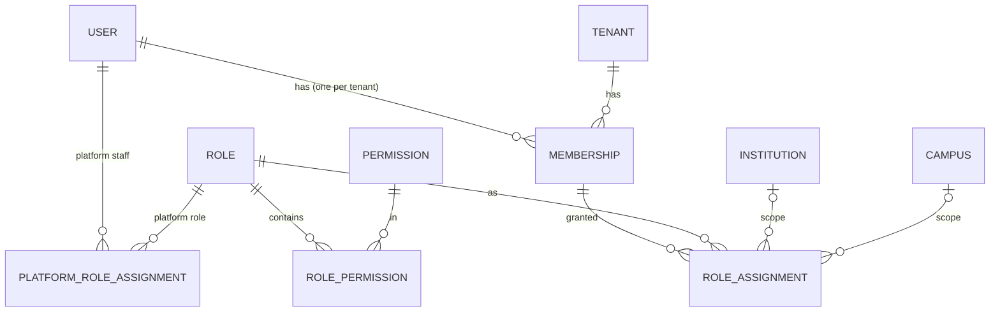
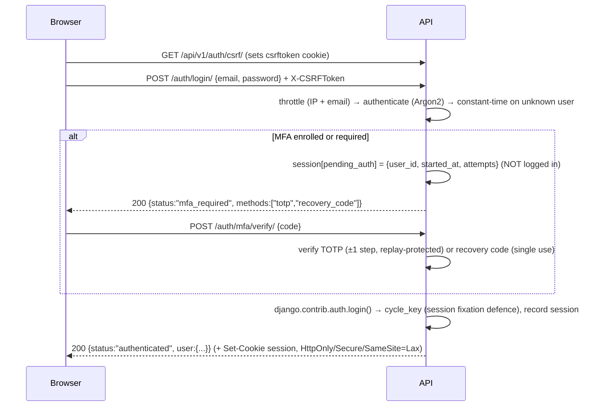

# Phase 2 Implementation Plan — Authentication, Users, Roles & Permissions

- **Status:** Proposed — awaiting owner approval. **No application code may be written until approved.**
- **Prepared:** 2026-11-05
- **Roadmap reference:** `DEVELOPMENT_ROADMAP.md` → Phase 2
- **Builds on (accepted):**
  - ADR-009 (tenancy/RLS), ADR-010 (hierarchy), ADR-011 (Django session auth), ADR-012 (UUIDv7), ADR-015 (REST/OpenAPI), ADR-021 (en/bn), ADR-030 (pins).
  - Phase 1 foundation: `core`, `identity.User` stub, DB roles.
- **Decisions requested with this plan:** ADR-031 to ADR-035 (§12) and questions Q1–Q8 (§13).

---

## 1. Goal

Deliver secure, production-grade **identity and authorization primitives** that every later phase depends on:

1. **Authentication.** Email + password login with Django sessions (ADR-011), MFA (TOTP + recovery codes), logout, and session management: list sessions, revoke sessions, idle and absolute timeouts.
2. **Account lifecycle.**
   - Activation: email verification combined with setting the first password.
   - Password change, and password reset with single-use tokens.
   - Email change with re-verification.
   - Deactivation.
3. **RBAC engine.**
   - A permission registry populated from module manifests.
   - Roles as bundles of permissions.
   - System role templates (data) for every role in `CLAUDE.md` §9.
   - Platform role assignments.
   - The evaluation service `has_perm(actor, code, scope)` and its DRF permission classes.
   - **Scope-aware by design**, so that Phase 3 can add tenant memberships without changing callers.
4. **Audit.** An append-only `audit_event` log covering all authentication and authorization events, protected at the database level (no UPDATE or DELETE for the app role).
5. **Frontend.** Login, MFA, password and activation flows; an account security page; a minimal platform console (users, roles, audit).
6. **Tenant-aware membership architecture.** Fully designed here (§4). It is implemented in Phase 3 together with tenants and RLS. See §2 for why.

## 2. Scope boundary with Phase 3 (important)

`Membership` and tenant `RoleAssignment` are **tenant-owned tables**. ADR-009 requires every tenant-owned table to:
- inherit `TenantScopedModel` (fail-closed manager);
- have RLS enabled + forced;
- run inside `core.db.tenant_atomic`.

All of these are **Phase 3 deliverables**. Creating membership tables in Phase 2 would mean either shipping tenant data without RLS, which ADR-009 forbids, or pulling half of Phase 3 forward.

**Therefore (proposed ADR-032):**

| Item | Phase 2 (this plan) | Phase 3 |
|---|---|---|
| User accounts, auth, MFA, sessions, password/email flows | ✅ Implemented | — |
| Permission registry, roles, role templates, `has_perm` engine | ✅ Implemented (scope-aware API) | Tenant scopes plugged in |
| Platform roles (`super_admin`, `platform_support`, `platform_billing`, `platform_onboarding`) + assignment | ✅ Implemented | — |
| Audit log (tenant_id column present, nullable) | ✅ Implemented | RLS policy for tenant rows + tenant viewer |
| `Tenant`, `Institution`, `Campus` | ❌ | ✅ |
| `Membership`, tenant `RoleAssignment`, invitations to a tenant | ❌ (designed in §4) | ✅ Implemented on the §4 design |
| Tenant role cloning/customization UI | ❌ | ✅ (basic) / Phase 5 (Studio) |
| Object scopes (teacher → own sections, guardian → own children) | Interface only | Phase 7 (domain relations exist then) |

Phase 2 serves **only the platform host** (`admin.<platform-domain>`; `localhost` in dev). Tenant hosts arrive in Phase 3.

## 3. Prerequisites checklist

| Item | State |
|---|---|
| Phase 1 foundation on `main` (PR #2) | ✅ Merged 2026-11-05 18:42:43 UTC |
| Phase 1 review follow-up (PR #12): prod guards, DB hardening, ADR-029/030 Accepted, S3 suite | ⏳ **Open, CI green, not merged.** Must be merged before Phase 2 implementation |
| Phase 1 marked `Approved` by owner | ⏳ Pending owner confirmation |
| ADR-031 to ADR-035 + Q1–Q8 answered | ⏳ This plan |
| Dependabot PRs #5, #10, #11 closed (would break ADR-003/030) | ⏳ Owner |

---

## 4. Tenant-aware user membership architecture (design; built in Phase 3)

### 4.1 Principles
1. **One person = one `User`** (global, platform-level, not tenant-scoped). An email belongs to one account across all tenants.
2. **Belonging to a tenant = `Membership`** (tenant-scoped, RLS-protected). One user may hold many memberships: a teacher in tenant A who is also a parent in tenant B.
3. **What a member may do = `RoleAssignment`** to one of their memberships, with a **scope** (tenant, institution or campus) and an optional validity window.
4. **Platform staff power is separate.** `PlatformRoleAssignment` grants platform permissions only. A Super Admin has **no implicit access to tenant data**; access goes through an audited support session (Phase 3, `MULTI_TENANT_ARCHITECTURE.md` §7).
5. **Authorization checks permissions, never role names.**

### 4.2 Entities



| Model | Key fields | Constraints |
|---|---|---|
| `tenancy.Membership` (Phase 3, `TenantScopedModel`, RLS) | `tenant`, `user`, `status` (`invited`/`active`/`suspended`/`left`), `invited_by`, `invited_at`, `joined_at`, `last_seen_at` | `UNIQUE(tenant_id, user_id)` |
| `rbac.RoleAssignment` (Phase 3, `TenantScopedModel`, RLS) | `tenant`, `membership`, `role`, `scope_type` (`tenant`/`institution`/`campus`), `institution` (nullable), `campus` (nullable), `valid_from`, `valid_until`, `granted_by` | CHECK: scope fields match `scope_type`; role is a tenant role of the same tenant (or a platform template cloned for it); `UNIQUE(membership, role, scope_type, institution, campus)` |
| `rbac.Role` (**Phase 2**) | `tenant_id` (NULL = system template / platform role), `code`, `name`, `name_i18n`, `kind` (`platform`/`template`/`tenant`), `institution_types[]` (template applicability), `is_system`, `description` | `UNIQUE(COALESCE(tenant_id), code)` |

> **RLS note for `rbac.Role`:** system templates and platform roles have `tenant_id = NULL`. They are platform reference data, readable by all and writable only by migrations or seed commands. Tenant-specific roles (Phase 3) get RLS. The Phase 3 policy is: `tenant_id IS NULL OR tenant_id = current tenant` for SELECT, and `tenant_id = current tenant` for writes.

### 4.3 Request flow (Phase 3 target; Phase 2 implements the platform-host branch)

```
Request → RequestID → Session auth (user or anonymous)
        → Host resolution
            ├── platform host  → platform context: PlatformRoleAssignments only            [Phase 2]
            └── tenant host    → tenant = resolve(host) → Membership(user, tenant).status == active  [Phase 3]
        → tenant_atomic(tenant) (sets app.tenant_id)                                         [Phase 3]
        → ModuleEntitled → HasPermission(code, scope) → object policy → masking → audit
```

- **Session per host.** The session cookie is host-only (ADR-011), so each tenant host has its own session. Switching tenants means visiting another host and logging in there. Cross-host SSO between tenant hosts is a later decision (enterprise SSO, Phase 17/18).
- A suspended or left membership results in `403 membership_inactive` on every request, even with a valid session.
- `last_active_tenant` is not stored. The tenant always comes from the host.

### 4.4 Permission evaluation (Phase 2 engine, Phase 3 adds tenant sources)

```python
has_perm(actor: User, code: str, *, tenant=None, institution=None, campus=None, obj=None) -> bool
```

1. Unknown permission code → `ImproperlyConfigured` in dev/test (catches typos). In production it is denied and logged.
2. **Platform context** (`tenant is None`): the union of the actor's `PlatformRoleAssignment` role permissions.
3. **Tenant context** (Phase 3): the active membership in `tenant` is required. The union covers role permissions from assignments that are currently valid and whose scope **covers** the target. Coverage: tenant ⊇ any institution ⊇ its campuses. A campus-scoped assignment never covers another campus or the institution as a whole.
4. Module entitlement for the code's module (Phase 4; Phase 2 treats all platform modules as entitled).
5. Object policy hook (`rbac.policies.register(resource, fn)`), e.g. "teacher may mark attendance only for assigned sections" (Phase 7+).
6. Default **deny**.

**Caching:**
- The effective permission set per (user, tenant or platform) lives in Redis under key `perm:{scope}:{user_id}:v{version}`.
- The version counter is bumped on any change to role permissions, assignments or memberships for that scope.
- TTL is 5 minutes as a safety net.
- The cache is never the only check for security-critical writes: services re-check through the same function.

---

## 5. Roles and permissions

### 5.1 Permission code catalog delivered in Phase 2

Format: `<module>.<resource>.<action>` (CLAUDE.md §10). Each module registers its codes in its `manifest.py`, and `manage.py sync_permissions` upserts them. A code is never deleted automatically; codes removed from manifests are flagged.

| Code | Meaning |
|---|---|
| `identity.account.view_own` / `identity.account.update_own` | Own profile |
| `identity.session.view_own` / `identity.session.revoke_own` | Own sessions |
| `identity.mfa.manage_own` | Enroll or remove own MFA |
| `identity.user.view` / `identity.user.create` / `identity.user.update` / `identity.user.deactivate` | Platform user administration |
| `identity.user.view_sensitive` | See security attributes (MFA state, login history) |
| `identity.session.revoke_any` | Revoke another user's sessions |
| `identity.mfa.reset` | Reset another user's MFA (audited, reason required) |
| `rbac.permission.view` | View the permission catalog |
| `rbac.role.view` / `rbac.role.create` / `rbac.role.update` / `rbac.role.delete` | Manage roles (platform roles in Phase 2; tenant roles in Phase 3) |
| `rbac.platform_role.assign` | Grant or revoke platform roles |
| `audit.event.view` | Read the audit log (platform scope in Phase 2) |

**Guard rails:**
- **No self-escalation.** Nobody can grant a permission they don't hold, or grant roles in a scope they don't control.
- **Two-person rule for `super_admin`.** Granting `super_admin` requires an existing `super_admin`, plus MFA re-authentication within the last 10 minutes ("sudo mode", §6.6).
- **The last `super_admin`** cannot be removed or deactivated.
- **Every grant and revoke** writes an audit event.

### 5.2 Role templates (seeded as data in Phase 2; used by tenants from Phase 3)

Permissions for modules that don't exist yet are listed as **planned codes**. They are registered when their module ships, and the template definitions in `rbac/templates/*.yaml` already reference them so presets stay consistent. Scope column: **P** = platform, **T** = tenant, **I** = institution, **C** = campus, **A** = assigned objects only, **O** = own records only.

| Role | Kind | Default scope | Phase 2 permissions | Planned permissions (registered by later phases) | MFA |
|---|---|---|---|---|---|
| **Super Admin** (`super_admin`) | platform | P | All `identity.*`, `rbac.*`, `audit.event.view`; `platform.*` (Phase 3+: tenants, plans, support sessions) | Tenant data **only** via audited support session | **Mandatory** |
| Platform Support (`platform_support`) | platform | P | `identity.user.view`, `identity.session.revoke_any`, `identity.mfa.reset`, `audit.event.view` | Support sessions (Phase 3) | Mandatory |
| Platform Billing (`platform_billing`) | platform | P | `identity.account.*_own` | `billing.*` (Phase 4) | Mandatory |
| Platform Onboarding (`platform_onboarding`) | platform | P | `identity.user.create`, `identity.user.view` | `tenancy.tenant.create` (Phase 3) | Mandatory |
| **Institution Admin** (`institution_admin`) | template | I | — (own-account codes only) | `tenancy.institution.*` (own), `tenancy.campus.*`, `rbac.role.*` + `rbac.assignment.*` within institution, `identity.member.invite`, `audit.event.view` (institution), and **view/manage** for all entitled ERP modules in the institution (`academics.*`, `students.*`, `staff.*`, `attendance.*`, `examinations.*`, `fees.*` (no `fees.payment.refund` approve if SoD is on), `communication.*`, `reports_analytics.*`, …) | **Mandatory** |
| **Campus Admin** (`campus_admin`) | template | C | own-account | Same families as Institution Admin, **limited to their campus**; cannot edit institution-level settings, roles or other campuses | Recommended (tenant-configurable; default on) |
| **Teacher** (`teacher`) | template | A | own-account | `academics.offering.view` (A), `attendance.record.mark` (A), `attendance.record.view` (A), `examinations.mark.enter` (A, until locked), `examinations.result.view` (A), `lms.*` content/assignments (A), `students.student.view` (A: students in assigned sections, non-sensitive fields), `communication.message.send` (A: classes/guardians) | Configurable |
| **Staff** (`staff_member`, generic non-teaching) | template | C | own-account | `staff.profile.view_own`, `attendance.self.view`, `hr_payroll.payslip.view_own`, `hr_payroll.leave.request_own`, `communication.notice.view`. Specialised staff roles add module scopes: `accountant`, `cashier`, `librarian`, `hostel_warden`, `transport_manager`, `front_desk`, `admission_officer`, `exam_controller`, `hr_manager` | Configurable (Mandatory for `accountant`/`cashier`/`hr_manager`, proposed) |
| **Student** (`student`) | template | O | own-account | `students.profile.view_own`, `timetable.view_own`, `attendance.record.view_own`, `examinations.result.view_own` (published only), `fees.invoice.view_own`, `lms.*` (enrolled courses), `online_exams.attempt.take_own`, `communication.notice.view` | Optional |
| **Parent / Guardian** (`guardian`) | template | O (linked children) | own-account | For each **linked child**: `students.profile.view_child`, `attendance.record.view_child`, `examinations.result.view_child` (published), `fees.invoice.view_child`, `fees.payment.pay_child` (online), `communication.notice.view`, `attendance.leave.request_child` | Optional |

> **New code name in the catalog:** the generic non-teaching role is `staff_member`. The `staff` module code already names the HR/staff module (CLAUDE.md §5), so the role can't also be called `staff`. CLAUDE.md §9 will list `staff_member` as a role template once this plan is approved. Specialised staff roles already listed there are unchanged.

**Sensitive fields** (medical info, national ID, guardian income, staff salary) require explicit `*.view_sensitive` codes, which no template includes by default except where a role's job needs them (e.g. `hr_manager` → staff salary).

---

## 6. Authentication & session design

### 6.1 Login (session-based, two-step when MFA applies)



- **No enumeration.** Unknown email, wrong password and an inactive account all return the same `401 invalid_credentials`, with similar timing (a dummy hash check runs for unknown users).
- The **pending-MFA state** expires after 5 minutes or 5 failed codes, after which login restarts. It lives in the session, not in a token.
- **MFA enrollment required.** A user who must have MFA but hasn't enrolled gets `status:"mfa_enrollment_required"`. The session is then in a restricted state that can call only the MFA-setup endpoints and logout.
- **Logout** (`POST /auth/logout/`): flushes the session and marks the session record revoked.

### 6.2 Throttling and lockout (no new dependency; Redis counters)
| Bucket | Limit (proposed defaults) | On exceed |
|---|---|---|
| Login per IP | 20 / 5 min | `429` + `Retry-After` |
| Login per email (normalized) | 5 failures / 15 min | progressive delay, then temporary lock 15 min; email notice to the account owner |
| MFA verify per pending login | 5 attempts | pending state cleared |
| Password reset / activation resend per email | 3 / hour | silent (still `202`, no enumeration) |
| Password reset per IP | 10 / hour | `429` |

Lockouts are keyed on the normalized email and **never** leak whether the account exists. Every lock, unlock and throttle event is audited.

### 6.3 Passwords
- Argon2id (Phase 1 setting).
- Validators: minimum length 10, user-attribute similarity, common-password list, not all-numeric.
- Maximum length 128, to prevent long-input DoS.
- **Breached-password check** (Have I Been Pwned k-anonymity range API): optional, **off by default** (Q4).
- Password change requires the current password. It revokes **all other** sessions and sends a notification email.

### 6.4 Tokens for email links (proposed ADR-034)
Activation, email verification, password reset and email change use **DB-stored, single-use, hashed tokens**:

| Field | Note |
|---|---|
| `purpose` | `activation` / `email_verification` / `password_reset` / `email_change` |
| `user` | FK |
| `token_hash` | SHA-256 of a 32-byte random token. The raw token is only ever in the email link |
| `expires_at` | activation 72 h, email verification 24 h, password reset 30 min, email change 24 h (proposed) |
| `used_at`, `created_ip` | single use; audit context |
| `payload` | e.g. new email address for `email_change` |

- Issuing a new token of the same purpose invalidates older unused ones.
- A **password reset completes by revoking all sessions** and sends a confirmation email.
- Links have the form `/{locale}/reset-password#token=…`. The token goes in the URL **fragment**, so it never reaches server logs or `Referer` headers. The page POSTs it to the API and then clears the fragment.

### 6.5 Activation and email verification
- There is **no public self-registration in Phase 2.** Tenant signup belongs to Phase 3 onboarding (Q3).
- Platform users are **created** by a Super Admin or Platform Onboarding user. Phase 3 adds tenant invitations, which reuse the same token mechanism.
- Creation sends an **activation email**. The user opens the link, sets a password (which verifies the email) and must then enroll MFA if their role requires it.
- `User.email_verified_at` records verification. An unverified account cannot log in. The response is the same `invalid_credentials`, plus an optional "resend activation" flow that doesn't reveal account state.
- **Email change:**
  1. A verification link goes to the **new** address.
  2. A notification goes to the **old** address.
  3. The change is applied only after verification.
  4. All other sessions are revoked.

### 6.6 MFA (TOTP + recovery codes)
- **TOTP** (RFC 6238), 30 s steps, 6 digits, ±1 step tolerance. The last used time-step is stored per device to **prevent replay**.
- **Secrets are encrypted at rest** (proposed ADR-031, field encryption) and never returned after enrollment.
- **Enrollment:**
  - `POST /me/mfa/totp/setup/` creates an unconfirmed device and returns the otpauth URI plus an SVG QR code (Q5).
  - `POST /me/mfa/totp/confirm/` with a valid code activates it and returns **10 recovery codes**. They are shown once and stored hashed (Django password hasher), each single use.
- **Re-authentication ("sudo mode")** for sensitive actions: changing password, disabling MFA, regenerating recovery codes, changing email, granting platform roles, and admin MFA reset. It requires the password, plus an MFA code if enrolled, within the last 10 minutes; the timestamp is stored in the session.
- **Mandatory MFA:**
  - **Phase 2:** every platform role.
  - **Phase 3:** `tenant_owner` and `institution_admin`, with tenant-configurable additions.
  - A user with mandatory MFA cannot disable it.
- **Admin MFA reset** requires `identity.mfa.reset` + sudo mode + a reason. It is audited and notifies the user by email.
- **WebAuthn/passkeys:** later (Phase 18); the device table is designed to allow additional device types.

### 6.7 Sessions
- `cached_db` engine (Phase 1).
- **New `identity.SessionRecord`** (Django sessions can't be listed per user): `user`, `session_key_hash` (SHA-256; the raw session key is never stored), `created_at`, `last_seen_at` (updated at most once per minute), `ip` (truncated per privacy policy, Q7), `user_agent` (shortened), `mfa_verified_at`, `revoked_at`, `revoke_reason`.
- **Timeouts:** absolute lifetime 12 h (Phase 1 setting) and idle timeout 30 min (proposed; configurable per tenant within platform bounds in Phase 3). Both are enforced by middleware and checked on every request.
- **Revocation:** a user can revoke one session or all others; an admin can revoke all of a user's sessions (`identity.session.revoke_any`). Revocation deletes the Django session and marks the record.
- **Automatic revoke-all:** on password reset, admin deactivation and admin MFA reset. Password change and email change revoke **others** only.
- The session key rotates (`cycle_key`) on login, on MFA completion and on privilege change (platform role granted or revoked).

### 6.8 Audit logging (`audit` app, delivered in Phase 2)

`audit.AuditEvent`:

| Field | Note |
|---|---|
| `id` | UUIDv7 (time-ordered) |
| `occurred_at` | `timestamptz` |
| `tenant_id` | nullable. Phase 3 adds an RLS policy for tenant rows; platform rows are NULL |
| `actor_user_id` | nullable for anonymous or system |
| `actor_type` | `user` / `system` / `support` / `ai` |
| `support_session_id` | nullable (Phase 3) |
| `action` | dotted, e.g. `identity.login.succeeded` |
| `outcome` | `success` / `failure` / `denied` |
| `target_type`, `target_id` | resource acted on |
| `metadata` | JSONB, **redacted** with the same sensitive-key processor as logs |
| `ip`, `user_agent`, `request_id` | request context |

- **Database-level immutability.** A migration grants `erp_app` only `SELECT, INSERT` on `audit_auditevent` (revoking `UPDATE, DELETE`) and adds a trigger rejecting UPDATE/DELETE, even for `erp_owner`. The trigger can only be removed by an explicit, reviewed migration. The same reusable grant helper restricts `django_migrations` to `SELECT` for `erp_app`, closing a Phase 1 known gap.
- **Written in the same transaction** as the action where possible (on rollback, no false "success").
  - Failed logins are recorded outside the failing transaction.
  - If writing the audit row itself fails, the action fails: it fails closed for security events.
- **Events in Phase 2:**
  - `identity.login.succeeded|failed|locked`, `identity.logout`;
  - `identity.mfa.challenge_failed|enrolled|disabled|reset|recovery_code_used`;
  - `identity.password.changed|reset_requested|reset_completed`;
  - `identity.email.change_requested|changed`, `identity.account.activated|deactivated|reactivated`;
  - `identity.session.revoked`;
  - `rbac.role.created|updated|deleted`, `rbac.role.permissions_changed`, `rbac.platform_role.granted|revoked`;
  - `authz.denied` (sampled/aggregated to avoid flooding: one row per actor+code per minute).
- **Partitioning** (monthly) is deferred to Phase 18 when volume requires it. The table and indexes are designed for it: `(occurred_at)`, `(actor_user_id, occurred_at)`, `(tenant_id, occurred_at)`.

---

## 7. Database models and migrations (Phase 2)

| App | Model / table | Notes |
|---|---|---|
| `identity` | `User` (**alter**) | Add `email_verified_at`, `last_password_change_at`, `deactivated_at`, `locale` (en/bn), `display_name`. Migration is additive and nullable (expand-only) |
| `identity` | `MFADevice` | `user`, `kind` (`totp`), `name`, `secret_encrypted` (bytes, ADR-031), `confirmed_at`, `last_used_step`, `last_used_at` |
| `identity` | `RecoveryCode` | `user`, `code_hash`, `used_at` (10 per generation; regenerating deletes unused ones, audited) |
| `identity` | `AccountToken` | §6.4 |
| `identity` | `SessionRecord` | §6.7 |
| `rbac` | `Permission` | `code` (unique), `module_code`, `description`, `is_sensitive`, `deprecated_at` |
| `rbac` | `Role` | §4.2 (platform, template; tenant roles in Phase 3) |
| `rbac` | `RolePermission` | `role`, `permission` (`UNIQUE` pair) |
| `rbac` | `PlatformRoleAssignment` | `user`, `role` (kind = platform), `granted_by`, `granted_at`, `reason` |
| `audit` | `AuditEvent` | §6.8; grants + immutability trigger migration |
| `core` | migration helper `RestrictTableGrants` | Reusable operation; used for `audit_auditevent` and `django_migrations` |

None of these tables are tenant-owned, so none need RLS in Phase 2. `AuditEvent` carries a nullable `tenant_id` for Phase 3, and a CI check that "every `tenant_id` table has RLS" will be activated in Phase 3 with a documented exemption list. Migrations are reviewed for lock impact; all tables are new except one additive `ALTER` on the small `identity_user` table.

## 8. API endpoints (`/api/v1`, OpenAPI documented, Problem Details errors)

**Auth (anonymous allowed where marked; CSRF on all unsafe methods):**

| Method & path | Auth | Purpose |
|---|---|---|
| `GET /auth/csrf/` | anon | Set CSRF cookie |
| `POST /auth/login/` | anon | Step 1 (§6.1) |
| `POST /auth/mfa/verify/` | pending | Step 2 (TOTP or recovery code) |
| `POST /auth/logout/` | user | End session |
| `POST /auth/password/reset/` | anon | Request reset (always `202`) |
| `POST /auth/password/reset/confirm/` | anon (token) | Set new password; revoke all sessions |
| `POST /auth/activate/` | anon (token) | Verify email + set first password |
| `POST /auth/activation/resend/` | anon | Always `202` |
| `POST /auth/email/verify/` | anon (token) | Confirm email change |
| `POST /auth/reauthenticate/` | user | Enter sudo mode (password [+ MFA]) |

**Self-service (`/me`), each requiring `identity.*_own` codes held by every active user:**

| Method & path | Purpose |
|---|---|
| `GET /me/` | Profile, permissions in current context, MFA state, flags (`mfa_enrollment_required`) |
| `PATCH /me/` | `display_name`, `locale` |
| `POST /me/password/` | Change password (current + new) |
| `POST /me/email/` | Request email change (sudo) |
| `GET /me/mfa/` · `POST /me/mfa/totp/setup/` · `POST /me/mfa/totp/confirm/` · `DELETE /me/mfa/totp/` (sudo; blocked if mandatory) · `POST /me/mfa/recovery-codes/` (sudo, regenerate) | MFA management |
| `GET /me/sessions/` · `DELETE /me/sessions/{id}/` · `POST /me/sessions/revoke-others/` | Session management |

**Platform administration (`/api/v1/platform/…`, platform host only, MFA-verified session required):**

| Method & path | Permission |
|---|---|
| `GET/POST /platform/users/` | `identity.user.view` / `identity.user.create` |
| `GET/PATCH /platform/users/{id}/` | `identity.user.view` / `identity.user.update` |
| `POST /platform/users/{id}/deactivate/` · `/reactivate/` | `identity.user.deactivate` |
| `POST /platform/users/{id}/sessions/revoke/` | `identity.session.revoke_any` |
| `POST /platform/users/{id}/mfa/reset/` | `identity.mfa.reset` (+ sudo, reason) |
| `POST /platform/users/{id}/activation/resend/` | `identity.user.create` |
| `GET /platform/permissions/` | `rbac.permission.view` |
| `GET/POST /platform/roles/` · `GET/PATCH/DELETE /platform/roles/{id}/` | `rbac.role.*` (system roles read-only) |
| `GET/POST /platform/users/{id}/platform-roles/` · `DELETE …/{assignment_id}/` | `rbac.platform_role.assign` (+ sudo) |
| `GET /platform/audit-events/` (cursor pagination; filters: action, actor, outcome, time range) | `audit.event.view` |

Every endpoint declares `HasPermission(...)` (or an explicit, reviewed anonymous exemption), and a CI test enumerates URL patterns to enforce this. List endpoints use selectors with `select_related`/`prefetch_related` (N+1 checks in tests).

## 9. Frontend screens (Next.js 16, en + bn, mobile-first)

| Route | Screen |
|---|---|
| `/[locale]/login` | Email + password; generic errors; throttle message with retry time |
| `/[locale]/login/mfa` | TOTP code or "use a recovery code" |
| `/[locale]/login/mfa-setup` | Forced enrollment (QR, manual key, confirm code, show and download recovery codes once) |
| `/[locale]/forgot-password` | Request reset (same confirmation message whether or not the account exists) |
| `/[locale]/reset-password` | Reads `#token`, sets new password with strength guidance |
| `/[locale]/activate` | Reads `#token`, sets first password → MFA setup if required |
| `/[locale]/verify-email` | Confirms email change |
| `/[locale]/account/security` | Change password, email, MFA (enroll/disable/regenerate codes), active sessions with revoke |
| `/[locale]/platform/users` · `/platform/users/[id]` | Platform user list/detail: create user, deactivate, revoke sessions, reset MFA, platform roles |
| `/[locale]/platform/roles` | Roles + permission catalog (system roles read-only) |
| `/[locale]/platform/audit` | Audit log with filters (cursor pagination) |
| App shell | Server-side session check via `/me/`; redirects anonymous users to login; navigation from the permission manifest; "re-authenticate" dialog for sudo actions |

- **Tech:** TanStack Query, react-hook-form + zod (deferred from Phase 1; now justified), generated API client and existing shadcn/ui components.
- **i18n:** all strings in `en.json` and `bn.json`, with a parity test.
- **Security:**
  - No tokens in JS storage.
  - The CSRF header is added by the existing client.
  - Password fields use correct `autocomplete` values, and the OTP field uses `one-time-code`.
  - Error messages never reveal whether an account exists.

**Emails** (Celery task, Django templates, `en`/`bn`, captured by Mailpit in dev): activation, password reset, password changed, email change verify/notify, MFA reset notice, account locked notice, new login notice (optional, Q8).

## 10. Tests (definition of done for Phase 2)

| Area | Tests |
|---|---|
| Login | success; wrong password / unknown email / inactive / unverified all give identical response; timing-safe path for unknown user; CSRF required; session cycled; cookie flags |
| Throttling | per-IP and per-email limits; lockout and unlock; no enumeration via throttle responses |
| MFA | enrollment; replay of the same TOTP step rejected; ±1 window; recovery code single use; pending-MFA expiry and attempt limit; mandatory-MFA enrollment gate; cannot disable when mandatory; secret encrypted at rest (raw DB value ≠ secret) |
| Tokens | single use; expiry; wrong purpose rejected; new token invalidates old; only the hash is stored; reset revokes all sessions |
| Sessions | list/revoke own; cannot revoke others' without permission; idle and absolute timeout; revoke-others on password change |
| RBAC | `has_perm` allow/deny matrix; unknown code raises in tests; no self-escalation; last-super-admin protection; sudo required for platform role grants; cache invalidation on change |
| API authz | URL-pattern audit (every view has a permission class); each platform endpoint allowed + denied cases; anonymous endpoints explicitly listed |
| Audit | every listed event written with redacted metadata; `erp_app` UPDATE/DELETE on audit table → permission denied; trigger blocks owner UPDATE/DELETE; failed logins recorded |
| DB | `django_migrations` is SELECT-only for `erp_app`; migrations reversible where safe |
| Frontend | Vitest for forms/validation and the auth client; Playwright E2E: login → MFA setup → logout → login with MFA → recovery code → password reset via Mailpit → session revoke; axe on auth pages; mobile viewport |
| Security | ruff `S`, pip-audit, Trivy, gitleaks unchanged; a dedicated `SECURITY.md` §10 checklist in the PR |

Coverage gate unchanged (≥ 85%); target ≥ 90% for `identity`, `rbac` and `audit` services.

## 11. Dependencies (each needs approval; pinned in lockfiles)

| Package | Why | Alternative considered |
|---|---|---|
| `pyotp` | RFC 6238 TOTP generation/verification (small, MIT) | `django-otp` (pulls its own device models without UUIDv7/encryption; less control) |
| `cryptography` | Field-level encryption for MFA secrets (ADR-031); industry standard | `django-fernet-fields` (unmaintained) |
| `segno` | Server-rendered SVG QR code for TOTP enrollment (pure Python, no deps) | Client-side QR library (adds JS; secret still has to reach the browser) |
| `@tanstack/react-query` | Server state (already in FRONTEND_STANDARDS) | — |
| `react-hook-form`, `zod`, `@hookform/resolvers` | Forms + validation (already in FRONTEND_STANDARDS) | — |

Not added: `django-axes` (throttling/lockout via Redis counters in ~150 lines with tests); `djangorestframework-simplejwt` / `django-oauth-toolkit` (ADR-028 still pending; not needed for browser auth).

## 12. Decisions requested (new ADRs, all Proposed)

| ADR | Decision | Recommendation |
|---|---|---|
| **ADR-031** | Field-level encryption for secrets at rest (MFA secrets now; integration credentials later). Uses `cryptography` AES-GCM (`MultiFernet`-style key ring) with keys from `FIELD_ENCRYPTION_KEYS` (comma-separated, first = active). Rotation by re-encrypt command. Production keys in a secret manager (KMS decision with ADR-019) | Accept |
| **ADR-032** | Phase boundary: `Membership` + tenant `RoleAssignment` are implemented in **Phase 3** (together with RLS), on the §4 design; Phase 2 ships the scope-aware engine and platform roles | Accept |
| **ADR-033** | Authorization uses the project's own `rbac` tables. Django's `auth.Group`/`auth.Permission` remain only for Django admin (platform staff), never for app authorization | Accept |
| **ADR-034** | Email-link tokens are DB-stored, hashed, single use, purpose-bound, short-lived (§6.4), not Django's stateless `PasswordResetTokenGenerator` (which can't be individually revoked or audited) | Accept |
| **ADR-035** | Sudo mode (re-authentication within 10 min) for sensitive actions; mandatory MFA for platform roles (Phase 2) and for `tenant_owner`/`institution_admin` (Phase 3) | Accept |

## 13. Open questions for the owner

| # | Question | Recommendation |
|---|---|---|
| Q1 | Approve ADR-031 to ADR-035? | Yes |
| Q2 | **Phone-number login / SMS OTP** is in the original roadmap text. It needs an SMS provider (Phase 14) and cost/abuse analysis. Defer to Phase 14? | Defer; Phase 2 is email-only |
| Q3 | **No public self-registration** in Phase 2. Platform users are created by Super Admin; tenant signup arrives with Phase 3 onboarding | Yes |
| Q4 | Breached-password check (HIBP k-anonymity, outbound call) | Off by default; optional setting |
| Q5 | QR code rendered server-side as SVG with `segno` | Yes |
| Q6 | Default idle timeout 30 min / absolute 12 h for all users in Phase 2 (tenant-configurable from Phase 3) | Yes |
| Q7 | Store IP addresses in session records and audit events **in full** for security forensics (retention set later in the data-retention policy), or truncated? | Full IP, retention ≤ 1 year (pending legal review already listed in Known gaps) |
| Q8 | "New sign-in" notification email on every successful login from a new device/IP | Yes for platform staff; tenant-configurable later |
| Q9 | Django admin: keep **disabled** in Phase 2 (platform console replaces it) | Keep disabled |

## 14. Implementation steps (after approval)

1. Branch `feat/phase-02-auth-rbac` from `main` (after PR #12 is merged).
2. `core`: `RestrictTableGrants` migration operation, field-encryption utility (ADR-031) with key rotation tests.
3. `audit`: model, immutability migration, `record()` service, redaction, tests.
4. `identity`: User additions, tokens, password flows, throttling, MFA, sessions + middleware, emails (Celery tasks, en/bn templates), tests.
5. `rbac`: permission registry + `sync_permissions`, roles, templates (YAML) + `seed_roles`, platform assignments, `has_perm`, DRF permission classes, URL-audit test, tests.
6. API views/serializers/URLs; OpenAPI regenerate; TS client regenerate.
7. Frontend: auth flows, account security, platform console, i18n, unit tests, Playwright E2E (Mailpit-driven).
8. Bootstrap: `manage.py create_platform_admin` (interactive or env-driven, forces activation + MFA on first login). No default credentials anywhere.
9. Full verification: CI parity locally, clean-volume stack, smoke check, Trivy, gitleaks.
10. Docs: SECURITY.md (implemented controls), API_STANDARDS (auth endpoints), DATABASE_DESIGN/ERD (new tables), DECISION_LOG, DEVELOPMENT_PROGRESS, this plan's outcome section.
11. Open a **separate PR** for Phase 2. Never merged without owner approval.

## 15. Acceptance criteria

1. A platform admin can be bootstrapped, activate via email (Mailpit), set a password, enroll TOTP and log in with MFA. Logout works.
2. Every mandatory-MFA user is blocked from all non-MFA endpoints until enrolled.
3. Password reset, activation and email change work end-to-end with single-use expiring tokens; no endpoint reveals whether an email exists.
4. Throttling and lockout work and are audited.
5. Users can list/revoke sessions; idle and absolute timeouts are enforced; sessions are revoked where §6.7 requires.
6. `has_perm` passes the allow/deny matrix. No endpoint lacks a permission class (CI-enforced). Self-escalation and last-super-admin removal are impossible.
7. All §6.8 events are recorded with redacted metadata. `erp_app` cannot UPDATE/DELETE audit rows (DB-enforced, tested).
8. MFA secrets are encrypted at rest. Recovery codes and email tokens are stored only as hashes.
9. All CI jobs green, coverage ≥ 85% (≥ 90% for `identity`/`rbac`/`audit` services), Playwright auth E2E green on desktop + mobile, axe has no serious violations.
10. Docs updated; separate PR opened; not merged without owner approval.

## 16. Risks

| Risk | Mitigation |
|---|---|
| Building tenant features before RLS | Explicit Phase 2/3 boundary (ADR-032) |
| Auth bugs are high impact | Threat-model-driven test list (§10), sudo mode, audit, security review in the PR |
| Lockout abused to lock out real users (DoS) | Per-email lock is temporary + progressive; account owner notified; IP throttle separate |
| Key management for field encryption | Key ring with rotation command; production keys via secret manager (Phase 19 / ADR-019) |
| Email deliverability in production | Provider decision deferred to Phase 14/19; Mailpit in dev; templates provider-agnostic |

### Change notes
- 2026-11-05 — Initial plan drafted (awaiting approval).
