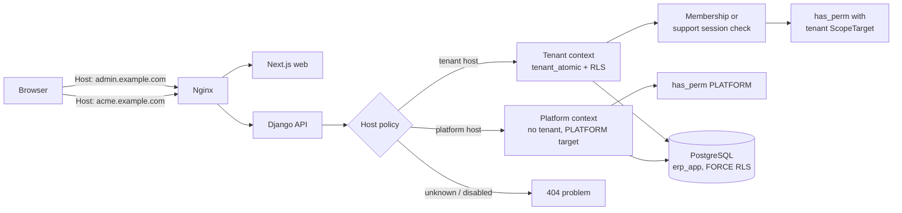
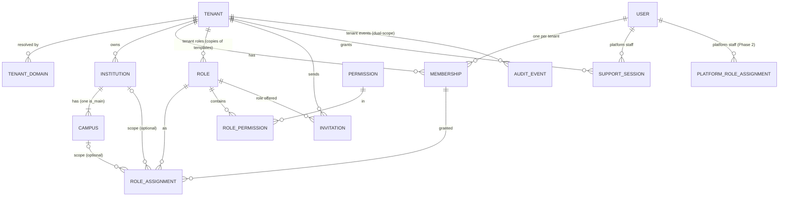
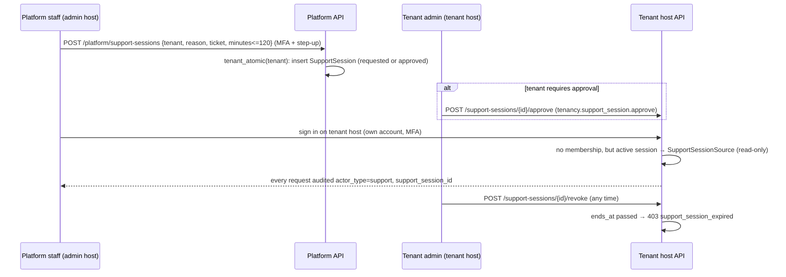

# Phase 3 Implementation Plan — Multi-Tenant Architecture & Tenant Isolation

- **Status:** **Proposed** (revision 1). **No application code until the owner approves this plan.**
- **Prepared:** 2026-11-08, on `main` at `2d61e83` (Phase 2 merged; Phases 0–2 Approved).
- **Roadmap reference:** `DEVELOPMENT_ROADMAP.md` → Phase 3 ("SaaS tenants, institutions & campuses").
- **Governing decisions (Accepted):** ADR-009 (shared schema + `tenant_id` + RLS, transaction-scoped context), ADR-010 (Tenant → Institution → Campus; limits), ADR-011 (host-only session cookies), ADR-012 (UUIDv7), ADR-032 (memberships with RLS in Phase 3; no rewrite of Phase 2), ADR-033 (own RBAC tables), ADR-034 (tokens), ADR-035 (MFA/step-up), ADR-036 (IP privacy), ADR-040 (security-review hardening, Phase 3 host prerequisite).
- **New decisions proposed by this plan:** ADR-041 to ADR-046 (§14). **Open owner questions:** §15.
- **Naming note:** the brief refers to `docs/ROADMAP.md` and `docs/DATABASE.md`; in this repository they are `docs/DEVELOPMENT_ROADMAP.md` and `docs/DATABASE_DESIGN.md`.

---

## 1. Goal and scope

Turn the Phase 2 platform (users, platform roles, audit) into a **multi-tenant SaaS**:

1. **Tenancy model:** tenants, institutions, campuses, tenant domains, lifecycle states, configurable institution/campus limits (ADR-010).
2. **People in tenants:** one global `User`; a tenant **Membership** per (tenant, user); **scoped RoleAssignments** at tenant, institution or campus scope; **invitations**. One person can be a teacher at School A, a department admin at University B and a parent at Madrasa C with **one account**, without any user being required to belong to more than one institution.
3. **Isolation primitives (ADR-009):** `TenantScopedModel` + fail-closed manager, `tenant_atomic()` with transaction-local `app.tenant_id`, a query guard, RLS (`ENABLE` + `FORCE`) on every tenant table, dual-scope policies for the Phase 2 platform/tenant tables, Celery tenant tasks, tenant-prefixed cache and storage keys.
4. **Tenant context resolution:** server-side, from the request host only (ADR-041). Tenant hosts stay **disabled** until resolution and isolation tests pass (ADR-040 I2).
5. **Tenant-aware RBAC:** `TenantMembershipSource` and `SupportSessionSource` plug into the Phase 2 engine **without changing it** (ADR-032 condition); tenant-scoped permission caches with immediate revocation.
6. **Support access:** explicit, time-limited (≤ 2 h), read-only, audited support sessions; tenant-visible and revocable; optional tenant consent (ADR-045).
7. **APIs and screens:** tenant administration (institutions, campuses, members, invitations, roles, assignments, support access, settings, tenant audit log), Super Admin tenant console, "My institutions" for multi-tenant users.
8. **Assurance:** shared isolation test suite, raw-SQL RLS tests as `erp_app`, concurrency and leakage tests, CI enforcement of RLS coverage, security monitoring of blocked cross-tenant attempts.

**Out of scope (later phases):** plans/subscriptions/entitlements (Phase 4; limits stored on the tenant until then), Customization Studio and presets content (Phase 5), self-service tenant sign-up (Phase 4/5, §15 Q6), custom domains with TLS (ADR-027, Phase 18), cross-host single sign-on (§15 Q2), domain records (students, staff) (Phase 6+), the full `files` module (§15 Q11).

## 2. Current state (verified on `main` at `2d61e83`)

| Item | State | Phase 3 impact |
|---|---|---|
| `rbac.engine` | `ScopeTarget(tenant, institution, campus)`, `ScopeGrant.covers()`, pluggable `RBAC_PERMISSION_SOURCES`, versioned cache (random token, ADR-040 L3) | Add tenant sources; tenant-prefixed cache keys; **no engine rewrite** |
| `rbac.middleware.ScopeTargetMiddleware` | Every request → `PLATFORM` (any allowed host) | **Replaced** by tenant resolution (ADR-041) |
| `rbac_role`, `rbac_rolepermission`, `audit_auditevent` | `tenant_id` nullable; all rows NULL today; tenant-sync trigger on role permissions | Dual-scope RLS policies (designed in Phase 2 plan §4.6, prototype tested) |
| `audit_auditeventip` | No `tenant_id`; integrity triggers (ADR-040 L4) | Add `tenant_id` mirror + dual-scope policy |
| `identity_*` | Platform (user-owned) tables; `SessionRecord.host` stored | Unchanged; per-host sessions identify tenant sessions |
| DB roles | `erp_owner` (migrations), `erp_app` (NOBYPASSRLS, DML), `erp_platform` (BYPASSRLS, NOLOGIN) | ADR-043 proposes keeping `erp_platform` **NOLOGIN** |
| Requests | Autocommit; `ATOMIC_REQUESTS = False`; persistent connections (`CONN_MAX_AGE = 60`) | Request-scoped tenant transaction (ADR-042) |
| Error handler | No `set_rollback()` | Tenant requests roll back on error; security audit must survive (durable audit, ADR-042) |
| Hosts | Dev `ALLOWED_HOSTS` includes `.localhost`, so **any** `*.localhost` host is served as the platform host today | Explicit platform hosts; unknown hosts rejected (ADR-041) |

Phase 2 tests (286), CI (8 jobs) and E2E (31) must stay green throughout.

## 3. Architecture overview



- **Platform host** (`admin.<platform-domain>`, dev `localhost`): Super Admin console, platform users, "My institutions". No tenant context: every tenant table is invisible (fail closed).
- **Tenant host** (`{slug}.<platform-domain>`, dev `{slug}.localhost`): everything tenant-owned. The tenant comes **only** from the host. Each host has its own session (host-only cookies, ADR-011/040), so tenants never share a session or CSRF cookie.
- One `User` account signs in to each tenant host it belongs to (§15 Q2 for cross-host SSO).

## 4. Domain model

### 4.1 Entities

| Model | Table | Kind | Key fields | Constraints |
|---|---|---|---|---|
| `Tenant` | `tenancy_tenant` | **Platform registry** (no `tenant_id`, no RLS; ADR-046) | `id`, `slug` (immutable), `name`, `status` (`provisioning`/`active`/`suspended`/`offboarding`/`deleted`), `default_locale`, `locales[]`, `timezone`, `currency`, `country`, `data_region`, `limits` JSONB (`max_institutions`, `max_campuses`), `limits_overridden_by/at/reason`, `settings` JSONB (`support_access_requires_approval`, …), `branding` JSONB | `UNIQUE(slug)`; slug `^[a-z][a-z0-9-]{1,30}[a-z0-9]$`, not in reserved list, never reused (tombstones) |
| `TenantDomain` | `tenancy_tenantdomain` | Tenant-owned, RLS | `tenant_id`, `domain` (lower-case FQDN), `kind` (`subdomain`; `custom` later), `is_primary`, `verified_at` | `UNIQUE(domain)`; one primary per tenant |
| `Institution` | `tenancy_institution` | Tenant-owned, RLS | `tenant_id`, `institution_type` (6 codes, CLAUDE.md §3), `code`, `name`, `name_i18n`, `preset_code`, `preset_version`, `settings` JSONB, `archived_at` | `UNIQUE(tenant_id, code)`; `UNIQUE(tenant_id, id)` (composite-FK target) |
| `Campus` | `tenancy_campus` | Tenant-owned, RLS | `tenant_id`, `institution_id`, `code`, `name`, `name_i18n`, `address` JSONB, `timezone` (override), `is_main`, `archived_at` | `UNIQUE(tenant_id, institution_id, code)`; exactly one `is_main` per institution (partial unique); composite FK `(tenant_id, institution_id)` → institution |
| `Membership` | `tenancy_membership` | Tenant-owned, RLS | `tenant_id`, `user_id` (FK identity_user), `status` (`invited`/`active`/`suspended`/`left`), `invited_by`, `joined_at`, `suspended_at`, `last_seen_at` | `UNIQUE(tenant_id, user_id)`; `UNIQUE(tenant_id, id)` |
| `RoleAssignment` | `rbac_roleassignment` | Tenant-owned, RLS | `tenant_id`, `membership_id`, `role_id`, `scope_type` (`tenant`/`institution`/`campus`), `institution_id`, `campus_id`, `valid_from`, `valid_until`, `granted_by`, `reason` | CHECK scope consistency; composite FKs `(tenant_id, membership_id)`, `(tenant_id, role_id)`, `(tenant_id, institution_id)`, `(tenant_id, institution_id, campus_id)`; no duplicate active (membership, role, scope) |
| `Invitation` | `tenancy_invitation` | Tenant-owned, RLS | `tenant_id`, `email`, `role_id`, `scope_type`, `institution_id`, `campus_id`, `token_hash` (Phase 2 `core.tokens`), `expires_at` (7 days), `accepted_at`, `revoked_at`, `invited_by` | `UNIQUE(token_hash)`; one open invitation per (tenant, email, role, scope) |
| `SupportSession` | `tenancy_supportsession` | Tenant-owned, RLS | `tenant_id`, `staff_user_id`, `reason`, `ticket_ref`, `access_level` (`read_only` only in Phase 3), `status` (`requested`/`approved`/`active`/`ended`/`revoked`/`expired`/`rejected`), `requested_at`, `approved_by`, `starts_at`, `ends_at` (≤ 2 h), `ended_at`, `revoked_by` | CHECK `ends_at - starts_at <= 2 h`; one active per (tenant, staff) |
| `Role` (tenant) | `rbac_role` (existing) | Dual-scope | `kind = tenant`, `tenant_id = T`, `template_id` (new, nullable FK to the template), `is_system` | Existing `UNIQUE(tenant_id, code) NULLS NOT DISTINCT` |

- **"Institution membership"** is **derived**, not stored: a member belongs to an institution when they hold an active assignment at that institution, one of its campuses, or tenant scope. This keeps one source of truth (§15 Q5 confirms).
- **Composite foreign keys** (ADR-044) make cross-tenant references impossible in the database: an assignment can't point at another tenant's role, membership, institution or campus, and a campus assignment's campus must belong to the assignment's institution. Django has no composite FKs, so they are added with reviewed `RunSQL` next to the normal FK.
- Tenant role templates (Phase 2, `kind = template`, `tenant_id NULL`) are **copied** into each tenant at provisioning as `kind = tenant` roles with `template_id` set (§15 Q5 for update propagation).

### 4.2 ERD



Example — one account, three tenants:

| User | Tenant | Membership | Assignment |
|---|---|---|---|
| rahim@example.com | School Group A | active | `teacher` @ campus *A-Main* |
| rahim@example.com | University B | active | `academic_coordinator` @ institution *Dept. of Botany* |
| rahim@example.com | Madrasa C | active | `guardian` @ tenant (child links in Phase 7) |

### 4.3 Tenant lifecycle (ADR-010; `MULTI_TENANT_ARCHITECTURE.md` §6)

| Status | Tenant host | Notes |
|---|---|---|
| `provisioning` | 404 | Created by Super Admin; becomes `active` when the owner invitation is sent |
| `active` | Normal | — |
| `suspended` | Sign-in blocked (`403 tenant_suspended`); support sessions still allowed | Super Admin action, step-up, reason, audited |
| `offboarding` | Read-only for tenant owner (export in Phase 18) | — |
| `deleted` | 404; slug tombstoned forever | Data purge procedure in Phase 18 |

`trial`/`past_due` arrive with billing in Phase 4.

## 5. Row-Level Security design (ADR-009, ADR-046)

### 5.1 Policy catalogue

With `ctx := NULLIF(current_setting('app.tenant_id', true), '')::uuid`:

| Class | Tables | Policies |
|---|---|---|
| **Standard tenant table** | `tenancy_tenantdomain`, `tenancy_institution`, `tenancy_campus`, `tenancy_membership`, `tenancy_invitation`, `tenancy_supportsession`, `rbac_roleassignment` (and every later tenant table) | `ENABLE` + `FORCE`; one policy `FOR ALL USING (tenant_id = ctx) WITH CHECK (tenant_id = ctx)`. No context → no rows, no writes |
| **Dual-scope (platform + tenant rows)** | `rbac_role`, `rbac_rolepermission` | Read `USING (tenant_id IS NULL OR tenant_id = ctx)`; write `WITH CHECK (tenant_id IS NOT DISTINCT FROM ctx)` |
| **Dual-scope, private** | `audit_auditevent`, `audit_auditeventip` | Read `USING (tenant_id IS NOT DISTINCT FROM ctx)`; insert `WITH CHECK (tenant_id IS NOT DISTINCT FROM ctx)`; existing grants/triggers keep UPDATE/DELETE rules |
| **Platform registry (no RLS, no `tenant_id`)** | `tenancy_tenant`, `identity_*`, `rbac_permission`, `rbac_platformroleassignment` | Application-layer authorization only; contain no tenant business data. On an explicit allow-list in the CI check |

- Policies are written per command where they differ (`FOR SELECT`, `FOR INSERT`, `FOR UPDATE`, `FOR DELETE`), so `UPDATE` cannot move a row to another tenant (`WITH CHECK` on the new row) and cannot touch platform rows from a tenant context.
- `FORCE` makes the owner subject to the policies too; migrations that must see all rows run per tenant under `tenant_atomic`, never by disabling RLS.

### 5.2 Cross-tenant reads without BYPASSRLS (ADR-043)

Some platform operations need data across tenants. Instead of a runtime `BYPASSRLS` connection, Phase 3 uses three narrow patterns:

1. **Per-tenant iteration:** platform jobs loop over `tenancy_tenant` (registry, no RLS) and run each tenant's work inside its own `tenant_atomic(t)`.
2. **`SECURITY DEFINER` read functions** owned by `erp_owner`, `SET search_path = pg_catalog, public`, `EXECUTE` granted only to `erp_app`, returning only the minimum columns:
   - `tenancy_resolve_host(host text) → (tenant_id uuid, status text)` — host resolution before any context exists;
   - `tenancy_memberships_of(user uuid) → (tenant_id, slug, name, status, membership_status)` — the "My institutions" list;
   - `tenancy_support_sessions_of(staff uuid) → (session_id, tenant_id, status, starts_at, ends_at)` — platform console list of a staff member's sessions.
3. **Platform aggregates** (tenant counts for the Super Admin dashboard) read only the registry.

`erp_platform` stays `NOLOGIN`; no runtime container holds `BYPASSRLS` credentials (consistent with ADR-040 H3). `platform_scope(reason)` becomes a context manager that **audits** the platform operation and provides patterns 1–3; it never disables RLS.

### 5.3 Migration helper and CI enforcement

- `core.db_operations.EnableTenantRLS(table)` / `EnableDualScopeRLS(table, private=bool)`: reversible operations that `ENABLE`/`FORCE` RLS and create the policies (names `tenant_isolation_*`).
- Reversal of an isolation migration is **refused in production/staging** (same guard as ADR-040 I1).
- **CI check (`tests/isolation/test_rls_coverage.py`)** queries `pg_class`/`pg_policies` on the migrated test database and fails when:
  1. a table with a `tenant_id` column lacks `relrowsecurity` **and** `relforcerowsecurity` and at least one policy;
  2. a dual-scope table is not on the explicit allow-list or has the wrong policy shape;
  3. a concrete model with a `tenant_id` field doesn't inherit `TenantScopedModel` (or a reviewed dual-scope base);
  4. a `SECURITY DEFINER` function lacks a pinned `search_path` or is executable by `PUBLIC`.
- **Static check:** a test greps the backend for `set_config('app.tenant_id'` with `false`, `SET app.tenant_id`, or `SET SESSION` and fails.

## 6. Tenant context lifecycle (ADR-042)

### 6.1 Primitives (`apps.core.tenancy`)

| Primitive | Behaviour |
|---|---|
| `TenantContext` | Frozen dataclass: `id`, `slug`, `status`. Stored in a `contextvars.ContextVar` (thread- and async-task-local) |
| `current_tenant()` | Returns the context or `None`; `require_tenant()` raises `TenantContextMissing` |
| `tenant_atomic(tenant)` | Opens `transaction.atomic()`; **first statement** `SELECT set_config('app.tenant_id', %s, true)`; marks the connection's outermost atomic block as "applied for tenant X"; sets the contextvar; restores both on exit (`finally`). Nesting with the **same** tenant creates a savepoint and reuses the setting; nesting with a **different** tenant raises `TenantContextConflict` |
| Query guard | `connection.execute_wrapper` installed for every connection. If a tenant context is active and the current transaction is not marked "applied for this tenant" (autocommit, a fresh connection, a different outer transaction), the query raises `TenantContextNotApplied` **before** reaching PostgreSQL |
| `TenantScopedModel` | Abstract base: `tenant` FK (`db_index`, `on_delete=PROTECT`), `created_by`/`updated_by`. Default manager `TenantManager` filters by `require_tenant()`; `save()` sets `tenant_id` from context and refuses a different value; `all_tenants` manager does not exist |
| `platform_scope(reason)` | Audited context for platform code; **no tenant context**; only the patterns in §5.2 |

### 6.2 Request lifecycle

```
RequestID → Security → Session → CSRF → Auth → SessionSecurity
  → TenantResolutionMiddleware   (host → platform | tenant | 404; sets request.tenant / scope_target)
  → [tenant host] TenantTransactionMiddleware: tenant_atomic(tenant) around the view
       → membership or support-session check (403 not_a_member / membership_inactive / tenant_suspended)
       → DRF view → HasPermission(code, target from request/object) → services (require_perm)
       → on error response: transaction rolled back (set_rollback); durable audit survives
  → ApiNoStore / CSP headers
```

- **One tenant transaction per tenant-host request.** Inside it, every query carries the context; outside it (other hosts), tenant tables return nothing.
- **Errors:** the Problem Details handler marks the transaction for rollback on 4xx/5xx inside a tenant transaction.
- **Durable security audit:** events that must survive a rollback (`authz.denied`, failed sign-in, cross-tenant attempt blocked, support access denied) are written by `audit.record(..., durable=True)` through a **second connection alias** (`audit_durable`, same `erp_app` credentials, `CONN_MAX_AGE = 0`, its own `tenant_atomic`). No new dependency.
- **Side effects** (emails, Celery tasks) are dispatched with `transaction.on_commit`, so a rolled-back request sends nothing.
- **Long requests:** tenant-host views stay short. Exports and imports are Celery tasks (202 + job), so one transaction per request doesn't hold locks for long.

### 6.3 Pooling, concurrency and leakage

| Risk | Control | Test |
|---|---|---|
| Setting leaks to the next request on a pooled connection | `set_config(..., true)` is **transaction-local**; COMMIT/ROLLBACK discards it. Session-level `SET` is forbidden (static check) | Connection reused across two requests for different tenants; second request sees only its own rows |
| PgBouncer transaction pooling (Phase 19) | Only transaction-scoped state is used; no session state, no `LISTEN`, no server-side prepared statements across transactions | Documented requirement; Phase 19 adds a PgBouncer stack test |
| Contextvar leaks between requests on the same thread | Set and reset in a `try/finally` in the middleware; `tenant_atomic` restores the previous token | Middleware unit test with an exception inside the view |
| Concurrent requests for different tenants | Thread-local contextvars + per-connection transactions | 20 threads × alternating tenants with `CONN_MAX_AGE > 0`; every thread asserts it sees only its tenant |
| Query outside the tenant transaction | Query guard raises `TenantContextNotApplied`; RLS returns no rows anyway | Guard tests: autocommit query, `on_commit` callback, new thread |
| ASGI/async views | Contextvars propagate through `sync_to_async`; tenant DB access stays in sync code paths | Async smoke test (Phase 3 serves WSGI/ASGI the same) |

### 6.4 Celery (ADR-042)

- `TenantTask` base class: tasks take `tenant_id` explicitly; before `run()` the worker loads the tenant from the registry, refuses non-`active` tenants (configurable per task), opens `tenant_atomic`, and always resets the context afterwards (also on retry and failure).
- Tasks without a tenant must be declared `platform_task` (Phase 2 email and housekeeping tasks); a CI test fails when a task neither inherits `TenantTask` nor is declared platform.
- Tasks are enqueued only via `transaction.on_commit` from tenant requests.
- Worker settings stay `acks_late` + prefetch 1 (Phase 1); tests use eager mode **and** the real worker in the stack job.

### 6.5 Cache and storage keys

- Cache: helper `tenant_cache_key(*parts)` → `t:{tenant_id}:…`; tenant permission caches use `t:{tenant}:perm:{user}:{scope}:v{tenant_version}` with a **per-tenant random version token** plus the global token (ADR-040 L3).
- Storage: helper `tenant_storage_key(*parts)` → `tenants/{tenant_id}/…`; presigned URLs only after a permission check (full `files` module: §15 Q11).

## 7. Tenant-aware RBAC (ADR-044)

### 7.1 Sources (no engine change; ADR-032 condition)

| Source | Grants |
|---|---|
| `SelfServiceSource` (Phase 2) | Own-account codes |
| `PlatformRoleSource` (Phase 2) | Platform permissions, platform targets only |
| `TenantMembershipSource` (new) | Union of currently valid assignments (`valid_from ≤ now < valid_until`, membership `active`, tenant `active`) whose `ScopeGrant` **covers** the target (tenant ⊇ institution ⊇ campus; never sideways). Reads run inside the request's tenant transaction, so RLS also applies |
| `SupportSessionSource` (new) | For an `active` support session of the actor on `target.tenant_id`: a fixed allow-list of read permissions (`*.view` codes flagged `support_readable`), nothing else |

`settings.RBAC_PERMISSION_SOURCES` gains the two new sources. `has_perm`, `require_perm`, `HasPermission` and `HasAnyPermission` keep their signatures.

### 7.2 Scope targets

- The tenant host sets `request.scope_target = ScopeTarget(tenant_id)`.
- Institution- and campus-scoped endpoints compute the target from the **object or path** (`/institutions/{id}/…` → `ScopeTarget(tenant, institution)`), after loading the object inside the tenant transaction (other tenants' objects are invisible → `404`, never `403`).
- Views use `HasPermission(code)` for the coarse check and the service re-checks with the precise target.

### 7.3 Guard rails (extending Phase 2 §5.1 and ADR-040 H2)

- Nobody can grant a role containing permissions they don't hold **in the target scope**, or grant in a scope they don't cover (a campus admin can't assign at institution or tenant scope).
- The **last active `tenant_owner`** can't be removed, suspended or demoted.
- `assert_can_act_on` extends to members: acting on another member requires holding every permission they hold in the overlapping scope.
- Platform roles never grant tenant permissions; Super Admins reach tenant data only through support sessions.
- Every grant, revoke, suspension, removal and invitation is audited **in the tenant's audit log**.

### 7.4 Revocation and cache invalidation

| Event | Effect |
|---|---|
| Membership suspended/removed | Membership status checked **uncached on every tenant request**; tenant permission version bumped; the member's sessions **on that tenant's hosts** revoked |
| Assignment revoked/expired | Tenant version bumped (signal + explicit bump after bulk ops); expiry checked at evaluation time (`valid_until`) |
| Role permissions changed | Tenant version (tenant roles) or global version (templates) bumped |
| Tenant suspended | Checked uncached per request; tenant hosts reject sign-in and API calls |
| Support session revoked/expired | Checked uncached per request; `403 support_session_expired` |

Security-critical writes (`require_perm(use_cache=False)`) never use the cache. Maximum staleness for ordinary reads is bounded by the version bump (immediate) and the 300 s TTL backstop.

## 8. Tenant resolution and hosts (ADR-041)

1. `PLATFORM_HOSTS` (explicit list, e.g. `admin.example.com`; dev `localhost`, `127.0.0.1`) → platform context.
2. Otherwise, if `TENANT_HOSTS_ENABLED` is true: normalise the host (lower-case, strip port, reject IP literals and non-ASCII), then `tenancy_resolve_host(host)`:
   - a verified `TenantDomain` of an `active` (or `suspended`/`offboarding`, with the rules in §4.3) tenant → tenant context;
   - anything else → `404 not_found` with the **same body and timing** for unknown, `provisioning` and `deleted` tenants (no tenant enumeration).
3. Otherwise → `404`.

- `ALLOWED_HOSTS` stays a Django safety net (`.example.com` in production); the authority is the host policy above. The dev wildcard `.localhost` keeps working for tenant hosts (`acme.localhost`), but those hosts serve **nothing** until `TENANT_HOSTS_ENABLED` is on.
- **Enablement gate (ADR-040 I2):** `TENANT_HOSTS_ENABLED` defaults to `false` in every environment; the production settings refuse `true` unless `TENANT_BASE_DOMAIN` is set. It's turned on in dev/CI only by the Phase 3 test suites; the owner turns it on in production after the Phase 3 security review.
- `X-Tenant` headers and tenant IDs in bodies or query strings are **never** used to choose the tenant. A request body naming another tenant's object fails with 404 (RLS) or 400 (validation).
- Nginx passes `Host` unchanged; the Next.js server forwards it to the API (`getServerMe` already does).
- Cookies: host-only, `__Host-` in production (ADR-040 L6); **no** `Domain` attribute ever, so `acme.example.com` cookies never reach `beta.example.com`.

## 9. Support sessions (ADR-045)



- **Read-only** in Phase 3: unsafe HTTP methods are rejected by middleware during support access, and `SupportSessionSource` grants only allow-listed `*.view` codes. Write access needs a later ADR.
- **Time-limited:** 15–120 minutes; automatic expiry; a session can't be extended, only re-requested.
- **Explicit:** reason (≥ 10 chars) and ticket reference required; tenant consent default per §15 Q4.
- **Audited** in the **tenant's** log (start, approve, every request, revoke, expire) and in the platform log (request, end).
- **Visible:** a persistent banner on the tenant host while support access is active; tenant admins see history and active sessions.
- **No BYPASSRLS:** support requests run as `erp_app` inside the tenant transaction like any member.

## 10. API specification (`/api/v1`, Problem Details, OpenAPI)

All endpoints use `HasPermission`/`HasAnyPermission` (URL audit test extended with host-type metadata: a view is either platform-host-only or tenant-host-only; a tenant view called on the platform host returns 404).

### 10.1 Tenant host

| Method & path | Permission (scope) | Notes |
|---|---|---|
| `GET /public/tenant/` | anonymous | Name, branding, locales for the sign-in page; no other data |
| `GET /me/context/` | own | Membership, assignments (with scope names), effective permissions per scope, support-session banner data. Phase 4 adds entitlements |
| `GET/PATCH /tenant/` | `tenancy.tenant.view` / `tenancy.tenant.update` (T) | Name, locales, timezone, currency, branding, support-consent setting |
| `GET/POST /institutions/` | `tenancy.institution.view` / `.create` (T) | Create checks `max_institutions` (`403 limit_exceeded`), row-locks the tenant for the count |
| `GET/PATCH /institutions/{id}/`, `POST …/archive/` | `.view` / `.update` / `.archive` (I) | Archive keeps data; no hard delete |
| `GET/POST /institutions/{id}/campuses/` | `tenancy.campus.view` / `.create` (I) | `max_campuses`; first campus `is_main` |
| `GET/PATCH /campuses/{id}/`, `POST …/archive/` | `tenancy.campus.*` (C) | Can't archive the main campus while others exist without choosing a new main |
| `GET /members/`, `GET/PATCH /members/{id}/` | `tenancy.member.view` / `.update` (T or I: filtered to the actor's scopes) | Suspend/reactivate (`assert_can_act_on`, last-owner rule) |
| `DELETE /members/{id}/` | `tenancy.member.remove` (T) + step-up | Membership → `left`; assignments ended; tenant sessions revoked |
| `GET/POST /members/{id}/role-assignments/`, `DELETE …/{aid}/` | `rbac.assignment.view` / `rbac.assignment.manage` (scope of the assignment) + step-up for privileged roles | Anti-escalation (§7.3) |
| `GET/POST /roles/`, `GET/PATCH/DELETE /roles/{id}/` | `rbac.role.*` (T) | Tenant roles; templates read-only; system copies read-only (§15 Q5) |
| `GET/POST /invitations/`, `POST /invitations/{id}/resend/`, `DELETE /invitations/{id}/` | `tenancy.member.invite` (scope of the offered assignment) | Rate-limited per tenant and per email |
| `POST /auth/invitations/accept/` | token (anonymous or signed in) | See §11.2; enumeration-safe |
| `GET /support-sessions/`, `POST /support-sessions/{id}/approve/`, `POST …/revoke/` | `tenancy.support_session.view` / `.approve` / `.revoke` (T) + step-up for approve | — |
| `GET /audit-events/`, `POST /audit-events/{id}/reveal-ip/` | `audit.event.view` / `audit.event.view_ip` (T) | Tenant events only (RLS) |

### 10.2 Platform host

| Method & path | Permission | Notes |
|---|---|---|
| `GET /me/memberships/` | own | Via `tenancy_memberships_of`; returns tenant name, status and sign-in URL |
| `GET/POST /platform/tenants/` | `tenancy.tenant.view_any` / `tenancy.tenant.create` (MFA) | Create = provision: tenant, subdomain, first institution (type), main campus, tenant role copies, owner invitation; one transaction per tenant (`tenant_atomic`) |
| `GET/PATCH /platform/tenants/{id}/` | `tenancy.tenant.view_any` / `tenancy.tenant.update_any` (MFA) | Registry fields only; no tenant data |
| `POST /platform/tenants/{id}/suspend/` · `/reactivate/` | `tenancy.tenant.suspend` (MFA + step-up + reason) | Audited in both logs |
| `PUT /platform/tenants/{id}/limits/` | `tenancy.limit.override` (MFA + step-up + reason) | ADR-010 audited override |
| `POST /platform/tenants/{id}/owner-invitation/` | `tenancy.tenant.create` (MFA) | Re-send/replace the owner invitation |
| `GET/POST /platform/support-sessions/`, `POST …/{id}/end/` | `tenancy.support_session.request` (MFA + step-up) | Lists the caller's sessions via `tenancy_support_sessions_of` |

### 10.3 New permission codes

Tenant scope: `tenancy.tenant.view|update`, `tenancy.institution.view|create|update|archive`, `tenancy.campus.view|create|update|archive`, `tenancy.member.view|invite|update|remove`, `rbac.assignment.view|manage`, `tenancy.support_session.view|approve|revoke`; Phase 2 `rbac.role.*` and `audit.event.view|view_ip` gain tenant-scope use.
Platform: `tenancy.tenant.view_any|create|update_any|suspend`, `tenancy.limit.override`, `tenancy.support_session.request`.
Flags follow ADR-035: role/assignment management, removals, approvals, suspensions and overrides are `requires_mfa`; destructive or privilege-changing ones are `requires_step_up`. Templates updated: `tenant_owner` (all tenant codes), `institution_admin` (institution scope), `campus_admin` (campus scope); others gain only `tenancy.tenant.view` where useful.

### 10.4 Error codes

`not_a_member`, `membership_inactive`, `tenant_suspended`, `tenant_unavailable` (offboarding writes), `support_session_expired`, `support_access_read_only`, `limit_exceeded`, `last_tenant_owner`, `scope_not_covered`, `invitation_invalid` (same body for unknown/expired/used/revoked), `invitation_email_mismatch`.

## 11. Frontend screens and flows (English + Bengali, mobile-first)

### 11.1 Screens

| Host | Route | Screen |
|---|---|---|
| Tenant | `/[locale]/login` | Tenant-branded sign-in (name/logo from `/public/tenant/`) |
| Tenant | `/[locale]/invite` | Accept invitation (`#token=`; new account: set password; existing: sign in, confirm) |
| Tenant | `/[locale]/dashboard` | Tenant home; **scope switcher** (all institutions / institution / campus) limited to the member's scopes |
| Tenant | `/[locale]/institutions` (+ `/[id]`, campuses) | Institutions and campuses; limits shown; archive |
| Tenant | `/[locale]/members` (+ `/[id]`) | Members, status, assignments (scope picker), invitations |
| Tenant | `/[locale]/roles` | Tenant roles, templates, permission catalog |
| Tenant | `/[locale]/settings` | Tenant profile, locales, timezone, currency, branding, support-access consent |
| Tenant | `/[locale]/support-access` | Active/requested sessions, approve/revoke, history |
| Tenant | `/[locale]/audit` | Tenant audit log (IP reveal with step-up) |
| Tenant | (banner) | "Platform support is viewing this account until …" while a support session is active |
| Platform | `/[locale]/me/institutions` | "My institutions": every membership with its sign-in link |
| Platform | `/[locale]/platform/tenants` (+ `/new`, `/[id]`) | Tenant list, provisioning wizard (tenant → first institution → main campus → owner email), status, domains, limits |
| Platform | `/[locale]/platform/support-sessions` | Request, list, end support sessions |

### 11.2 Key flows

1. **Provisioning:** Super Admin creates the tenant → owner receives an invitation email (tenant host link) → accepts (new account: sets password, MFA enrollment because `tenant_owner` requires MFA) → lands on the tenant dashboard.
2. **Invitation acceptance:** the token identifies the invitation only; acceptance requires that the signed-in user's verified email equals the invited email (else `invitation_email_mismatch`), or creates the account for that email. Re-accepting is idempotent; revoked/expired tokens give the same `invitation_invalid` response.
3. **Multi-tenant user:** signs in on the platform host → "My institutions" → follows the link to `school-a.example.com` → signs in there (§15 Q2) → scope switcher shows campus *A-Main*.
4. **Support session:** as in §9, with the tenant banner.

All strings in `en.json` and `bn.json` (typed keys); CSP unchanged; per-host session handling needs no frontend token storage.

## 12. Security and threat model

| # | Threat | Vector | Controls | Tests |
|---|---|---|---|---|
| T1 | Cross-tenant read/write (IDOR) | Another tenant's UUID in a path or body | Tenant from host only; RLS on every tenant table; fail-closed manager; 404 for invisible objects | Isolation suite (§13.2) on every endpoint and model |
| T2 | Missing filter in new code | Developer forgets `tenant` filter | `TenantManager` raises without context; RLS returns nothing; CI RLS coverage check | Guard + coverage tests |
| T3 | Context leakage across pooled connections | `SET` without `LOCAL`; reused connection | Transaction-local `set_config` only; static check; guard | Pool-reuse and concurrency tests |
| T4 | Context leakage in Celery | Worker reuses thread/connection | `TenantTask` sets/resets in `finally`; explicit `tenant_id` | Task A cannot see tenant B; retry/failure reset tests |
| T5 | Host-header spoofing / unknown hosts | `Host: other-tenant…` via direct API access | Host policy + `ALLOWED_HOSTS`; Nginx is the only ingress; sessions are host-bound, so a spoofed host has no session | Host-policy tests; session from host A rejected on host B |
| T6 | Tenant enumeration | Probe subdomains | Identical 404 for unknown/provisioning/deleted | Response-equality test |
| T7 | Subdomain takeover / slug reuse | Re-registering an offboarded slug | Slugs immutable and tombstoned; reserved list (`admin`, `api`, `www`, `mail`, `static`, …) | Slug validation tests |
| T8 | Privilege escalation inside a tenant | Campus admin grants institution scope | Scope-coverage + permission-superset guard rails; last-owner rule | Matrix tests per role template |
| T9 | Super Admin over-reach | Platform role used on tenant host | `PlatformRoleSource` returns nothing for tenant targets; support sessions only | Super Admin on tenant host without session → 403 |
| T10 | Support-session abuse | Long or write access | ≤ 2 h, read-only, consent, banner, tenant revoke, full audit | Expiry, revoke, write-attempt, audit tests |
| T11 | Stale permissions after revocation | Cached grants | Uncached membership/tenant/support checks per request; version bumps | Revocation takes effect on the next request |
| T12 | Invitation hijack | Forwarded invitation email | Email-bound acceptance; single-use hashed token (ADR-034); 7-day expiry; rate limits | Mismatch, reuse, expiry tests |
| T13 | Cross-tenant FK reference | Assignment pointing at another tenant's campus | Composite FKs + RLS `WITH CHECK` | Raw-SQL insert attempts as `erp_app` |
| T14 | Cross-subdomain CSRF / cookie tossing | Sibling host sets cookies | Host-only `__Host-` cookies; CSRF per host | Cookie attribute tests in prod settings |
| T15 | Platform tasks touching tenant data | Housekeeping without context | Platform tasks can't see tenant tables (RLS); per-tenant iteration | CI task-declaration test |
| T16 | `SECURITY DEFINER` misuse | `search_path` injection, broad results | Pinned `search_path`; minimal columns; `EXECUTE` only for `erp_app`; owner-reviewed | Coverage test (§5.3 #4) |
| T17 | Durable-audit bypass | Rollback erases denial evidence | Second connection for security events | Denied request still leaves an audit row |

**Security monitoring:** `tenancy.isolation.blocked` audit events (guard exceptions, cross-tenant 404s on IDs that exist in another tenant are **not** detectable without cross-tenant reads, so monitoring counts guard exceptions, host-policy rejections and `TenantContextConflict`); Sentry alerts on any `TenantContextNotApplied`/`TenantContextConflict`; structured logs carry `tenant_id`; a daily platform report counts denials per tenant.

## 13. Testing strategy

### 13.1 Layers

| Layer | Tests |
|---|---|
| Unit | `tenant_atomic` nesting/conflict, guard, contextvar reset, host normalisation, slug rules, scope coverage, guard rails, limits, invitation token rules |
| DB (as `erp_app`) | RLS coverage check; raw-SQL cross-tenant SELECT/INSERT/UPDATE/DELETE attempts for every tenant table; dual-scope policies on real tables; composite-FK violations; `SECURITY DEFINER` functions return only the documented columns |
| API | Allowed + denied for every endpoint and role template; platform-host vs tenant-host routing; 404 (not 403) for other tenants' objects; Problem Details codes |
| Isolation suite (`tests/isolation/`) | Shared fixtures (`tenant_a`, `tenant_b`, members, hosts) and helpers (`assert_list_isolated`, `assert_object_isolated`, `assert_fk_rejected`, `assert_task_isolated`) reused by every later module |
| Concurrency | Threads with alternating tenants on persistent connections; concurrent institution creation at the limit (row lock); concurrent assignment grant/revoke |
| Celery | Eager and real-worker tests: tenant tasks, platform task declaration, context reset after failure/retry |
| Revocation | Membership suspension, assignment revoke, tenant suspension, support expiry → effective on the next request |
| Phase 2 regression | All 286 backend tests, URL audit, leak scan, 31 E2E stay green |
| E2E (Playwright) | Two tenants on `acme.localhost` and `beta.localhost`: provisioning → owner invitation → MFA enrollment → institution/campus → member invitation → scoped assignment → member sees only their scope; a second tenant's member can't reach the first; support session with banner, tenant revoke; en + bn, desktop + mobile; axe; CSP |

### 13.2 Mandatory isolation checks per tenant resource (`MULTI_TENANT_ARCHITECTURE.md` §8)

1. List from tenant A never contains tenant B rows.
2. Get/update/delete of a tenant B id from tenant A → 404.
3. Create referencing a tenant B FK → rejected (400/404; composite FK in DB).
4. ORM access without context raises.
5. Celery task for A cannot touch B.
6. Raw SQL with `app.tenant_id = A` returns zero B rows; without context returns zero rows.

**Coverage gates:** ≥ 85% overall; ≥ 90% for `tenancy`, `rbac` and `core.tenancy` services.

## 14. Proposed ADRs

| ADR | Title | Summary |
|---|---|---|
| **041** | Tenant resolution by host; platform host separation; enablement gate | Tenant only from the host; explicit `PLATFORM_HOSTS`; `TENANT_HOSTS_ENABLED` off until reviewed; identical 404 for unknown hosts; no tenant headers/body selection; per-host sessions |
| **042** | Tenant context lifecycle | Contextvar + `tenant_atomic` + execute-wrapper guard; one tenant transaction per tenant-host request with rollback on error; durable security audit via a second connection; `on_commit` side effects; `TenantTask` for Celery; per-tenant cache/storage keys |
| **043** | No runtime BYPASSRLS | `erp_platform` stays `NOLOGIN`; cross-tenant needs met by per-tenant iteration, minimal `SECURITY DEFINER` functions and the tenant registry. **Amends ADR-009 §5** (`erp_platform` use) |
| **044** | Membership and scoped role-assignment model | One membership per (tenant, user); assignments at tenant/institution/campus scope; derived institution membership; composite FKs; tenant role copies of templates; guard rails and revocation semantics |
| **045** | Support sessions | Read-only, ≤ 2 h, reason + ticket, tenant consent setting, tenant-visible banner and revoke, audited in both logs, no BYPASSRLS |
| **046** | RLS policy catalogue and enforcement | Standard, dual-scope and private dual-scope policies; registry tables without RLS on an allow-list; migration helpers; CI coverage and static checks; refused reversal in production |

## 15. Open questions for the owner

| # | Question | Recommendation |
|---|---|---|
| Q1 | Tenant addressing: subdomain per tenant vs one shared host with the tenant in the path | **Subdomain per tenant** (ADR-041): stronger isolation (host-only cookies), white-label custom domains later |
| Q2 | Signing in to several tenants | **Phase 3: separate sign-in per tenant host**, linked from "My institutions". Cross-host single sign-on (one-time handoff token) deferred to a later ADR |
| Q3 | `platform_scope` without BYPASSRLS (ADR-043, amends ADR-009 §5) | **Approve** |
| Q4 | Support sessions: tenant approval required by default? | **Yes by default**, tenant may opt out; read-only only; max 120 minutes |
| Q5 | Tenant system roles: kept in sync with platform templates (read-only for tenants) or copied once | **Synced and read-only**; tenants customize by cloning into custom roles |
| Q6 | Self-service tenant sign-up (PLT-06) | **Defer** to Phase 4/5 (needs trial plans and abuse controls); Phase 3 is Super Admin provisioning only |
| Q7 | One tenant transaction per tenant-host request (+ durable audit connection) | **Approve** (ADR-042) |
| Q8 | Composite foreign keys via reviewed `RunSQL` | **Approve** (ADR-044) |
| Q9 | Platform base domain for tenant subdomains and the reserved-slug list | Owner to provide the production domain (dev: `localhost`); reserved list as in §12 T7 |
| Q10 | `tenancy_tenant` as a platform registry without RLS | **Approve** (contains no tenant business data; ADR-046 allow-list) |
| Q11 | Full `files` module (roadmap lists it in Phase 3) | **Move** to the first phase that stores uploads (Phase 6/7); Phase 3 delivers only `tenant_storage_key` + presigned-URL helper with isolation tests |
| Q12 | Default limits before billing (Phase 4) | `max_institutions = 1`, `max_campuses = 3` per tenant, Super Admin override; plan-driven from Phase 4 |

## 16. Dependencies and technology

- **No new runtime dependencies.** Everything uses Django, PostgreSQL 17 (RLS, `SECURITY DEFINER`), Celery, Redis and the existing frontend stack.
- No PgBouncer in Phase 3 (the design is transaction-pooling compatible; a PgBouncer stack test is a Phase 19 item).
- No microservices (ADR-002). New Django app: `tenancy`; new core module: `apps.core.tenancy`.
- Possible dev-only addition: none planned. If E2E needs extra host names, `*.localhost` resolves to loopback in Chromium without configuration.

## 17. Migration and rollback strategy

### 17.1 Migrations (all additive; reviewed for locks)

| # | Migration | Content |
|---|---|---|
| 1 | `core.0003_tenancy_functions` | Shared SQL helpers (`app_tenant_id()` stable function wrapping `NULLIF(current_setting…)`) |
| 2 | `tenancy.0001_initial` | Tenant, TenantDomain, Institution, Campus, Membership, Invitation, SupportSession |
| 3 | `tenancy.0002_constraints` | Composite unique keys and composite FKs (`RunSQL`) |
| 4 | `tenancy.0003_rls` | `EnableTenantRLS` for all tenancy tables |
| 5 | `tenancy.0004_definer_functions` | `tenancy_resolve_host`, `tenancy_memberships_of`, `tenancy_support_sessions_of` (+ grants) |
| 6 | `rbac.0003_roleassignment` | RoleAssignment + composite FKs + `EnableTenantRLS`; `rbac_role.template_id` (nullable) |
| 7 | `rbac.0004_dual_scope_rls` | Dual-scope policies on `rbac_role`, `rbac_rolepermission` |
| 8 | `audit.0004_tenant_scope` | `audit_auditeventip.tenant_id` (nullable, filled by trigger from the event) + private dual-scope policies on both audit tables |
| 9 | Data | `sync_permissions` + `seed_roles` (new codes, template updates); no tenant data exists yet |

- **Existing Phase 2 data:** all `rbac_role`/`rbac_rolepermission`/audit rows have `tenant_id NULL`, so they stay visible on the platform host exactly as today. No backfill is needed (the Phase 2 tenant-sync trigger already maintains `rbac_rolepermission.tenant_id`). Platform users get no memberships.
- **Lock impact:** `ENABLE/FORCE RLS` and `CREATE POLICY` take brief `ACCESS EXCLUSIVE` locks; all affected tables are small (audit tables included at this stage). Run during the normal deploy window.
- **Expand → contract:** `ScopeTargetMiddleware` is replaced in the same release; nothing is removed from Phase 2.

### 17.2 Rollback

- Code rollback to Phase 2 is safe while `TENANT_HOSTS_ENABLED = false` and no tenants exist: the Phase 2 code ignores the new tables, and dual-scope policies keep platform rows visible.
- **Reversing isolation migrations is refused** in production/staging (ADR-046, same guard as ADR-040 I1); in dev/CI it requires `ERP_ALLOW_ISOLATION_ROLLBACK=true`.
- Rollback rehearsal: forward → reverse → forward on a scratch database in CI (extends the Phase 2 rehearsal).

## 18. Implementation milestones (after approval; branch `feat/phase-03-tenancy`)

| M | Deliverable | Exit evidence |
|---|---|---|
| M1 | `apps.core.tenancy`: contextvar, `tenant_atomic`, guard, `TenantScopedModel`/`TenantManager`, `platform_scope`, RLS migration operations, CI RLS-coverage + static checks | Unit + DB tests; Phase 2 green |
| M2 | `tenancy` models, composite constraints, RLS, `SECURITY DEFINER` functions, limits, slug rules, lifecycle | Raw-SQL isolation tests as `erp_app`; definer-function tests |
| M3 | Host policy + `TenantResolutionMiddleware` + tenant transaction middleware + durable audit connection + rollback on error; `ScopeTargetMiddleware` retired; `TENANT_HOSTS_ENABLED` gate | Host tests, enumeration-equality test, pool/concurrency tests |
| M4 | Memberships, invitations, role assignments, tenant role copies, `TenantMembershipSource`, tenant cache versions, guard rails, revocation | RBAC matrix per template; revocation tests |
| M5 | Support sessions + `SupportSessionSource` + read-only enforcement + banner data + dual audit | Expiry/revoke/write-attempt/audit tests |
| M6 | Dual-scope RLS on `rbac_role`, `rbac_rolepermission`, `audit_auditevent`, `audit_auditeventip`; tenant audit writes | Policy tests on real tables; Phase 2 audit/rbac suites green |
| M7 | `TenantTask` + platform-task declaration check; tenant cache/storage key helpers | Celery isolation tests (eager + worker) |
| M8 | APIs (§10) + OpenAPI + TS client; URL audit with host metadata | Allowed/denied per endpoint; schema zero warnings |
| M9 | Frontend (§11) en/bn | Vitest; typed i18n parity |
| M10 | Shared isolation suite, two-tenant E2E, security monitoring events, threat-model test mapping | Isolation suite green; E2E multi-host; axe; CSP |
| M11 | Docs (MULTI_TENANT, SECURITY, API, DB, ERD, DEPLOYMENT, progress), security self-review, PR | All CI green; separate PR, not merged without approval |

## 19. Acceptance criteria

1. **Isolation:** for every tenant table, the six checks of §13.2 pass; the CI RLS-coverage and static checks pass; RLS is verified with raw SQL as `erp_app`.
2. **Context:** tenant context is transaction-local; pool-reuse, concurrency and Celery leakage tests pass; any query issued with a context but outside its transaction is blocked.
3. **Resolution:** the tenant comes only from the host; unknown/provisioning/deleted hosts are indistinguishable; tenant hosts are disabled by default and production refuses to enable them without the base domain.
4. **Memberships:** one account can hold memberships in several tenants with independent scoped roles; a member sees and acts only within covered scopes; revocation is effective on the next request.
5. **RBAC:** Phase 2 engine unchanged; anti-escalation, scope coverage and last-owner rules hold; platform roles grant nothing on tenant hosts.
6. **Support access:** only through an explicit, approved (when required), ≤ 2 h, read-only session; every action audited in the tenant log; tenant can revoke; banner visible.
7. **Lifecycle & limits:** provisioning, suspension and limits work and are audited; concurrent creation can't exceed limits.
8. **Compatibility:** all Phase 2 tests, E2E and CI checks stay green; existing Phase 2 records need no backfill.
9. **Quality gates:** CI green (8 jobs + new checks); coverage gates; Trivy/gitleaks clean; OpenAPI zero warnings; en/bn parity.
10. **Docs & PR:** docs updated; ADR-041–046 accepted before implementation; separate PR; not merged without owner approval.

## 20. Risks

| Risk | Mitigation |
|---|---|
| Request-wide transactions hold locks longer | Short views; heavy work in Celery; statement timeout (30 s) already on `erp_app` |
| Developers bypass `tenant_atomic` with raw SQL | Guard + RLS + static checks + review checklist |
| `SECURITY DEFINER` functions widen access | Few, minimal columns, pinned `search_path`, coverage test, owner review |
| Separate sign-in per tenant host is friction for multi-tenant users | "My institutions" links; SSO handoff in a later ADR (Q2) |
| Dual-scope tables are an exception to fail-closed | Explicit allow-list; platform rows hold no tenant data; tested |
| Durable-audit second connection doubles connections under errors | `CONN_MAX_AGE = 0` for that alias; only on security events |
| Redis eviction affects caches, not authorization correctness | Membership/tenant/support checks uncached; permission cache backed by versions + TTL |

### Change notes
- 2026-11-08 — Rev. 1 drafted (Proposed; awaiting owner approval). Documentation only.
