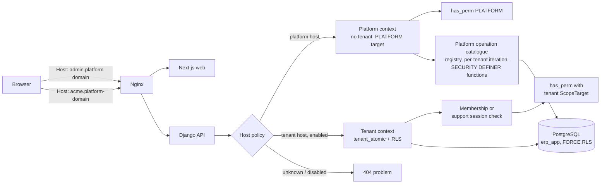
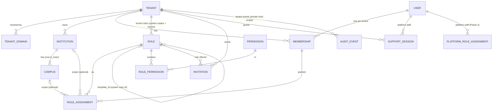

# Phase 3 Implementation Plan — Multi-Tenant Architecture & Tenant Isolation

- **Status:** **Approved — revision 3.** The owner gave final approval on 2026-11-08 to the plan and to ADR-041 to ADR-047 (all **Accepted**), including decisions D1–D9.
  - Approval history:
    - Q1–Q12 approved in principle (rev. 1 review);
    - ADR-041 to ADR-047 approved in principle and D1–D9 decided (rev. 2 review);
    - final approval of rev. 3.
  - Merged into `main` in PR #16 (`75bb2c5`).
  - Implementation branch: `feat/phase-03-tenancy`.
  - **Implementation (M1 onwards) starts only when the owner explicitly authorizes it.**
- **Prepared on:** `main` at `2d61e83` (Phase 2 merged; Phases 0–2 Approved).
- **Roadmap reference:** `DEVELOPMENT_ROADMAP.md` → Phase 3 ("SaaS tenants, institutions & campuses").
- **Governing decisions (Accepted):**
  - ADR-009: shared schema + `tenant_id` + RLS, transaction-scoped context.
  - ADR-010: Tenant → Institution → Campus; limits.
  - ADR-011: host-only session cookies.
  - ADR-012: UUIDv7.
  - ADR-032: memberships with RLS in Phase 3; no rewrite of Phase 2.
  - ADR-033: own RBAC tables.
  - ADR-034: tokens.
  - ADR-035: MFA and step-up.
  - ADR-036: IP privacy.
  - ADR-040: security-review hardening; Phase 3 host prerequisite I2.
- **Decisions proposed by this plan:** ADR-041 to ADR-047 (§16). ADR-043 **amends ADR-009 §5**; the clause-by-clause reconciliation is in §6.1.
- **Decisions D1–D9:** decided by the owner (§17.2). **Still open:** §17.3 (none block implementation; the production domain and the security review block enabling tenant hosts in production).
- **Naming note:** the brief refers to `docs/ROADMAP.md` and `docs/DATABASE.md`. In this repository they are `docs/DEVELOPMENT_ROADMAP.md` and `docs/DATABASE_DESIGN.md`.

### Revision 3 — owner decisions D1–D9 and final documentation requirements

| Item | Owner decision / requirement | Where |
|---|---|---|
| D1 | Defer the production domain; use a documented placeholder; tenant hosts stay disabled until the owner provides the domain **and** approves the security review | §10.2, §10.3, §17.2 |
| D2 | Suspended tenant: no emergency bypass. The tenant owner may sign in **only** to review and approve support access. No suspended-tenant business data is exposed to platform staff | §4.3, §11.3 |
| D3 | No browsing of tenant audit events from the platform host; only through an approved, audited, tenant-scoped support session | §5.1, §6.3 P11 |
| D4 | Start with `CONN_MAX_AGE = 0` and transaction-safe connection handling; measure in M3. Any later persistent-connection setting requires leak tests | §2, §8.6 |
| D5 | Only the tenant owner may disable support approval, with step-up and an immutable audit event. Sessions stay time-limited, visible and revocable | §11.1 |
| D6 | Break-glass deferred to Phase 18. No `erp_platform` login and no emergency access in Phase 3; any future capability needs a new ADR and approval | §6.2, §6.5 |
| D7 | Generic authentication error that reveals nothing about the email or account | §10.5 |
| D8 | No cross-tenant platform lists in the Phase 3 MVP; only the approved tenant-by-tenant mechanisms | §6.3 |
| D9 | Initial targets: lock wait 5 s, warning 2 s, ≤ 20% p95 overhead attributable to tenant isolation. These are engineering thresholds, not guarantees; environment and methodology documented | §8.4 |
| Final 3 | ADR-009 stays Accepted; its amendment is documented accurately | §6.1, ADR-009 note, ADR-043 |
| Final 4–7 | Definer threat models and tests; no silent RLS bypass by platform operations; isolated transaction-scoped context for every request and task; support sessions can't bypass isolation | §23 (approval-gate checklist) |
| Final 8 | Tenant hosts disabled until domain + security review are approved | §10.2, §23 |

### Revision 2 — what changed and where (owner's additional requirements)

| # | Owner requirement | Where |
|---|---|---|
| 1 | Reconcile ADR-043 with accepted ADR-009 | §6.1 (clause table), §6.2 (`erp_platform` disposition), ADR-043 |
| 2 | Explain precisely how platform operations work without runtime BYPASSRLS | §6.3 (complete operation catalogue P1–P16), §6.4 (`platform_scope` contract), §6.5 (maintenance and break-glass) |
| 3 | Threat-model every `SECURITY DEFINER` function | §7 |
| 4 | Verify that tenant context cannot leak between requests or Celery tasks | §8.5 (leak-verification matrix L1–L10, C1–C10) |
| 5 | Verify transaction rollback behaviour, including durable security auditing | §8.3 (rollback and durable-audit matrix, tests R1–R9) |
| 6 | Clarify host resolution when tenant domains are disabled | §10.1 (decision table), §10.2 (disabled-mode behaviour), §10.3 (placeholder domain) |
| 7 | Ensure PostgreSQL enforces cross-tenant composite foreign keys | §4.4 |
| 8 | Preserve Phase 2 RBAC compatibility without circular imports | §9.1–§9.2 (import architecture, contracts, migration graph) |
| 9 | Concurrency tests for requests of different tenants | §15.3 (K1–K8) |
| 10 | Support sessions cannot silently bypass tenant RLS | §11.2 (S1–S9) |
| Q7 | Performance safeguards | §8.4 |
| Q10 | Justification and access-control tests for each registry exception | §5.2 |
| Q11 | Minimum file-storage infrastructure only | §1, §8.7 |

---

## 1. Goal and scope

Turn the Phase 2 platform (users, platform roles, audit) into a **multi-tenant SaaS**:

1. **Tenancy model:** tenants, institutions, campuses, tenant domains, lifecycle states. Institution and campus limits default to 1 institution and 3 campuses per tenant, are configurable, and can be overridden by a Super Admin (ADR-010, Q12).
2. **People in tenants:**
   - one global `User`;
   - one tenant **Membership** per (tenant, user);
   - **scoped RoleAssignments** at tenant, institution or campus scope;
   - **invitations**.

   One person can be a teacher at School A, a department admin at University B and a parent at Madrasa C with **one account**. No user is required to belong to more than one institution.
3. **Isolation primitives (ADR-009):**
   - `TenantScopedModel` with a fail-closed manager;
   - `tenant_atomic()` with a transaction-local `app.tenant_id`, plus a query guard;
   - RLS (`ENABLE` + `FORCE`) on every tenant table, and dual-scope policies for the Phase 2 platform/tenant tables;
   - Celery tenant tasks;
   - tenant-prefixed cache and storage keys.
4. **Tenant context resolution:** server-side, from the request host only (ADR-041). There is one subdomain per tenant (Q1).
   - Tenant hosts stay **disabled** until resolution and isolation tests pass **and** the owner supplies the production domain (ADR-040 I2, Q9).
5. **Platform operations without runtime BYPASSRLS (ADR-043):** every platform capability is delivered through a catalogued, explicitly authorized and audited mechanism (§6).
6. **Tenant-aware RBAC:**
   - `TenantMembershipSource` and `SupportSessionSource` plug into the Phase 2 engine **without changing it** (ADR-032 condition).
   - Permission caches are scoped per tenant, and revocation takes effect immediately.
   - Built-in role templates are read-only; tenants customise by cloning (Q5).
7. **Support access:** explicit, time-limited (≤ 2 h), read-only and audited support sessions. **Tenant approval is required by default** (Q4). Sessions are visible to the tenant and revocable, and they never bypass RLS (§11).
8. **APIs and screens:**
   - tenant administration: institutions, campuses, members, invitations, roles, assignments, support access, settings, tenant audit log;
   - the Super Admin tenant console;
   - "My institutions" for multi-tenant users;
   - a **separate sign-in per tenant host** (Q2), with the architecture kept open for single sign-on (§10.5).
9. **Assurance:**
   - a shared isolation test suite and raw-SQL RLS tests as `erp_app`;
   - composite-foreign-key integrity tests;
   - concurrency, rollback and leakage tests;
   - CI enforcement of RLS coverage and of the registry allow-list;
   - security monitoring of blocked cross-tenant attempts.

**Out of scope (later phases):**

| Item | Where it goes |
|---|---|
| Plans, subscriptions, entitlements | Phase 4. Limits are stored on the tenant until then |
| Customization Studio and preset content | Phase 5 |
| Self-service tenant sign-up | Phase 4/5 (Q6) |
| Custom domains with TLS | ADR-027, Phase 18 |
| Cross-host single sign-on | Later ADR (Q2) |
| Domain records (students, staff) | Phase 6+ |
| The full `files` module (uploads, presigned URLs, virus scanning, quotas) | Phase 6/7 (Q11). Phase 3 delivers **only** the tenant storage-key helper (§8.7); no upload endpoint and no logo upload (branding is name and colours only) |
| Tenant export and purge | Phase 18 |

## 2. Current state (verified on `main` at `2d61e83`)

| Item | State | Phase 3 impact |
|---|---|---|
| `rbac.engine` | `ScopeTarget(tenant, institution, campus)`, `ScopeGrant.covers()`, pluggable `RBAC_PERMISSION_SOURCES` (loaded from settings strings), versioned cache (random token, ADR-040 L3) | Add tenant sources; tenant-prefixed cache keys; **no engine rewrite** |
| `rbac.middleware.ScopeTargetMiddleware` | Every request → `PLATFORM` (any allowed host) | **Replaced** by tenant resolution (ADR-041) |
| `rbac_role`, `rbac_rolepermission`, `audit_auditevent` | `tenant_id` nullable; all rows NULL today; tenant-sync trigger on role permissions | Dual-scope RLS policies (designed in Phase 2 plan §4.6; prototype tested) |
| `audit_auditeventip` | No `tenant_id`; integrity triggers (ADR-040 L4) | Add a `tenant_id` mirror and a dual-scope policy |
| `audit.anonymize_expired_ips` (Celery beat) | Runs over **all** audit IP rows with no context | Under the new RLS it would see only platform rows → **rewritten as a catalogued platform operation** (§6.3 P10) |
| `identity_*` | Platform (user-owned) tables; `SessionRecord.host` stored | Unchanged; per-host sessions identify tenant sessions |
| DB roles (`infra/docker/postgres/01-roles.sh`) | `erp_owner` (migrations, `NOBYPASSRLS`), `erp_app` (`NOBYPASSRLS`, `NOINHERIT`, DML, `statement_timeout = 30s`, `idle_in_transaction_session_timeout = 60s`), `erp_platform` (`BYPASSRLS`, `NOLOGIN`, no members) | `erp_platform` **kept unchanged and unused** (ADR-043, §6.2) |
| Tests | Created as the owner, then **run as `erp_app`** (`conftest.py`); `CONN_MAX_AGE = 0` | Isolation tests run as `erp_app`; concurrency tests use `CONN_MAX_AGE > 0` explicitly |
| Server | Production image: Gunicorn + Uvicorn workers (**ASGI**); all views are sync; `CONN_MAX_AGE = 60` (default) | **D4:** default changes to `CONN_MAX_AGE = 0` in M3; measured, and any later persistent setting is gated by leak tests (§8.6) |
| Requests | Autocommit; `ATOMIC_REQUESTS = False` (the explicit wrapper is the single entry point) | Request-scoped tenant transaction on tenant hosts (ADR-042) |
| Error handler | `problem_details_exception_handler` without `set_rollback()` | Tenant requests roll back on error; security audit survives (durable audit, §8.3) |
| Sessions | `cached_db` (dev/prod), `db` (tests); `django_session` is a framework table | Session save runs **after** the tenant transaction, without tenant context (§8.2) |
| Hosts | Dev `ALLOWED_HOSTS` includes `.localhost`, so **any** `*.localhost` host is served as the platform host today; health checks call `127.0.0.1:8000/healthz` | Explicit platform hosts; unknown hosts get 404 (ADR-041); health endpoints don't depend on the host (§10.1) |
| Celery | `acks_late`, prefetch 1, JSON only; tasks `core.ping`, `identity.deliver_security_email`, `identity.housekeeping`, `audit.anonymize_expired_ips` | Tasks are declared platform tasks or `TenantTask` (§8.5) |
| Import contracts | 5 import-linter contracts (core independent; rbac core ↛ identity; identity models ↛ rbac/audit; audit core ↛ identity; UUID library only through `core.ids`) | Extended for `tenancy` (§9.1) |

Phase 2 tests (286 backend, 31 E2E) and CI (8 jobs) must stay green throughout.

## 3. Architecture overview



- **Platform host** (`admin.<platform-domain>`; dev `localhost`):
  - serves the Super Admin console, platform users and "My institutions";
  - has no tenant context, so every standard tenant table is invisible (fail closed);
  - reaches tenant-related data **only** through the catalogue in §6.3.
- **Tenant host** (`{slug}.<platform-domain>`; dev `{slug}.localhost`):
  - serves everything tenant-owned;
  - takes the tenant **only** from the host;
  - has its own session (host-only cookies, ADR-011/040), so tenants never share a session or CSRF cookie.
- One `User` account signs in separately to each tenant host it belongs to (Q2).

## 4. Domain model

### 4.1 Entities

| Model | Table | Kind | Key fields | Constraints |
|---|---|---|---|---|
| `Tenant` | `tenancy_tenant` | **Platform registry with self-scoping policy** (§5.1) | `id`, `slug` (immutable), `name`, `status` (`provisioning`/`active`/`suspended`/`offboarding`/`deleted`), `default_locale`, `locales[]`, `timezone`, `currency`, `country`, `data_region`, `limits` JSONB (`max_institutions`, `max_campuses`; defaults from `TENANT_DEFAULT_LIMITS`, Q12), `limits_overridden_by/at/reason`, `settings` JSONB (`support_access_requires_approval` default `true`, …), `branding` JSONB (name and colours only in Phase 3) | `UNIQUE(slug)`; slug `^[a-z][a-z0-9-]{1,30}[a-z0-9]$`, not in the reserved list, never reused (tombstones) |
| `TenantDomain` | `tenancy_tenantdomain` | Tenant-owned, RLS | `tenant_id`, `domain` (lower-case FQDN), `kind` (`subdomain`; `custom` later), `is_primary`, `verified_at` | `UNIQUE(domain)` (global by design, §4.4); one primary per tenant |
| `Institution` | `tenancy_institution` | Tenant-owned, RLS | `tenant_id`, `institution_type` (6 codes, CLAUDE.md §3), `code`, `name`, `name_i18n`, `preset_code`, `preset_version`, `settings` JSONB, `archived_at` | `UNIQUE(tenant_id, code)`; `UNIQUE(tenant_id, id)` (composite-FK target) |
| `Campus` | `tenancy_campus` | Tenant-owned, RLS | `tenant_id`, `institution_id`, `code`, `name`, `name_i18n`, `address` JSONB, `timezone` (override), `is_main`, `archived_at` | `UNIQUE(tenant_id, institution_id, code)`; one `is_main` per institution (partial unique); `UNIQUE(tenant_id, institution_id, id)` (composite-FK target); composite FK `(tenant_id, institution_id)` → institution |
| `Membership` | `tenancy_membership` | Tenant-owned, RLS | `tenant_id`, `user_id` (FK `identity_user`), `status` (`invited`/`active`/`suspended`/`left`), `invited_by`, `joined_at`, `suspended_at`, `last_seen_at` | `UNIQUE(tenant_id, user_id)`; `UNIQUE(tenant_id, id)` |
| `RoleAssignment` | `rbac_roleassignment` | Tenant-owned, RLS (rbac app, §9.1) | `tenant_id`, `membership_id`, `role_id`, `scope_type` (`tenant`/`institution`/`campus`), `institution_id`, `campus_id`, `valid_from`, `valid_until`, `granted_by`, `reason` | CHECK scope consistency (§4.4); composite FKs to membership, role, institution and campus; no duplicate active (membership, role, scope) |
| `Invitation` | `tenancy_invitation` | Tenant-owned, RLS | `tenant_id`, `email`, `role_id`, `scope_type`, `institution_id`, `campus_id`, `token_hash` (Phase 2 `core.tokens`), `expires_at` (7 days), `accepted_at`, `revoked_at`, `invited_by` | `UNIQUE(token_hash)` (global by design); one open invitation per (tenant, email, role, scope); same composite FKs and scope CHECK as assignments |
| `SupportSession` | `tenancy_supportsession` | Tenant-owned, RLS | `tenant_id`, `staff_user_id`, `reason`, `ticket_ref`, `access_level` (`read_only` only), `status` (`requested`/`approved`/`active`/`ended`/`revoked`/`expired`/`rejected`), `requested_at`, `approved_by`, `starts_at`, `ends_at` (≤ 2 h), `ended_at`, `revoked_by` | CHECK `ends_at - starts_at <= 2 h`; one non-terminal session per (tenant, staff) |
| `Role` (tenant) | `rbac_role` (existing) | Dual-scope | `kind = tenant`, `tenant_id = T`, `template_id` (new, nullable FK to the template), `is_system` | Existing `UNIQUE(tenant_id, code) NULLS NOT DISTINCT`; new `UNIQUE(tenant_id, id)` (composite-FK target) |

- **"Institution membership"** is **derived**, not stored. A member belongs to an institution when they hold an active assignment at that institution, at one of its campuses, or at tenant scope. This keeps one source of truth.
- **Role templates (Q5):**
  - Tenant role templates (Phase 2, `kind = template`, `tenant_id NULL`) are **copied** into each tenant at provisioning as `kind = tenant`, `is_system = true` roles with `template_id` set.
  - System copies are **read-only** for tenants and kept in sync with their template by platform operation P7 (§6.3).
  - Tenants customise by **cloning** a role into a non-system tenant role, which is never synced.

### 4.2 ERD



Example: one account in three tenants.

| User | Tenant | Membership | Assignment |
|---|---|---|---|
| rahim@example.com | School Group A | active | `teacher` @ campus *A-Main* |
| rahim@example.com | University B | active | `academic_coordinator` @ institution *Dept. of Botany* |
| rahim@example.com | Madrasa C | active | `guardian` @ tenant (child links in Phase 7) |

### 4.3 Tenant lifecycle (ADR-010; `MULTI_TENANT_ARCHITECTURE.md` §6)

| Status | Tenant host | Notes |
|---|---|---|
| `provisioning` | 404 | Created by a Super Admin; becomes `active` when the owner invitation is sent |
| `active` | Normal | — |
| `suspended` | Members can't sign in (`403 tenant_suspended`). **Only** a `tenant_owner` may sign in, into a restricted mode limited to reviewing, approving, rejecting and revoking support sessions (D2). Support sessions can't be used while the tenant is suspended, and no business data is exposed to platform staff (§11.3) | Super Admin action with step-up and a reason; audited. Active support sessions are revoked on suspension |
| `offboarding` | Read-only for the tenant owner (export in Phase 18) | — |
| `deleted` | 404; the slug is tombstoned forever | Data purge procedure in Phase 18 |

`trial` and `past_due` arrive with billing in Phase 4.

### 4.4 Composite foreign keys and integrity (owner requirement 7; ADR-044)

**Why composite keys are needed:** PostgreSQL runs referential-integrity checks **without** row-level security. An ordinary `role_id → rbac_role(id)` foreign key would therefore accept a role id belonging to another tenant. A composite key that includes `tenant_id` on both sides makes such a reference impossible in the database, whatever the application does.

1. **Referenced keys:**

   | Table | Unique key |
   |---|---|
   | `tenancy_membership`, `tenancy_institution`, `rbac_role` | `UNIQUE (tenant_id, id)` |
   | `tenancy_campus` | `UNIQUE (tenant_id, institution_id, id)` |

2. **Referencing keys** (all `MATCH SIMPLE`, `ON DELETE RESTRICT`, not deferrable). For example, on `rbac_roleassignment`:
   ```sql
   FOREIGN KEY (tenant_id, membership_id) REFERENCES tenancy_membership (tenant_id, id) ON DELETE RESTRICT
   FOREIGN KEY (tenant_id, role_id)       REFERENCES rbac_role (tenant_id, id)          ON DELETE RESTRICT
   FOREIGN KEY (tenant_id, institution_id) REFERENCES tenancy_institution (tenant_id, id) ON DELETE RESTRICT
   FOREIGN KEY (tenant_id, institution_id, campus_id)
     REFERENCES tenancy_campus (tenant_id, institution_id, id) ON DELETE RESTRICT
   ```
   The same pattern applies to:
   - `tenancy_invitation` (role, institution, campus);
   - `tenancy_campus` → institution;
   - `rbac_role.template_id` → only `kind = template` rows. This is a CHECK plus a trigger, because templates have `tenant_id NULL`.

   A template role (`tenant_id NULL`) can never be assigned directly: `(T, template_id)` matches no row. Assignments always use the tenant's system copy or a clone.
3. **NULL semantics:** `MATCH SIMPLE` skips the check when any referencing column is NULL. The scope CHECK makes the right keys mandatory:
   - `scope_type = 'tenant'` → `institution_id IS NULL AND campus_id IS NULL`;
   - `'institution'` → `institution_id IS NOT NULL AND campus_id IS NULL`;
   - `'campus'` → both `NOT NULL`, so the campus key is always checked, and it also proves the campus belongs to that institution.
4. **No single-column database FK between tenant tables:**
   - Django FK fields that point at tenant tables use `db_constraint=False`, so the composite FK is the only database constraint. Django relations and `on_delete` behaviour still work in Python, and an explicit index is added for each FK column.
   - This also removes an **existence oracle**. With both a single and a composite FK, the error would reveal whether an id exists in another tenant. With only the composite FK, every foreign id fails the same way.
   - The API maps every `23503` (foreign-key violation) on tenant writes to the same `404`/`400` Problem response.
5. **Unique constraints also bypass RLS.** Every unique constraint on a tenant table starts with `tenant_id`, with three justified exceptions:
   - `TenantDomain.domain` (domains are public in DNS anyway);
   - `Invitation.token_hash` (256-bit random input);
   - `Tenant.slug` (registry).

   The CI catalogue check (§5.3) enforces this.
6. Composite keys are created in reviewed `RunSQL` migrations with stable constraint names. The tables are new and empty, so `NOT VALID` / `VALIDATE` is not needed.
7. **Tests:**
   - **Catalogue tests:** every listed constraint exists with the expected columns, match type and delete action. **No** FK from a tenant table to another tenant table omits `tenant_id`.
   - **Raw SQL as `erp_app`** with context A (all must fail with SQLSTATE `23503`):
     - insert an assignment or invitation referencing tenant B's membership, role, institution or campus;
     - a campus of a different institution in the same tenant;
     - a template role id.
   - The same inserts on the **owner** connection under context A also fail with `23503`. This shows the FK, not only RLS, rejects them.
   - Deleting a referenced institution, role or membership while assignments exist fails (`RESTRICT`); the service layer archives instead.
   - The API returns the same Problem response for a foreign id from another tenant and for a random id.
   - **Migration tests:**
     - forward → reverse → forward on a scratch database;
     - `makemigrations --check`;
     - migrating a database that holds Phase 2 data (roles, permissions, audit events) needs no backfill and leaves it unchanged (§19).

## 5. Row-Level Security design (ADR-009, ADR-046)

### 5.1 Policy catalogue

With `ctx := app_tenant_id()`, a `STABLE` SQL function returning `NULLIF(current_setting('app.tenant_id', true), '')::uuid`:

| Class | Tables | Policies |
|---|---|---|
| **Standard tenant table** | `tenancy_tenantdomain`, `tenancy_institution`, `tenancy_campus`, `tenancy_membership`, `tenancy_invitation`, `tenancy_supportsession`, `rbac_roleassignment` (and every later tenant table) | `ENABLE` + `FORCE`; per-command policies `USING (tenant_id = ctx)` / `WITH CHECK (tenant_id = ctx)`. No context → no rows, no writes |
| **Dual-scope (platform and tenant rows)** | `rbac_role`, `rbac_rolepermission` | Read `USING (tenant_id IS NULL OR tenant_id = ctx)`; write `WITH CHECK (tenant_id IS NOT DISTINCT FROM ctx)`. A tenant context can't modify templates; the platform context can't modify tenant rows |
| **Dual-scope, private** | `audit_auditevent`, `audit_auditeventip` | Read and insert `tenant_id IS NOT DISTINCT FROM ctx`. Platform events are invisible on tenant hosts and tenant events are invisible on the platform host (D3). Existing grants and immutability triggers are unchanged |
| **Registry, self-scoped** | `tenancy_tenant` | `ENABLE` + `FORCE`; `USING (ctx IS NULL OR id = ctx)`, `WITH CHECK (ctx IS NULL OR id = ctx)`. In a tenant context, only that tenant's own registry row is visible, so a bug on a tenant host can't list other customers. Without a tenant context (the platform), the whole registry is visible: that is its purpose |
| **Registry, no RLS (allow-list)** | §5.2 | Application-layer authorization and the access-control tests listed in §5.2 |

- Policies are written per command (`FOR SELECT`, `FOR INSERT`, `FOR UPDATE`, `FOR DELETE`). Because `WITH CHECK` applies to the new row, an `UPDATE` can't move a row to another tenant, and a tenant context can't touch platform rows.
- `FORCE` makes the table owner (`erp_owner`) subject to the policies too. Migrations that must touch tenant rows run per tenant under `tenant_atomic` (§6.5); RLS is never disabled.

### 5.2 Registry tables without RLS: allow-list with justification and access-control tests (Q10)

Each exception lives in `tests/isolation/registry_allowlist.py` as (table, justification, access-control test ids). CI fails when:
- a table without RLS is missing from the list;
- an entry's justification is empty;
- a referenced test doesn't exist.

| Table(s) | Why there is no `tenant_id`/RLS | Access control (application layer) | Access-control tests |
|---|---|---|---|
| `identity_user` | One global account per person (CLAUDE.md §9, ADR-032). Needed before any tenant context (sign-in) | Own-account endpoints; platform user admin (`identity.user.*`, platform scope). Tenant endpoints expose members only through memberships (RLS) and only `id`, `email`, `display_name`. No user search on tenant hosts; invitations don't reveal whether an account exists | Member list never contains users without a membership in the tenant; tenant admin can't read or change a non-member user; invitation responses identical for existing and new emails |
| `identity_accounttoken`, `identity_mfadevice`, `identity_recoverycode`, `identity_sessionrecord`, `identity_seendevice` | Per-user security data, independent of tenants (Phase 2) | Own account, or platform permission with the privileged-target rule (ADR-040 H2). No tenant endpoint reads them in Phase 3 | Tenant admin has no route to another user's MFA, sessions or tokens (URL audit plus denial tests); session listing shows only the caller's sessions across hosts |
| `rbac_permission` | Global, code-defined permission catalogue; needed by every tenant | Read-only through the API; written only by `sync_permissions`. Phase 3 narrows `erp_app` to `SELECT` if the M1 inspection confirms nothing else writes it | No endpoint creates or changes permissions; the `erp_app` grant test (SELECT only) |
| `rbac_platformroleassignment` | Platform staff roles; no tenant meaning | Platform permissions only. `PlatformRoleSource` grants nothing for tenant targets | Super Admin on a tenant host without a support session → 403 on every tenant endpoint |
| `django_session` | Framework session store, keyed by a random session key; sessions are host-bound | Never queried by application code; the middleware rejects a session whose `SessionRecord.host` ≠ request host | Session from host A replayed on host B → anonymous |
| `django_migrations` | Framework (already `SELECT` only for `erp_app`, Phase 2) | — | Existing grant test |
| `django_content_type`, `auth_permission`, `auth_group`, `auth_group_permissions`, `identity_user_groups`, `identity_user_user_permissions` | Framework tables, unused for authorization (ADR-033) | No endpoint; grants narrowed to `SELECT` where the app never writes (decided in M1 after inspection) | Grant tests; URL audit shows no route |

`tenancy_tenant` is **not** on this list: it has the self-scoping policy in §5.1. Its own tests check that a tenant host reads only its own row (raw SQL as `erp_app` under context A sees one row), that the platform list requires `tenancy.tenant.view_any`, and that non-staff platform users get 403.

### 5.3 Migration helpers and CI enforcement

- `core.db_operations.EnableTenantRLS(table)` and `EnableDualScopeRLS(table, private=bool)` are reversible operations that `ENABLE`/`FORCE` RLS and create the policies (named `tenant_isolation_*`). They extend the existing `RestrictTableGrants` file.
- Reversing an isolation migration is **refused in production and staging** (same guard as ADR-040 I1). In dev and CI it requires `ERP_ALLOW_ISOLATION_ROLLBACK=true`.
- **CI catalogue check** (`tests/isolation/test_rls_coverage.py`, on the migrated test database) fails when:
  1. a table with a `tenant_id` column lacks `relrowsecurity` **and** `relforcerowsecurity` and at least one policy per command;
  2. a dual-scope or self-scoped table is not on its explicit list or has the wrong policy shape;
  3. a table without RLS is not on the §5.2 allow-list, or its entry lacks a justification or tests;
  4. a concrete model with a `tenant_id` field doesn't inherit `TenantScopedModel` (or a reviewed dual-scope base);
  5. an FK between two tenant tables doesn't include `tenant_id` on both sides, or a unique constraint on a tenant table doesn't start with `tenant_id` and isn't on the exception list (§4.4);
  6. a `SECURITY DEFINER` function isn't on the §7 list, lacks a pinned `search_path`, is executable by `PUBLIC`, isn't owned by `erp_owner`, or is not `STABLE`;
  7. any role other than `erp_platform` has `rolbypassrls`, `erp_platform` can log in, or `erp_platform` has members (§6.2).
- **Static check:** a test searches the backend for `set_config('app.tenant_id'` with `false`, `SET app.tenant_id`, `SET SESSION`, `SET ROLE` and `RESET ROLE`, and fails on any match.

### 5.4 What RLS protects against, and what it doesn't

- RLS against `erp_app` protects against **application bugs**:
  - a missing filter;
  - a query in the wrong context;
  - a new table without scoping;
  - a foreign id in a request.
- It is **not** a boundary against an attacker who can run arbitrary SQL as `erp_app`. Any role can call `set_config('app.tenant_id', …)`, so such an attacker can select any tenant.
- Controls against that threat:
  - parameterised ORM queries, with no dynamic SQL from input;
  - least-privilege grants;
  - no `BYPASSRLS` credential at runtime (ADR-043), so even full compromise of `erp_app` can't read audit-protected data or change DDL;
  - secret isolation from the owner role (ADR-040 H3).

  This is why ADR-043 matters: a runtime `BYPASSRLS` login would turn any SQL injection into unscoped access with no policy at all.

## 6. Platform-level database operations without runtime BYPASSRLS (ADR-043)

### 6.1 Reconciliation with ADR-009 (owner requirement 1)

ADR-009 stays **Accepted**. ADR-043 amends **only §5's third bullet**. Accepted ADR text is never rewritten (decision-log rule). On acceptance, an append-only status note "§5 amended by ADR-043" is added under ADR-009.

| ADR-009 clause | Effect of ADR-043 |
|---|---|
| §1 Shared schema; `tenant_id NOT NULL` on tenant tables; `TenantScopedModel` | **Unchanged.** Clarified:<ul><li>the Phase 2 dual-scope tables (nullable `tenant_id`, ADR-033) and registry tables are listed exceptions (ADR-046);</li><li>`tenancy_tenant` has no `tenant_id` but is self-scoped.</li></ul> |
| §2 Fail-closed `TenantManager`; platform-wide access only through the explicit, audited `platform_scope(reason=…)` | **Unchanged contract.** `platform_scope` stays the **only** entry point for platform code that needs tenant-related data. Its implementation (§6.4) gives access through the catalogue in §6.3 instead of a `BYPASSRLS` connection |
| §3 RLS `ENABLE` + `FORCE` + policy on `app.tenant_id`; fail closed | **Unchanged** for standard tables; extended by ADR-046 (dual-scope, self-scoped registry) |
| §4 Transaction-scoped context; `tenant_atomic`; guard; transaction-pooling compatible | **Unchanged**; detailed by ADR-042 |
| §5 `erp_owner` owns and migrates | **Unchanged** |
| §5 `erp_app` runtime role, `NOBYPASSRLS`, DML only; audit INSERT/SELECT only | **Unchanged** |
| §5 "`erp_platform` is a restricted `BYPASSRLS` role used only by `platform_scope()` code paths" | **Amended:** `erp_platform` stays provisioned exactly as today (`NOLOGIN`, `BYPASSRLS`, no members, no grants to it). It is **not used by any runtime or maintenance code path**. It is reserved for a future, separately approved break-glass procedure (D6). Nothing that exists today is removed |
| §5 Tests and app connect as `erp_app` | **Unchanged** |
| §6 CI isolation tests and RLS coverage check | **Unchanged**; extended by ADR-046 (§5.3) |
| §7 Database-per-tenant as a future option | **Unchanged** |
| Consequence: "Raw SQL must run inside `tenant_atomic` or `platform_scope`" | **Unchanged** |

The `CLAUDE.md` §10 item 3 wording ("Unscoped access is only possible through an explicit, audited `platform_scope()` context used by platform code") **remains true**. On acceptance, the words "(through the platform operation catalogue; no `BYPASSRLS` at runtime, ADR-043)" are added there, with a change note.

The `01-roles.sh` comment ("Login is disabled until Phase 3 enables and wires it") is corrected in M1. That is an infrastructure file and is not touched in this documentation PR.

### 6.2 What happens to `erp_platform` (no capability removed)

| Property | Today | After Phase 3 |
|---|---|---|
| Exists | Yes | Yes (unchanged) |
| `BYPASSRLS` | Yes | Yes (unchanged) |
| `LOGIN` | No | No (unchanged; CI-asserted) |
| Members (`GRANT erp_platform TO …`) | None | None (CI-asserted: `erp_owner`/`erp_app` can't `SET ROLE` to it) |
| Used by code | No | No (static check: no `SET ROLE`) |

The capability "read across tenants in one query" was planned for `erp_platform` but never implemented or used. In Phase 3 every platform need it was meant for is replaced by a specific, narrower mechanism (§6.3). The role stays available, so a future break-glass ADR can enable it with its own controls (D6) without a schema change.

### 6.3 Platform operation catalogue (complete for Phase 3 and inherited Phase 2 duties)

Mechanisms:

| Mechanism | Meaning |
|---|---|
| **R** — registry | Read or write `tenancy_tenant` or §5.2 tables only |
| **T** — targeted tenant transaction | Open `tenant_atomic(t)` for **one** explicitly named tenant, on behalf of an authorized platform actor |
| **I** — per-tenant iteration | Loop over the registry, one `tenant_atomic(t)` per tenant, each failure isolated |
| **D** — `SECURITY DEFINER` function | Only the functions in §7 |

| # | Operation | Trigger / actor | Authorization | Mechanism | Audit |
|---|---|---|---|---|---|
| P1 | Resolve the request host to a tenant | Every tenant-host request (anonymous allowed) | Host policy (§10) | **D** `tenancy_resolve_host` | Rejections counted (`tenancy.host.rejected`, sampled log) |
| P2 | "My institutions" for the signed-in user | Platform host, `GET /me/memberships/` | Own account only (wrapper passes `request.user.id`) | **D** `tenancy_memberships_of` | None (own data) |
| P3 | Sign-in and membership check on a tenant host | Tenant host | Credentials plus active membership or active support session | Ordinary tenant transaction (RLS); no platform mechanism | Failed sign-ins: durable audit (§8.3) |
| P4 | Provision a tenant | Super Admin, `POST /platform/tenants/` | `tenancy.tenant.create`, MFA; refused while tenant hosts are disabled in production (§10.2) | **R** insert tenant → **T** domain, first institution, main campus, system role copies, owner invitation (one transaction per step group; compensating cleanup marks the tenant `deleted` on failure) | Platform log + tenant log |
| P5 | Read or update registry fields, suspend, reactivate, override limits | Super Admin | `tenancy.tenant.view_any` / `update_any` / `suspend`, `tenancy.limit.override` (MFA, step-up, reason) | **R** (+ **T** to write the tenant's audit event and, on suspension, revoke active support sessions (D2); host-bound session revocation uses identity tables, **R**) | Platform log + tenant log |
| P6 | Request, end or list own support sessions | Platform staff | `tenancy.support_session.request` (MFA, step-up) | **T** to insert or update the session in that tenant; **D** `tenancy_support_sessions_of` for the caller's own list | Platform log + tenant log |
| P7 | Sync tenant system role copies after template changes (Q5) | `seed_roles` (migrate step) / deploy | Operator (deploy pipeline) | **I**: per tenant, update the system copies of changed templates; idempotent; bumps the tenant cache version | One platform event per run, with a per-tenant result count |
| P8 | Platform dashboard counts (tenants by status, limits) | Super Admin | `tenancy.tenant.view_any` | **R** only (registry fields). **D8:** no cross-tenant lists of tenant-owned data (no per-tenant member counts, no all-staff support-session list) in the Phase 3 MVP | None |
| P9 | Account deactivation, MFA reset, session revocation (Phase 2) | Platform admin | Phase 2 permissions + privileged-target rule | **R** (identity tables); memberships unchanged (a deactivated user can't sign in anywhere) | Platform log |
| P10 | Anonymise expired security-event IPs (ADR-036) | Celery beat, platform task | System | Platform rows in the platform context **+ I** over tenants for tenant rows. Replaces today's single context-free pass, which would see only platform rows under the new RLS | One platform event per run with counts |
| P11 | Security investigation of a tenant's audit log | Platform staff | Support session (read-only, tenant-approved, §11) | **T** via the tenant host only. **D3:** platform staff can't browse tenant audit events from the platform host | Tenant log (every request) + platform log |
| P12 | Security-email delivery, identity housekeeping, `core.ping` | Celery | System | **R** (identity) / none; declared `platform_task` | Existing |
| P13 | Data migrations that touch tenant rows | Migration (`erp_owner`) | Code review | **I**: helper `for_each_tenant(apps, schema_editor, fn)` opens `tenant_atomic` per tenant on the owner connection (RLS forced on the owner too) | Migration log |
| P14 | Cross-tenant isolation monitoring | Platform | System | Guard and host-policy events are recorded in the **platform** log with the tenant id as metadata (no tenant data) | Platform log |
| P15 | Tenant export and purge | Phase 18 | — | Planned as **I**/**T**; purge of append-only audit data needs its own ADR | — |
| P16 | Incident break-glass (corruption, forensic cross-tenant query) | — | **Not in Phase 3 (D6).** Deferred to Phase 18; a new ADR and explicit owner approval are required | None; `erp_platform` stays `NOLOGIN` and reserved | Procedure log (Phase 18 runbook) |

**Completeness gate (acceptance criterion):**
- Every code path that touched tenant-related data before Phase 3 appears in this table. P10 is the only Phase 2 task affected.
- Every platform endpoint in §12.2 maps to a row.
- A CI test lists Celery tasks and platform-host views and fails if one isn't mapped to a catalogue entry (`@platform_operation("P10")` declaration).

### 6.4 `platform_scope` contract

```python
with platform_scope(operation="P4", actor=request.user, reason="provision tenant acme"):
    tenant = tenancy_services.create_tenant_registry_row(...)          # R
    with tenant_atomic(tenant):                                         # T (explicit tenant)
        tenancy_services.provision_tenant_contents(tenant, ...)
```

- `operation` must be a catalogue id. Unknown ids raise.
- The actor's permission for that operation is checked again inside (`require_perm`, `use_cache=False`), in addition to the view.
- `platform_scope` refuses to start while a tenant context is active (`TenantContextConflict`). It **never** sets `app.tenant_id`, disables RLS or changes roles.
- Inside it, `tenant_atomic(t)` may be opened for an explicitly passed tenant (mechanism **T**) or in a loop (**I**). Each block is a separate transaction, so one tenant's failure can't affect another's data.
- Start, end, outcome, operation id, actor, reason and (for **T**/**I**) the affected tenant ids are written to the platform audit log. **T** also writes a tenant-log event in the same tenant transaction.
- System actors (Celery, migrations) use `platform_scope(operation=…, actor=SYSTEM, reason=…)`.

### 6.5 Maintenance, migrations and break-glass

- **Migrations** run as `erp_owner`, which is also subject to `FORCE` RLS. Schema changes don't need row visibility. Data changes use P13 per-tenant iteration.
- **Owner-role management commands** (Phase 2 `require_owner_role`: key rotation, index rebuild) touch identity and audit tables:
  - for **platform** rows: no tenant context;
  - for **tenant** audit rows: per-tenant iteration (P13 helper).

  Key rotation of encrypted IPs therefore covers every tenant's rows explicitly; its test asserts that the rotated count equals the total.
- **Break-glass (D6, owner decision):** **not built in Phase 3.** No `erp_platform` login and no emergency bypass access. It is deferred to Phase 18 and requires a new ADR and explicit owner approval. The outline below is only a starting point for that ADR:
  - a database administrator would act in a maintenance window under a written procedure (two people, ticket, session log);
  - granting `LOGIN` to `erp_platform` would need a new ADR.

## 7. `SECURITY DEFINER` functions: threat model (owner requirement 3)

**Common controls (all functions):**
- **Ownership:** owned by `erp_owner`, a non-superuser with `NOBYPASSRLS`. These functions run **with the owner's rights, which are still subject to `FORCE` RLS**. They never call `set_config` and never change roles. The rows they can read are defined by owner-only `SELECT` policies (see the note below) together with their own explicit predicates.
- **`search_path`:** `SET search_path = pg_catalog, public, pg_temp` (with `pg_temp` last), and every reference is schema-qualified (`public.tenancy_…`).
- **Code:** `LANGUAGE sql`, `STABLE`, `PARALLEL SAFE`; no dynamic SQL, no writes, no `set_config`.
- **Execute grants:** `REVOKE EXECUTE … FROM PUBLIC`; `GRANT EXECUTE … TO erp_app` only.
- **Inputs:** validated in SQL (lengths, formats) **and** in Python before the call. Only minimal columns are returned.
- **Python wrappers:** each function is called only from a single wrapper in `apps.tenancy.selectors.platform`. An import-linter contract and a static check forbid other callers.
- **Review:** each function needs owner review in the PR and is covered by the CI catalogue check (§5.3 #6).

> **Note on `FORCE` RLS and definer functions:** the definer runs as `erp_owner`, and `FORCE` RLS applies to the owner. A definer function therefore **can't** see tenant rows of RLS tables without a context. Two designs were considered:
> - **(a)** each function wraps its query in a policy-compatible way. Rejected: it would require `set_config` inside the function, which is a context-switching primitive.
> - **(b)** the tables these functions read get one additional, narrowly scoped **policy for the owner role only**, restricted to the needed rows and columns. Chosen. The policies are `CREATE POLICY definer_resolve ON tenancy_tenantdomain FOR SELECT TO erp_owner USING (verified_at IS NOT NULL)`, and similarly for memberships and support sessions. PostgreSQL combines permissive policies with OR **per role**, so these policies **don't apply to `erp_app`** at all.
>
> **Side effect on migrations:** migrations, which run as `erp_owner`, could also read those row subsets. They are reviewed code and need that visibility rarely; data migrations still use P13.
>
> The CI check verifies that every `TO erp_owner` policy is on the list below and that **no** owner policy grants `INSERT`/`UPDATE`/`DELETE`.

### F1 `tenancy_resolve_host(p_host text) → TABLE(tenant_id uuid, status text)`

| Aspect | Design |
|---|---|
| Purpose | Map a request host to a tenant **before** any context exists (P1) |
| Reads | `tenancy_tenantdomain` (verified domains only) join `tenancy_tenant` |
| Returns | At most one row, only for tenants in `active`, `suspended` or `offboarding`. `provisioning`/`deleted`/unknown → no row, so the caller can't tell them apart (uniform 404) |
| Input validation | `p_host` lower-case, ≤ 253 chars, matches the LDH hostname regex, no trailing dot, no IP literal (checked in Python and SQL) |
| Spoofing | The host header is attacker-controlled, but the result only **selects** a tenant. Access still requires a session for that exact host (host-only cookies, `SessionRecord.host` check) **and** a membership or support session found under RLS in that tenant. A spoofed host gives an attacker a tenant context with no rights in it |
| Tampering | Read-only (`STABLE`, SQL only); no write path |
| Information disclosure | Reveals only whether a host is an active tenant, which DNS reveals anyway. Responses for unknown, provisioning and deleted hosts are identical (body; timing within one indexed lookup). The tenant id is never returned to the client |
| Denial of service | Callable per anonymous request → unique index on `domain`, one indexed lookup, `statement_timeout`; Nginx rate limits (Phase 19). No caching in Phase 3, so suspension is effective immediately |
| Elevation | Pinned `search_path`, no dynamic SQL, owner is not a superuser, `EXECUTE` only for `erp_app` |
| Tests | Uniform result for unknown, provisioning and deleted hosts; invalid hosts rejected before the call; `PUBLIC` can't execute; returns no columns other than the two; `search_path` hijack attempt (a function created in `pg_temp` with the same name) has no effect |

### F2 `tenancy_memberships_of(p_user uuid) → TABLE(tenant_id uuid, slug text, name text, tenant_status text, membership_status text)`

| Aspect | Design |
|---|---|
| Purpose | "My institutions" on the platform host (P2) |
| Reads | `tenancy_membership` where `user_id = p_user` and status in (`invited`, `active`, `suspended`), joined to `tenancy_tenant` with status in (`active`, `suspended`, `offboarding`) |
| Returns | Only the five columns; no roles, no other members |
| Spoofing / wrong user | The Python wrapper takes the user from `request.user` (no parameter in the API), so passing another user's id would be an application bug |
| Information disclosure | A compromised `erp_app` could list any user's tenants. That same attacker could already `set_config` per tenant and read memberships (§5.4), so the function adds **no new privilege**; it adds risk only for application bugs. Mitigated by the single wrapper, the import contract and tests |
| Tampering / elevation | As F1 |
| Tests | Endpoint returns only the caller's memberships; another user's id is not accepted by any API; `left` memberships and `provisioning`/`deleted` tenants excluded; exact column set; `PUBLIC` can't execute |

### F3 `tenancy_support_sessions_of(p_staff uuid) → TABLE(session_id uuid, tenant_id uuid, tenant_slug text, status text, starts_at timestamptz, ends_at timestamptz)`

| Aspect | Design |
|---|---|
| Purpose | Platform staff see **their own** support sessions across tenants (P6) |
| Reads | `tenancy_supportsession` where `staff_user_id = p_staff`, joined to the tenant slug |
| Returns | Session metadata only: no reason text from the tenant, no approver identity, no tenant data |
| Spoofing | Wrapper uses `request.user`; only users with `tenancy.support_session.request` can reach the endpoint |
| Information disclosure | Same reasoning as F2. Listing **all** staff sessions across tenants is not offered (D8) |
| Tampering / elevation | As F1 |
| Tests | Only own sessions; non-staff 403; column set; `PUBLIC` can't execute |

No other `SECURITY DEFINER` functions are allowed. Triggers (the `audit_auditeventip.tenant_id` mirror and the Phase 2 role-permission tenant sync) are `SECURITY INVOKER`: they run as the inserting role under the same tenant context. Their tests prove that they can't copy a `tenant_id` the caller couldn't write.

## 8. Tenant context lifecycle (ADR-042)

### 8.1 Primitives (`apps.core.tenancy`)

| Primitive | Behaviour |
|---|---|
| `TenantContext` | Frozen dataclass: `id`, `slug`, `status`. Stored in a `contextvars.ContextVar` (local to the thread and the asyncio task). `core` never imports the `tenancy` app; the context is built by `apps.tenancy` |
| `current_tenant()` / `require_tenant()` | Return the context or `None` / raise `TenantContextMissing` |
| `tenant_atomic(tenant=None, using="default")` | <ul><li>Opens `transaction.atomic(using)`.</li><li>Its **first statement** is `SELECT set_config('app.tenant_id', %s, true)`.</li><li>Records "applied for tenant X" on that connection's outermost atomic block and sets the contextvar.</li><li>Restores both in `finally`.</li><li>Without an argument it uses the current context.</li><li>Nesting with the **same** tenant creates a savepoint and reuses the setting; with a **different** tenant it raises `TenantContextConflict`.</li></ul> |
| Query guard | `connection.execute_wrapper` on every connection. If a tenant context is active and the current transaction on **that** connection isn't marked as applied for this tenant (autocommit, a new connection or thread, an `on_commit` callback, another alias), the query raises `TenantContextNotApplied` **before** reaching PostgreSQL |
| `TenantScopedModel` | Abstract base: `tenant` FK (to the registry, `on_delete=PROTECT`, indexed), `created_by`/`updated_by`. The default manager `TenantManager` filters by `require_tenant()`. `save()` sets `tenant_id` from the context and refuses a different value. There is no "all tenants" manager |
| `platform_scope(operation, actor, reason)` | §6.4 |

### 8.2 Request lifecycle (middleware order)

```
RequestID → Security → Session → Common → CSRF → Auth → SessionSecurity
  → TenantResolutionMiddleware   host → platform | tenant | 404 (§10); sets request.tenant and scope_target;
                                 rejects a session whose SessionRecord.host ≠ request host
  → [tenant host] TenantTransactionMiddleware
       try: tenant_atomic(request.tenant):
              membership or support-session check (403 not_a_member / membership_inactive / tenant_suspended)
              support read-only check (§11)
              view → HasPermission → services (require_perm)
              error response → transaction.set_rollback(True)
       finally: contextvar reset (always)
  → ApiNoStore / CSP headers / XFrameOptions
```

- **One tenant transaction per tenant-host request** (Q7). Inside it, every query carries the context. Platform-host requests stay in autocommit exactly as in Phase 2.
- **Session save happens after the transaction:** `SessionMiddleware.process_response` runs **outside** (after) `TenantTransactionMiddleware`. By then the contextvar is reset, so the session save in `django_session` (framework table) runs in autocommit and the guard doesn't fire. `SessionSecurityMiddleware` runs before the transaction and touches only identity tables (registry).
- **Streaming responses** (`StreamingHttpResponse`, `FileResponse`) are **rejected on tenant hosts** in Phase 3, because their body would be produced after the transaction closes. Tenant exports return 202 and a Celery job instead.

### 8.3 Rollback and durable security auditing (owner requirement 5)

| Situation | Tenant data | Audit events written inside the transaction | Durable security events | Side effects (`on_commit`) |
|---|---|---|---|---|
| 2xx response | Committed | Committed with the data | — | Run after commit |
| 4xx/5xx response produced by the Problem Details handler | **Rolled back** (`set_rollback(True)` when inside a tenant transaction) | Rolled back: a change that didn't happen must leave no "success" audit event | Written (see the list below) | Not run |
| Unhandled exception | Rolled back (atomic exits with the exception) → 500 | Rolled back | `request.failed` is **not** durable (Sentry has it); security events raised before the exception are already durable | Not run |
| Commit fails (serialization, deadlock, constraint) | Rolled back → 500 (409 for serialization if retry is safe) | Rolled back | — | Not run |
| Client disconnects mid-request | Sync view runs to completion, then commits or rolls back as above | As above | As above | As above |
| Platform-host request | Autocommit as in Phase 2 | Written immediately (as in Phase 2) | n/a | Phase 2 behaviour |

**Durable events** are those whose evidence must survive a rollback:
- `authz.denied`;
- `auth.login.failed` and lock events on tenant hosts;
- `tenancy.isolation.blocked` (guard, host policy, conflict);
- `support.access_denied`;
- `support.write_rejected`;
- `invitation.invalid_attempt` (rate-limited).

They are written by `audit.record(..., durable=True)`:
- **Connection:** a separate alias, `audit_durable`. It uses the same `erp_app` credentials (no new role, no new dependency) and `CONN_MAX_AGE = 0` (D4).
- **Context:** its own `tenant_atomic(tenant, using="audit_durable")`, so the event is stored under the right tenant and RLS applies. The guard tracks applied transactions **per connection**, so the main transaction and the durable transaction don't interfere.
- **Scope:** durable events reference only already-committed identifiers (actor user id, tenant id, request id). They never reference rows created in the uncommitted main transaction.
- **Failure policy:** if the durable write fails, the **response stays a denial** (fail closed). The failure is logged with `request_id` and sent to Sentry. A denial is never turned into success.
- **Cost:** a new connection per durable event, which happens only on denials and failures. Denial rates are bounded by the existing rate limits; measured in M3 (D4).

**Tests:**

| # | Test |
|---|---|
| R1 | Create an institution, then force a 403 later in the same request → no institution row, no success event, one durable `authz.denied` event |
| R2 | The durable event carries the right `tenant_id` and is invisible from another tenant |
| R3 | The durable connection can't see the main transaction's uncommitted rows |
| R4 | Durable write failure (connection refused) → response still 403; error logged |
| R5 | `on_commit` email/task not dispatched after rollback; dispatched after commit |
| R6 | A service savepoint rolls back partially while the request commits |
| R7 | The Problem Details handler sets rollback only inside a tenant transaction; platform-host behaviour unchanged (Phase 2 suite) |
| R8 | An unhandled exception leaves no data and no open transaction; the next request on the same connection works |
| R9 | A support-session read commits its audit row atomically with the response; if the audit insert fails, the response is 500 and no data is returned (§11.2 S4) |

### 8.4 Performance safeguards for request-wide transactions (Q7)

1. **Existing role limits:** `statement_timeout = 30s` and `idle_in_transaction_session_timeout = 60s` on `erp_app`.
2. **Lock wait limit:** `tenant_atomic` for **requests** also sets `set_config('lock_timeout', '5s', true)` (transaction-local), so a request never waits long on a lock. Celery tenant tasks use their own setting.
3. **No external I/O inside a tenant transaction:** email, HTTP and storage calls run through `on_commit` or Celery. The review checklist covers this. In tests, a guard in the email backend and the storage helper raises if called inside an open tenant transaction.
4. **Read-mostly views:** no `select_for_update` in `GET` paths. Row locks are used only for limit checks (lock the tenant registry row) and balance-like counters. Lock order is always tenant → institution → campus → membership → assignment.
5. **Pagination:** maximum page size 100; list endpoints use indexed `(tenant_id, …)` ordering.
6. **Observability:** a structured log field `tx_ms` on every tenant request, with a warning above **2 s** (D9) and a Sentry performance span.
7. **Initial engineering thresholds (D9, owner-approved):**
   - PostgreSQL lock wait (`lock_timeout`) 5 s;
   - warning threshold 2 s;
   - **at most 20% p95 overhead attributable to tenant isolation.**

   These are initial targets, **not permanent guarantees**. They are reviewed with measured data at the end of M10 and in Phase 18.
8. **Benchmark methodology (M10; results recorded in `docs/benchmarks/PHASE_03_TENANT_ISOLATION.md`):**
   - **What is measured:** the overhead of the isolation layer, i.e. host resolution (F1), the request transaction with `set_config`, the query guard, the membership check and RLS policy evaluation. Measured on the same endpoints and data, *with* and *without* that layer.
   - **Control configuration:** a benchmark-only settings module (`config.settings.benchmark`) runs against a **scratch benchmark database** that the benchmark command creates. Comparison runs use a copy without RLS policies and with the isolation middleware replaced by a fixed context. The settings guard refuses this module unless `DJANGO_ENV=benchmark`, so it can never load in production, staging, dev or CI test runs, and it never touches the application database.
   - **Workload:**
     - representative tenant endpoints: list and detail of institutions, campuses and members, `/me/context/`, one write (institution update);
     - 3 tenants seeded with fixed volumes (proposed: 1 000 members, 10 institutions, 50 campuses each), so plans are realistic;
     - fixed random seed.
   - **Procedure:**
     - warm-up of 200 requests per endpoint;
     - then 2 000 measured requests per endpoint at concurrency 1, 8 and 32 (standard-library threads against the compose stack through Nginx and Uvicorn);
     - 3 repetitions;
     - report p50, p95 and p99, plus the median of the repetitions.
   - **Overhead metric:** `(p95_with_isolation − p95_control) / p95_control` per endpoint and concurrency level. The target is ≤ 20%.
   - **Environment recorded with every result:** CPU model and core count, RAM, OS and kernel, Docker and Compose versions, PostgreSQL version and settings (`shared_buffers`, `work_mem`), `CONN_MAX_AGE`, Gunicorn and Uvicorn worker counts, commit SHA, date. Absolute numbers from shared CI runners are noisy, so the gate uses the **relative** overhead measured within one run.
   - **On a miss:** a measured breach of a threshold is reported to the owner with an analysis. Thresholds are never silently relaxed.

### 8.5 Context leakage verification (owner requirement 4)

**Requests:**

| # | Scenario | Control | Test |
|---|---|---|---|
| L1 | One persistent connection serves A, then B | `set_config(…, true)` is transaction-local; COMMIT/ROLLBACK discards it | Force `CONN_MAX_AGE > 0`, assert the same `pg_backend_pid()`, then: A sees only A, `current_setting('app.tenant_id', true)` is `''` after the request, B sees only B |
| L2 | Exception inside the view | `finally` resets the contextvar; atomic rolls back | After the exception, `current_tenant()` is `None` and the connection has no open transaction |
| L3 | Platform-host request after a tenant request on the same thread and connection | Contextvar reset; no session-level state | Platform request sees no tenant rows (raw SQL) |
| L4 | `on_commit` callback tries a tenant query | Guard (transaction no longer applied) | Raises `TenantContextNotApplied` |
| L5 | New thread started inside a request | Contextvars aren't inherited by `threading.Thread`; the new connection isn't applied | Thread query sees nothing (RLS); with a copied context the guard raises |
| L6 | Durable-audit alias | Separate applied marker per connection | Main context never applies to `audit_durable` implicitly |
| L7 | Streaming response | Rejected on tenant hosts | Returns 500 in tests; URL audit forbids streaming views on tenant hosts |
| L8 | Context still set after the response | `request_finished` leak detector: raises in tests, logs to Sentry in production | Detector test |
| L9 | ASGI (Uvicorn worker), sync views in the thread-sensitive executor | Context is per request; connections per async context | Stack test (integration marker) with concurrent requests to two tenants through Uvicorn (K3) |
| L10 | Session-level `SET`/`SET ROLE` in code | Static check (§5.3) | CI |

**Celery (`TenantTask`; platform tasks declared with `@platform_task` and a catalogue id):**

| # | Scenario | Control | Test |
|---|---|---|---|
| C1 | Same worker process runs task(A), then task(B) | `TenantTask.__call__` opens `tenant_atomic(t)` and resets in `finally` | Real worker (`--concurrency=1`): B sees only B |
| C2 | Task raises | Rollback + reset in `finally` | Next task starts with no context and no open transaction |
| C3 | Retry / `autoretry_for` | Each attempt is a fresh `__call__` | Retry re-establishes the same tenant; no carry-over to other tasks |
| C4 | Soft time limit | `SoftTimeLimitExceeded` handled like C2 | Test with a short limit |
| C5 | Leak detector | `task_prerun` asserts no context and an empty `app.tenant_id` on the connection; `task_postrun` asserts reset | Detector tests |
| C6 | Eager mode inside a request's `on_commit` | `TenantTask` opens its own transaction; same tenant allowed, different tenant raises | Eager tests |
| C7 | Missing, unknown or non-`active` tenant id | Task refuses (configurable per task for suspended tenants) | Refusal tests |
| C8 | Platform task tries a tenant query | No context → RLS returns nothing, and `TenantManager` raises | Test |
| C9 | Chains and groups | Each signature carries `tenant_id` explicitly; no implicit propagation | Test |
| C10 | Beat schedules | Beat schedules only platform tasks; fan-out platform tasks enqueue per-tenant `TenantTask`s (I) | CI declaration test: every task is `TenantTask` or `@platform_task` with a catalogue id |

Worker settings stay as in Phase 1 (`acks_late`, prefetch 1). On `worker_process_init`, the worker closes inherited database connections.

### 8.6 Pooling and ASGI

- Only transaction-scoped database state is used. There is no session-level `SET`, no `LISTEN`, and no server-side prepared statements across transactions. The design is therefore compatible with PgBouncer **transaction** pooling; a PgBouncer stack test is a Phase 19 item.
- **D4 (owner decision):** Phase 3 starts with **`CONN_MAX_AGE = 0`** for every runtime alias (`default` and `audit_durable`) and every server (ASGI API, Celery worker and beat), with `CONN_HEALTH_CHECKS = True`. Transaction-safe connection handling means:
  - a connection never leaves a request or task inside an open transaction (Django closes it at request end; `TenantTask` rolls back in `finally`);
  - no session-level state is ever set;
  - `request_finished` and `task_postrun` leak detectors assert both (L8, C5).
- **M3 measurement:** connection-setup cost, request latency and connection counts under ASGI at concurrency 1, 8 and 32, with the §8.4 methodology. Results are recorded.
- **Any later persistent-connection configuration** (`CONN_MAX_AGE > 0`, or a pool) requires a change approved by the owner **and** tests proving that tenant context can't leak across requests or reused connections: L1, K1 and K2 re-run with the new setting, plus K3 through the real ASGI stack. Phase 3 already runs L1, K1 and K2 in a forced-reuse configuration, so this guard exists from day one. A pool library (for example `psycopg_pool`) would also need dependency approval.

### 8.7 Cache and storage keys

- **Cache:** the helper `tenant_cache_key(*parts)` builds `t:{tenant_id}:…`.
  - Tenant permission caches use `t:{tenant}:perm:{user}:{scope}:v{tenant_version}`, combining a **per-tenant random version token** with the global token (ADR-040 L3).
  - A static check forbids raw `cache.get`/`cache.set` with a string literal key in tenant modules.
- **Storage (Q11, minimum only):** the helper `tenant_storage_key(*parts)` builds `tenants/{tenant_id}/…` and rejects `..`, absolute paths and empty parts. It has unit tests.
  - No upload endpoint, presigned-URL issuer, virus scanning or quotas in Phase 3. These arrive with the `files` module in Phase 6/7.

## 9. Tenant-aware RBAC (ADR-044)

### 9.1 Module boundaries and imports (owner requirement 8)

Import direction: higher layers may import lower layers, never the reverse.

```
config
  └── apps.tenancy            (models, services, selectors, middleware, rbac_sources, tasks, api)
        ├── apps.rbac         (engine, sources, models incl. RoleAssignment, services, api)
        ├── apps.identity     (models, services, api)
        ├── apps.audit        (models, services)
        └── apps.core         (core.tenancy primitives, db_operations, ids, tokens, exceptions)
```

- **`RoleAssignment` lives in `apps.rbac`** (CLAUDE.md §5: `rbac` owns role assignments; table name `rbac_roleassignment` from the Phase 2 plan). Its relations to `tenancy.Membership`, `tenancy.Institution` and `tenancy.Campus` are **lazy string references** (`"tenancy.Membership"`), so no Python import is created.
- **The new permission sources live in `apps.tenancy.rbac_sources`.** The rbac engine loads them from `settings.RBAC_PERMISSION_SOURCES` through `import_string` at first use, so the engine never imports `tenancy`.
- **Cache invalidation is one-directional:** tenancy services call `rbac.services.bump_tenant_version(tenant_id)` (tenancy → rbac). rbac never calls tenancy.
- **Middleware:** `apps.tenancy.middleware` replaces `apps.rbac.middleware.ScopeTargetMiddleware`, which is deleted with its tests migrated. The `ScopeTarget`/`PLATFORM` types stay in `apps.rbac.engine`.
- **New import-linter contracts** (forbidden type, the same style as Phase 2):
  1. `apps.core` must not import `apps.tenancy` (extends the existing core contract);
  2. rbac core (`engine`, `sources`, `models`, `registry`, `seeding`, `role_templates`, `signals`) must not import `apps.tenancy`;
  3. `apps.identity.models` and `managers` must not import `apps.tenancy`;
  4. `apps.audit.models`, `services` and `events` must not import `apps.tenancy`;
  5. only `apps.tenancy.selectors.platform` may call the `SECURITY DEFINER` wrappers (enforced by a static test, because import-linter can't express "only caller").
- **Migration dependency graph:** `tenancy.0001` → `rbac.0002`, `identity`, `core`; `rbac.0003_roleassignment` → `tenancy.0001`; `audit.0004` → `tenancy.0001`. There is no migration cycle, which `migrate --plan` checks in CI.

### 9.2 Phase 2 compatibility

- `has_perm`, `require_perm`, `HasPermission`, `HasAnyPermission`, `ScopeTarget`, `ScopeGrant` and `assert_can_act_on` **keep their signatures**. `SelfServiceSource` and `PlatformRoleSource` are unchanged.
- An M4 test proves that `PlatformRoleSource` yields nothing for a tenant target.
- Phase 2 endpoints:
  - `/auth/*` and `/me/*` are served on both host types;
  - `/platform/*` is platform-host only (URL audit gains host-type metadata).
- Test settings add `testserver` and `localhost` to `PLATFORM_HOSTS`, so the existing 286 tests run unchanged. Any test that depends on `*.localhost` being the platform is converted.
- The Phase 2 E2E suite (31 tests) runs on `localhost` (the platform) unchanged.

### 9.3 Sources

| Source | Grants |
|---|---|
| `SelfServiceSource` (Phase 2) | Own-account codes |
| `PlatformRoleSource` (Phase 2) | Platform permissions, platform targets only |
| `TenantMembershipSource` (new) | The union of currently valid assignments (`valid_from ≤ now < valid_until`, membership `active`, tenant `active`) whose `ScopeGrant` **covers** the target: tenant ⊇ institution ⊇ campus, never sideways. Reads run inside the request's tenant transaction, so RLS also applies |
| `SupportSessionSource` (new) | For an `active` support session of the actor on `target.tenant_id`, inside that tenant's transaction: only the fixed allow-list of read permissions (`*.view` codes flagged `support_readable`) |

### 9.4 Scope targets

- The tenant host sets `request.scope_target = ScopeTarget(tenant_id)`.
- Institution- and campus-scoped endpoints compute the target from the **object or path** (`/institutions/{id}/…` → `ScopeTarget(tenant, institution)`), after loading the object inside the tenant transaction. Other tenants' objects are invisible, so the response is `404`, never `403`.
- Views use `HasPermission(code)` for the coarse check, and the service re-checks with the precise target.

### 9.5 Guard rails (extending Phase 2 §5.1 and ADR-040 H2)

- Nobody can grant a role containing permissions they don't hold **in the target scope**, or grant in a scope they don't cover. For example, a campus admin can't assign at institution or tenant scope.
- The **last active `tenant_owner`** can't be removed, suspended or demoted.
- `assert_can_act_on` extends to members: acting on another member requires holding every permission they hold in the overlapping scope.
- Platform roles never grant tenant permissions; Super Admins reach tenant data only through support sessions.
- System role copies are read-only (Q5): `PATCH`/`DELETE` returns `403 system_role_read_only`. A clone (`POST /roles/{id}/clone/`) creates an editable tenant role.
- Every grant, revoke, suspension, removal, invitation and clone is audited **in the tenant's audit log**.

### 9.6 Revocation and cache invalidation

| Event | Effect |
|---|---|
| Membership suspended or removed | Membership status is checked **uncached on every tenant request**; the tenant permission version is bumped; the member's sessions **on that tenant's hosts** are revoked |
| Assignment revoked or expired | Tenant version bumped (service call; an explicit bump after bulk operations); expiry is checked at evaluation time (`valid_until`) |
| Role permissions changed | Tenant version (tenant roles) or global version (templates and system-copy sync, P7) bumped |
| Tenant suspended | Checked uncached per request; tenant hosts reject sign-in and API calls |
| Support session revoked or expired | Checked uncached per request → `403 support_session_expired` |

- Security-critical writes (`require_perm(use_cache=False)`) never use the cache.
- Staleness for ordinary reads is bounded by the version bump (immediate) and the 300 s TTL backstop.

## 10. Tenant resolution and hosts (ADR-041)

### 10.1 Decision table (owner requirement 6)

Evaluated by `TenantResolutionMiddleware` for every request, in this order:

| Step | Condition | Result | Database access |
|---|---|---|---|
| 0 | Path is `/healthz` or `/readyz` | Served as today. No session, no tenant, no tenant data; independent of the host | Readiness: `SELECT 1` only |
| 1 | Host fails Django `ALLOWED_HOSTS` | `400` (Django `DisallowedHost`, as today) | None |
| 2 | Normalised host (lower-case, port stripped) ∈ `PLATFORM_HOSTS` | **Platform** context | None for resolution |
| 3 | `TENANT_HOSTS_ENABLED` is `false` | `404 not_found`, the **same body** as an unknown host | **None** (no lookup, so disabled mode exposes nothing about tenants) |
| 4 | Host isn't exactly `<slug>.<TENANT_BASE_DOMAIN>` (one extra label), or is an IP literal or non-ASCII | `404 not_found` (same body) | None |
| 5 | F1 `tenancy_resolve_host(host)` returns no row (unknown, provisioning, deleted) | `404 not_found` (same body; one indexed lookup in every case) | F1 |
| 6 | Row found (`active`, `suspended`, `offboarding`) | **Tenant** context (`suspended` → `403 tenant_suspended` after the session check; `offboarding` → read-only for the tenant owner) | F1 |

- `X-Tenant` headers and tenant ids in bodies or query strings are **never** used to choose the tenant. A body naming another tenant's object fails with `404` (RLS) or `400` (validation).
- Nginx passes `Host` unchanged, and the Next.js server forwards it to the API (`getServerMe` already does).
- Cookies are host-only, with the `__Host-` prefix in production (ADR-040 L6). There is **never** a `Domain` attribute, so `acme.<domain>` cookies never reach `beta.<domain>`.

### 10.2 Behaviour while tenant domains are disabled

- **Default:** `TENANT_HOSTS_ENABLED = false` in every environment. The Phase 3 test suites turn it on in their own settings fixtures, and dev turns it on explicitly in `.env` for local work.
- **Production guard:** settings refuse `TENANT_HOSTS_ENABLED = true` unless `TENANT_BASE_DOMAIN` is set **and** is not a placeholder or reserved name (`localhost`, `*.test`, `*.example`, `*.invalid`, `*.local`, `example.com/.net/.org`). The guard is a `core.config_guards` check like ADR-040 H3, with unit tests.
- **While disabled:**
  - only platform hosts serve anything;
  - every other host (including `*.localhost` in dev) gets the uniform 404;
  - this **changes** today's dev behaviour, where any `*.localhost` host is the platform, and closes the ADR-040 I2 gap.
- **Provisioning while disabled:**
  - In **production**, `POST /platform/tenants/` returns `409 tenant_hosts_disabled`, and the console explains why. No tenant can exist before its host can be served securely, so no owner invitation can point at a dead link.
  - In dev and CI, provisioning works whenever the suite enables tenant hosts.
- **Enabling in production (D1, owner decision: deferred):** the owner supplies the domain → `TENANT_BASE_DOMAIN` and `ALLOWED_HOSTS` (`.<domain>`) are configured → Phase 3 security review → `TENANT_HOSTS_ENABLED = true`. Each step is a configuration change recorded in the deployment log.

### 10.3 Placeholder domain (Q9)

- Documents use `<platform-domain>`; no real domain is assumed anywhere.
- Platform host in production: `admin.<platform-domain>`, set by `PLATFORM_HOSTS` (no default in production; settings refuse to start without it).
- Dev: `PLATFORM_HOSTS = localhost,127.0.0.1`; `TENANT_BASE_DOMAIN = localhost` (tenant hosts `{slug}.localhost`, which resolve to loopback in browsers).
- Tests: `PLATFORM_HOSTS = testserver,localhost`; tenant hosts `{slug}.tenants.test` (RFC 6761 reserved name).
- E2E: `{slug}.localhost`.

### 10.4 Slugs

- Format: `^[a-z][a-z0-9-]{1,30}[a-z0-9]$`.
- Reserved list (`admin`, `api`, `www`, `mail`, `static`, `assets`, `support`, `status`, `help`, `docs`, `billing`, `auth`, `login`, `app`, …).
- Slugs are immutable; a deleted slug is tombstoned and never reused (T7).

### 10.5 Sign-in per host (Q2) and SSO extensibility

- Each tenant host has its own session; the same `User` signs in separately. "My institutions" lists each tenant with its sign-in link.
- **Non-member sign-in (D7, owner decision):** a sign-in on a tenant host by a non-member, an unknown email, a wrong password, a suspended membership or a non-owner of a suspended tenant all return the **same generic authentication error**: same body, status and code, with timing equalised by the Phase 2 dummy-hash path. It never reveals whether an email or account exists or belongs to the tenant. The page only suggests checking the address and credentials.
- **Future SSO is kept possible**, with no Phase 3 code:
  - the global `User` and per-host `SessionRecord` already separate identity from host sessions;
  - a later ADR can add a one-time, host-bound handoff token (hashed, single use, ≤ 60 s, issued on the platform host, redeemed on the tenant host) without changing tenancy tables, RLS or the session model;
  - enterprise SAML/OIDC (CLAUDE.md §8) plugs in at the same handoff point.

## 11. Support sessions (ADR-045)

### 11.1 Flow

```mermaid
sequenceDiagram
  participant S as Platform staff (admin host)
  participant P as Platform API
  participant T as Tenant admin (tenant host)
  participant H as Tenant host API
  S->>P: POST /platform/support-sessions {tenant, reason, ticket, minutes<=120} (MFA + step-up)
  P->>P: platform_scope(P6) → tenant_atomic(tenant): insert SupportSession (status requested)
  P-->>T: email to tenant owners (on_commit): approval needed
  T->>H: POST /support-sessions/{id}/approve (tenancy.support_session.approve, step-up)
  S->>H: sign in on tenant host (own account, MFA)
  H->>H: tenant_atomic(host tenant): no membership, active session found under RLS → SupportSessionSource (read-only)
  H-->>S: every request audited (actor_type=support, support_session_id) in the same transaction
  T->>H: POST /support-sessions/{id}/revoke (any time)
  H->>H: ends_at passed or revoked → 403 support_session_expired; staff's sessions on this host revoked
```

**Rules:**
- **Approval:** tenant approval is required by default (Q4): `support_access_requires_approval = true` at provisioning.
  - **D5 (owner decision):**
    - only a `tenant_owner` may change this setting, with step-up authentication;
    - every change writes an **immutable** audit event (`tenancy.support_approval.changed`, old and new value, actor, reason) in the tenant log, in the same transaction as the change. The audit table is append-only (INSERT/SELECT grants plus a mutation-rejecting trigger, Phase 2);
    - tenant owners are emailed (`on_commit`).
  - With approval disabled, a session is approved automatically on request, but it is still:
    - **time-limited** (≤ 120 minutes);
    - **visible** (banner, owner email on start, history);
    - **revocable** by the tenant at any time.
  - Super Admins can't change tenant settings: `PATCH /platform/tenants/{id}/` excludes `settings`.
- **Read-only:** unsafe HTTP methods are rejected while support access is used, and only allow-listed `support_readable` view codes are granted. Write access needs a new ADR.
- **Time-limited:** 15–120 minutes, with automatic expiry. Sessions can't be extended, only requested again.
- **Explicit:** a reason (≥ 10 characters) and a ticket reference are required.
- **Visible:**
  - a persistent banner is shown to every tenant user while a session is active;
  - tenant owners get an email on request, approval and start;
  - tenant admins see the history and active sessions.

### 11.2 Why support sessions can't silently bypass RLS (owner requirement 10)

| # | Property | How it is guaranteed | Test |
|---|---|---|---|
| S1 | Same database role | Support requests run as `erp_app` through the normal middleware. There is no `SET ROLE`, no other credential and no `SECURITY DEFINER` function returning tenant data (F3 returns only session metadata) | Static check; definer column tests |
| S2 | Tenant comes only from the host | The session lookup happens **inside** `tenant_atomic(host tenant)`, so RLS limits it to that tenant's `SupportSession` rows. A session approved for tenant A doesn't exist on host B | Staff with an active session for A gets 403 on B; raw SQL under context B can't see A's session |
| S3 | Rights limited to allow-listed reads | `SupportSessionSource` grants only `support_readable` view codes for `target.tenant_id == session.tenant_id`. Read-only middleware rejects unsafe methods (`403 support_access_read_only`, durable audit). Services re-check with `require_perm` | Every write endpoint returns 403 for support; non-allow-listed view codes return 403 |
| S4 | Never unaudited | Each support request inserts its audit event **in the same tenant transaction** as the response data. If the insert fails, the request fails (500) and returns no data | R9 |
| S5 | Never invisible to the tenant | Banner data comes from `/me/context/` for every member; owners are emailed; the history is tenant-readable (RLS-protected) | Banner and email tests |
| S6 | Never self-approved | Approval requires a tenant permission held by a **member** (`tenancy.support_session.approve`). `SupportSessionSource` never grants approval codes, and staff can't be members through a support session | Staff attempting to approve their own session → 403 |
| S7 | Bounded in time | CHECK constraint (≤ 2 h) plus status checked uncached per request; expiry revokes the staff member's sessions on that host | Expiry and revoke tests |
| S8 | No platform-host shortcut | Platform endpoints never return tenant data (catalogue §6.3); F3 returns metadata only | URL audit and response-schema tests |
| S9 | Not reachable by host spoofing | Staff need a session on that exact host (`SessionRecord.host`) | Session replay on another host → anonymous |
| S10 | No access to suspended tenants (D2) | `SupportSessionSource` grants nothing while the tenant is `suspended`; active sessions are revoked on suspension; staff sign-in on a suspended tenant host gets the generic error (D7) | Suspended tenant: staff with an approved session → no data (403/generic); suspension revokes active sessions |

### 11.3 Suspended tenants (D2, owner decision)

- **No emergency bypass.**
- Suspension revokes all active support sessions and all member sessions on the tenant host.
- **Only `tenant_owner` members** can sign in, into a **restricted mode**. A middleware allow-list permits only:
  - `/me/context/`;
  - `GET /support-sessions/` and `POST /support-sessions/{id}/approve|reject|revoke/`;
  - sign-out.

  Every other tenant endpoint returns `403 tenant_suspended`. The restricted mode can't read tenant business data: institutions, members, roles, audit and later-phase records.
- Support sessions may be **requested, reviewed and approved** while the tenant is suspended, but they **can't be used**. `SupportSessionSource` returns no grants while the tenant isn't `active`, so **no suspended-tenant business data is exposed to platform staff.** An approved session becomes usable only if the tenant is reactivated within the session window. The window isn't extended.
- All restricted-mode actions are audited in the tenant log.
- **Tests:**
  - owner restricted mode allows only the allow-list;
  - non-owner members get the generic error;
  - staff with an approved session get no data;
  - suspension revokes sessions;
  - reactivation restores normal behaviour.

## 12. API specification (`/api/v1`, Problem Details, OpenAPI)

All endpoints use `HasPermission`/`HasAnyPermission`. The URL audit test is extended with host-type metadata: a view is either platform-host-only or tenant-host-only, and a tenant view called on the platform host returns 404. Every platform-host view declares its catalogue id (§6.3).

### 12.1 Tenant host

| Method & path | Permission (scope) | Notes |
|---|---|---|
| `GET /public/tenant/` | anonymous | Name, branding (colours), locales for the sign-in page; no other data |
| `GET /me/context/` | own | Membership, assignments (with scope names), effective permissions per scope, support-session banner data. Phase 4 adds entitlements |
| `GET/PATCH /tenant/` | `tenancy.tenant.view` / `tenancy.tenant.update` (T) | Name, locales, timezone, currency, branding. Changing `support_access_requires_approval` requires `tenant_owner` and step-up |
| `GET/POST /institutions/` | `tenancy.institution.view` / `.create` (T) | Create checks `max_institutions` (`403 limit_exceeded`) with the tenant registry row locked for the count |
| `GET/PATCH /institutions/{id}/`, `POST …/archive/` | `.view` / `.update` / `.archive` (I) | Archive keeps data; no hard delete |
| `GET/POST /institutions/{id}/campuses/` | `tenancy.campus.view` / `.create` (I) | `max_campuses` (per tenant); the first campus is `is_main` |
| `GET/PATCH /campuses/{id}/`, `POST …/archive/` | `tenancy.campus.*` (C) | The main campus can't be archived while others exist unless a new main is chosen |
| `GET /members/`, `GET/PATCH /members/{id}/` | `tenancy.member.view` / `.update` (T or I: filtered to the actor's scopes) | Suspend/reactivate (`assert_can_act_on`, last-owner rule) |
| `DELETE /members/{id}/` | `tenancy.member.remove` (T) + step-up | Membership → `left`; assignments ended; tenant sessions revoked |
| `GET/POST /members/{id}/role-assignments/`, `DELETE …/{aid}/` | `rbac.assignment.view` / `rbac.assignment.manage` (scope of the assignment) + step-up for privileged roles | Anti-escalation (§9.5) |
| `GET/POST /roles/`, `GET/PATCH/DELETE /roles/{id}/`, `POST /roles/{id}/clone/` | `rbac.role.*` (T) | System copies read-only; clone creates an editable role (Q5) |
| `GET/POST /invitations/`, `POST /invitations/{id}/resend/`, `DELETE /invitations/{id}/` | `tenancy.member.invite` (scope of the offered assignment) | Rate-limited per tenant and per email |
| `POST /auth/invitations/accept/` | token (anonymous or signed in) | See §13.2; enumeration-safe |
| `GET /support-sessions/`, `POST /support-sessions/{id}/approve/`, `POST …/reject/`, `POST …/revoke/` | `tenancy.support_session.view` / `.approve` / `.revoke` (T) + step-up for approve | — |
| `GET /audit-events/`, `POST /audit-events/{id}/reveal-ip/` | `audit.event.view` / `audit.event.view_ip` (T) | Tenant events only (RLS) |

### 12.2 Platform host

| Method & path | Permission | Catalogue | Notes |
|---|---|---|---|
| `GET /me/memberships/` | own | P2 | Via F2; tenant name, status and sign-in URL |
| `GET/POST /platform/tenants/` | `tenancy.tenant.view_any` / `tenancy.tenant.create` (MFA) | P8 / P4 | Create = provision; `409 tenant_hosts_disabled` in production while hosts are disabled |
| `GET/PATCH /platform/tenants/{id}/` | `tenancy.tenant.view_any` / `tenancy.tenant.update_any` (MFA) | P5 | Registry fields only; never `settings` or tenant data |
| `POST /platform/tenants/{id}/suspend/` · `/reactivate/` | `tenancy.tenant.suspend` (MFA + step-up + reason) | P5 | Audited in both logs |
| `PUT /platform/tenants/{id}/limits/` | `tenancy.limit.override` (MFA + step-up + reason) | P5 | ADR-010 audited override |
| `POST /platform/tenants/{id}/owner-invitation/` | `tenancy.tenant.create` (MFA) | P4 | Re-send or replace the owner invitation |
| `GET/POST /platform/support-sessions/`, `POST …/{id}/end/` | `tenancy.support_session.request` (MFA + step-up) | P6 | Lists the caller's sessions via F3 |

### 12.3 New permission codes

- **Tenant scope:**
  - `tenancy.tenant.view|update`;
  - `tenancy.institution.view|create|update|archive`;
  - `tenancy.campus.view|create|update|archive`;
  - `tenancy.member.view|invite|update|remove`;
  - `rbac.assignment.view|manage`;
  - `tenancy.support_session.view|approve|revoke`;
  - Phase 2 `rbac.role.*` (plus `clone`) and `audit.event.view|view_ip` gain tenant-scope use.
- **Platform:**
  - `tenancy.tenant.view_any|create|update_any|suspend`;
  - `tenancy.limit.override`;
  - `tenancy.support_session.request`.
- **Flags (ADR-035):**
  - role and assignment management, removals, approvals, suspensions and overrides are `requires_mfa`;
  - destructive or privilege-changing ones are `requires_step_up`;
  - a new `support_readable` flag marks view codes available to support sessions.
- **Templates updated:**
  - `tenant_owner`: all tenant codes;
  - `institution_admin`: institution scope;
  - `campus_admin`: campus scope;
  - others gain only `tenancy.tenant.view` where useful.

### 12.4 Error codes

| Code | Meaning |
|---|---|
| `not_a_member` | No membership in this tenant |
| `membership_inactive` | Membership suspended or left |
| `tenant_suspended` | The tenant is suspended |
| `tenant_unavailable` | Write attempted during offboarding |
| `tenant_hosts_disabled` | Provisioning while tenant hosts are disabled (production) |
| `support_session_expired` | The support session has ended, expired or been revoked |
| `support_access_read_only` | A support session attempted a write |
| `limit_exceeded` | Institution or campus limit reached |
| `last_tenant_owner` | The action would remove the last active tenant owner |
| `scope_not_covered` | The actor's scope doesn't cover the target |
| `system_role_read_only` | Attempt to change a system role copy |
| `invitation_invalid` | Same body for unknown, expired, used and revoked tokens |
| `invitation_email_mismatch` | Signed-in user's email differs from the invited email |

## 13. Frontend screens and flows (English + Bengali, mobile-first)

### 13.1 Screens

| Host | Route | Screen |
|---|---|---|
| Tenant | `/[locale]/login` | Tenant-branded sign-in (name and colours from `/public/tenant/`) |
| Tenant | `/[locale]/invite` | Accept invitation (`#token=`; new account: set password; existing account: sign in, confirm) |
| Tenant | `/[locale]/dashboard` | Tenant home; **scope switcher** (all institutions / institution / campus) limited to the member's scopes |
| Tenant | `/[locale]/institutions` (+ `/[id]`, campuses) | Institutions and campuses; limits shown; archive |
| Tenant | `/[locale]/members` (+ `/[id]`) | Members, status, assignments (scope picker), invitations |
| Tenant | `/[locale]/roles` | Tenant roles (system copies read-only, "Clone" action), permission catalogue |
| Tenant | `/[locale]/settings` | Tenant profile, locales, timezone, currency, branding colours, support-access approval setting (owner only) |
| Tenant | `/[locale]/support-access` | Requested and active sessions, approve, reject, revoke, history |
| Tenant | `/[locale]/audit` | Tenant audit log (IP reveal with step-up) |
| Tenant | (banner) | "Platform support has read-only access until …" while a support session is active |
| Platform | `/[locale]/me/institutions` | "My institutions": every membership with its sign-in link |
| Platform | `/[locale]/platform/tenants` (+ `/new`, `/[id]`) | Tenant list; provisioning wizard (tenant → first institution → main campus → owner email), disabled with an explanation while tenant hosts are disabled; status, domains, limits |
| Platform | `/[locale]/platform/support-sessions` | Request, list and end own support sessions |

### 13.2 Key flows

1. **Provisioning:**
   - a Super Admin creates the tenant;
   - the owner receives an invitation email with a tenant-host link;
   - the owner accepts: a new account sets a password and enrolls in MFA (because `tenant_owner` requires MFA);
   - the owner lands on the tenant dashboard.
2. **Invitation acceptance:**
   - the token identifies the invitation only;
   - acceptance requires that the signed-in user's verified email equals the invited email (else `invitation_email_mismatch`), or it creates the account for that email;
   - re-accepting is idempotent; revoked and expired tokens give the same `invitation_invalid` response.
3. **Multi-tenant user:** signs in on the platform host → "My institutions" → follows the link to `school-a.<platform-domain>` → signs in there (Q2) → the scope switcher shows campus *A-Main*.
4. **Support session:** as in §11.1, with the tenant banner and owner emails.

All strings are in `en.json` and `bn.json` (typed keys). CSP is unchanged. Per-host sessions need no frontend token storage.

## 14. Security and threat model

| # | Threat | Vector | Controls | Tests |
|---|---|---|---|---|
| T1 | Cross-tenant read/write (IDOR) | Another tenant's UUID in a path or body | Tenant from host only; RLS on every tenant table; fail-closed manager; 404 for invisible objects | Isolation suite (§15.2) on every endpoint and model |
| T2 | Missing filter in new code | Developer forgets the `tenant` filter | `TenantManager` raises without context; RLS returns nothing; CI RLS coverage check | Guard and coverage tests |
| T3 | Context leakage across pooled connections | `SET` without `LOCAL`; reused connection | Transaction-local `set_config` only; static check; guard | L1–L10, K1–K3 |
| T4 | Context leakage in Celery | Worker reuses thread or connection | `TenantTask` sets and resets in `finally`; explicit `tenant_id`; leak detectors | C1–C10, K6 |
| T5 | Host-header spoofing / unknown hosts | `Host: other-tenant…` via direct API access | Host policy + `ALLOWED_HOSTS`; sessions host-bound (`SessionRecord.host`); Nginx is the only ingress | Host-policy tests; session replay across hosts |
| T6 | Tenant enumeration | Probing subdomains; sign-in on a tenant host | Identical 404 for unknown, provisioning and deleted; no lookup while disabled; generic sign-in failure for non-members (D7) | Response-equality tests |
| T7 | Subdomain takeover / slug reuse | Re-registering an offboarded slug | Immutable, tombstoned slugs; reserved list | Slug validation tests |
| T8 | Privilege escalation inside a tenant | Campus admin grants institution scope | Scope-coverage and permission-superset guard rails; last-owner rule | Matrix tests per role template |
| T9 | Super Admin over-reach | Platform role used on a tenant host | `PlatformRoleSource` returns nothing for tenant targets; support sessions only | Super Admin on a tenant host without a session → 403 |
| T10 | Support-session abuse | Long, write or silent access | ≤ 2 h, read-only, tenant approval by default, banner, emails, tenant revoke, full audit, no self-approval | S1–S9 |
| T11 | Stale permissions after revocation | Cached grants | Uncached membership, tenant and support checks per request; version bumps | Revocation takes effect on the next request (K5) |
| T12 | Invitation hijack | Forwarded invitation email | Email-bound acceptance; single-use hashed token (ADR-034); 7-day expiry; rate limits | Mismatch, reuse and expiry tests |
| T13 | Cross-tenant FK reference | Assignment pointing at another tenant's campus or role | Composite FKs (FK checks ignore RLS, §4.4); no single-column tenant FKs; scope CHECK | §4.4 tests |
| T14 | Cross-subdomain CSRF / cookie tossing | Sibling host sets cookies | Host-only `__Host-` cookies; CSRF per host | Cookie attribute tests in production settings |
| T15 | Platform tasks touching tenant data | Housekeeping without context | RLS; catalogue declaration; per-tenant iteration | CI task-declaration test; C8 |
| T16 | `SECURITY DEFINER` misuse | `search_path` injection, broad results, wrong caller | §7 controls; owner-only policies limited to `SELECT`; single wrappers | §7 tests; CI catalogue check |
| T17 | Durable-audit bypass | Rollback erases denial evidence | Separate connection for security events; fail-closed denial | R1–R4 |
| T18 | Existence oracle through constraint errors | FK or unique error reveals another tenant's id | Composite-only FKs; `tenant_id`-leading uniques; uniform error mapping | §4.4 tests |
| T19 | Hidden `BYPASSRLS` path | A future change grants login or membership in `erp_platform` | CI role assertions (§5.3 #7); static `SET ROLE` check; ADR-043 | CI |
| T20 | Platform operation creep | New platform code reads tenant data ad hoc | `platform_scope(operation=…)` requires a catalogue id; declaration test for views and tasks | Completeness test (§6.3) |
| T21 | Long transactions as a DoS vector | Slow request holds locks | `lock_timeout`, `statement_timeout`, idle-in-transaction timeout, no I/O inside transactions | §8.4 tests and benchmark |
| T22 | Registry table leaks across tenants | Bug reading `tenancy_tenant` on a tenant host | Self-scoping policy (§5.1) | Raw SQL under context A sees one row |
| T23 | Premature tenant exposure in production | Tenant hosts enabled without a domain or review | Disabled by default; production guard; `409` provisioning while disabled | Config-guard tests |
| T24 | Context in spawned threads or streaming bodies | Work outside the request transaction | Guard; streaming rejected on tenant hosts | L5, L7 |

**Security monitoring:**
- Guard exceptions, host-policy rejections and `TenantContextConflict` produce `tenancy.isolation.blocked` events in the platform log, with tenant id metadata.
- Sentry alerts on any `TenantContextNotApplied` or `TenantContextConflict`.
- Structured logs carry `tenant_id` and `tx_ms`.
- A daily platform report counts denials per tenant (through I, P14).
- Cross-tenant 404s for ids that exist in another tenant **can't** be detected without cross-tenant reads. This limit is accepted.

## 15. Testing strategy

### 15.1 Layers

| Layer | Tests |
|---|---|
| Unit | `tenant_atomic` nesting and conflict, guard, contextvar reset, host normalisation, slug rules, scope coverage, guard rails, limits, invitation token rules, config guards, `tenant_storage_key` |
| Database (as `erp_app`) | RLS catalogue check; raw-SQL cross-tenant SELECT/INSERT/UPDATE/DELETE for every tenant table; dual-scope and self-scoped policies on real tables; composite-FK violations (§4.4); definer functions (§7) return only the documented columns; role assertions (§5.3 #7) |
| Migration | Forward → reverse → forward rehearsal; `makemigrations --check`; `migrate --plan` (no cycle); Phase 2 data preserved, no backfill (§19) |
| API | Allowed and denied for every endpoint and role template; platform-host vs tenant-host routing; 404 (not 403) for other tenants' objects; Problem Details codes; catalogue declarations |
| Isolation suite (`tests/isolation/`) | Shared fixtures (`tenant_a`, `tenant_b`, members, hosts) and helpers (`assert_list_isolated`, `assert_object_isolated`, `assert_fk_rejected`, `assert_task_isolated`), reused by every later module; registry allow-list check |
| Rollback | R1–R9 (§8.3) |
| Leakage | L1–L10, C1–C10 (§8.5) |
| Concurrency | K1–K8 (§15.3) |
| Revocation | Membership suspension, assignment revoke, tenant suspension, support expiry → effective on the next request |
| Support sessions | S1–S9 (§11.2) |
| Phase 2 regression | All 286 backend tests, URL audit, leak scan and 31 E2E stay green |
| E2E (Playwright) | Two tenants on `acme.localhost` and `beta.localhost`: <ul><li>provisioning → owner invitation → MFA enrollment → institution/campus → member invitation → scoped assignment;</li><li>a member sees only their scope;</li><li>a second tenant's member can't reach the first;</li><li>support session with approval, banner and tenant revoke.</li></ul> Run in en and bn, desktop and mobile, with axe and CSP checks |

### 15.2 Mandatory isolation checks per tenant resource (`MULTI_TENANT_ARCHITECTURE.md` §8)

1. A list from tenant A never contains tenant B rows.
2. Get, update or delete of a tenant B id from tenant A → 404.
3. Create referencing a tenant B FK → rejected (400/404; composite FK in the database).
4. ORM access without context raises.
5. A Celery task for A can't touch B.
6. Raw SQL with `app.tenant_id = A` returns zero B rows; without a context it returns zero rows.

### 15.3 Concurrency tests (owner requirement 9)

These run with `transaction=True` on a real PostgreSQL, as `erp_app`, with `CONN_MAX_AGE > 0` unless noted.

| # | Test | Pass condition |
|---|---|---|
| K1 | 20 threads × 50 requests, alternating hosts of 3 tenants (Django test client, separate threads) against list and detail endpoints | Every response contains only its host's tenant rows; no `TenantContext*` errors; no leaked context after each request |
| K2 | One thread, one forced persistent connection, sequence A, B, A, platform, B | Same `pg_backend_pid()`; each step sees only its own scope; `current_setting` is empty between requests |
| K3 | ASGI stack test (integration marker): standard-library threads send concurrent HTTP requests through Nginx/Uvicorn to `acme.localhost` and `beta.localhost` | As K1, through the real server stack |
| K4 | Two threads create an institution at the limit simultaneously (barrier) | Exactly one succeeds; the other gets `403 limit_exceeded` |
| K5 | Grant and revoke an assignment while another thread polls a protected endpoint | After the revoke commits, no later request is allowed |
| K6 | Real Celery worker (prefork, concurrency 2) with interleaved tasks for A and B | Each task sees only its tenant; leak detectors silent |
| K7 | A tenant revokes a support session while the staff member's request loop runs | The first request after the revoke commits is denied |
| K8 | Platform-host requests interleaved with tenant requests on the same threads | Platform requests see no tenant rows |

### 15.4 Coverage gates

≥ 85% overall; ≥ 90% for the `tenancy`, `rbac` and `core.tenancy` services.

## 16. Proposed ADRs (revision 2)

| ADR | Title | Status |
|---|---|---|
| **041** | Tenant resolution by host; platform host separation; enablement gate; placeholder domain; generic non-member sign-in | **Accepted** (owner final approval 2026-11-08) (rev. 2 + D1, D7) |
| **042** | Tenant context lifecycle: primitives, request transaction, rollback, durable audit, performance safeguards, Celery, keys | **Accepted** (owner final approval 2026-11-08) (rev. 2 + D4, D9) |
| **043** | No runtime BYPASSRLS; platform operation catalogue; **amends ADR-009 §5** (`erp_platform` reserved, unused) | **Accepted** (owner final approval 2026-11-08) (rev. 2 + D3, D6, D8) |
| **044** | Membership and scoped role-assignment model; composite FKs; read-only system roles + cloning; import boundaries | **Accepted** (owner final approval 2026-11-08) (rev. 2) |
| **045** | Support sessions: tenant approval by default, read-only, ≤ 2 h, audited, no RLS bypass, suspended-tenant rules | **Accepted** (owner final approval 2026-11-08) (rev. 2 + D2, D5) |
| **046** | RLS policy catalogue and CI enforcement; registry allow-list with justification and tests; `SECURITY DEFINER` rules | **Accepted** (owner final approval 2026-11-08) (rev. 2) |
| **047** | Phase 3 scope decisions (owner answers Q1–Q12 and D1–D9) | **Accepted** (owner final approval 2026-11-08) |

All seven were **Accepted** with the owner's final approval on 2026-11-08. ADR-009 stays **Accepted**, and its §5 amendment by ADR-043 is now in effect (§6.1).

## 17. Owner decisions and remaining questions

### 17.1 Decisions Q1–Q12 (owner, 2026-11-08, approved in principle)

| # | Question | Owner decision | Where applied |
|---|---|---|---|
| Q1 | Tenant addressing | **One subdomain per tenant** | §10, ADR-041 |
| Q2 | Signing in to several tenants | **Separate sign-in per tenant host for the MVP**; keep the architecture open for future SSO | §10.5 |
| Q3 | Runtime BYPASSRLS / `platform_scope` | **Runtime BYPASSRLS not approved.** Platform capabilities must not be removed without a complete, security-reviewed replacement: narrowly scoped, explicitly authorized, audited operations; document the ADR-009 changes; detailed threat model before implementation | §5.4, §6, §7, §14; ADR-043 rev. 2 |
| Q4 | Tenant approval for support sessions | **Mandatory tenant approval by default** | §11; D5 |
| Q5 | Built-in roles | **Read-only built-in role templates; tenants customise by cloning** | §4.1, §9.5 |
| Q6 | Self-service tenant sign-up | **Deferred to Phase 4/5** | §1; roadmap |
| Q7 | One transaction per tenant request | **Approved, with performance safeguards and tests for rollback, connection reuse and concurrent tenant requests** | §8.3–§8.5, §15.3 |
| Q8 | Composite FKs via reviewed SQL | **Approved, with migration and integrity tests** | §4.4 |
| Q9 | Production domain | **Don't assume one; use a documented placeholder; tenant hosts stay disabled until the owner provides the domain** | §10.2, §10.3; D1 |
| Q10 | Registry tables without RLS | **Explicit, CI-enforced allow-list; justification and access-control tests for each exception** | §5.2 |
| Q11 | Files module | **Full module moves to Phase 6/7; only the minimum storage infrastructure needed now** | §1, §8.7; roadmap |
| Q12 | Default limits | **1 institution and 3 campuses per tenant; configurable for future plans** | §4.1 (`TENANT_DEFAULT_LIMITS`, Super Admin override; Phase 4 plans take over) |

### 17.2 Decisions D1–D9 (owner, 2026-11-08)

| # | Topic | Owner decision | Applied in |
|---|---|---|---|
| D1 | Production platform domain | **Deferred.** Use a clearly documented placeholder (`<platform-domain>`). Tenant hosts stay disabled until the owner provides the domain **and** approves the security review | §10.2, §10.3; production guard |
| D2 | Support access while a tenant is suspended | **No emergency bypass.** The tenant owner may sign in only to review and approve support access. No suspended-tenant business data is exposed to platform staff | §4.3, §11.2 S10, §11.3 |
| D3 | Tenant audit visibility | Platform staff can't browse tenant audit events from the platform host; only through an approved, audited, tenant-scoped support session | §5.1, §6.3 P11 |
| D4 | ASGI database connections | Start with `CONN_MAX_AGE = 0` and transaction-safe connection handling; measure in M3. Any later persistent-connection configuration needs tests proving no leak across requests or reused connections | §8.6 |
| D5 | Disabling support approval | Only the tenant owner, with step-up and an immutable audit event. Sessions stay time-limited, visible and revocable | §11.1 |
| D6 | Break-glass | Deferred to Phase 18. No `erp_platform` login and no emergency bypass in Phase 3. A future capability needs a new ADR and explicit approval | §6.2, §6.3 P16, §6.5 |
| D7 | Non-member sign-in | Generic authentication error that reveals nothing about the email, the account or membership | §10.5 |
| D8 | Cross-tenant platform lists | Not in the Phase 3 MVP; platform operations use only the approved tenant-by-tenant mechanisms | §6.3 |
| D9 | Performance limits | Initial targets: lock wait 5 s, warning 2 s, ≤ 20% p95 overhead attributable to tenant isolation. Engineering thresholds, not permanent guarantees; environment and methodology documented | §8.4 |

### 17.3 Still open (none blocks implementation)

| Item | Status | Blocks |
|---|---|---|
| Actual production platform domain (D1) | Waiting for owner input | Enabling tenant hosts in production |
| Phase 3 security review of the implementation | After M11 | Enabling tenant hosts in production; merge of the implementation PR |
| Benchmark results against the D9 targets | Measured in M3 (connections) and M10 (isolation overhead) | Phase 3 completion; a miss is reported to the owner |
| Seed volumes for the benchmark (§8.4) | Proposed (1 000 members, 10 institutions, 50 campuses per tenant) | Nothing; may be adjusted in M10 with a recorded reason |
| Inherited known gaps (Bengali copy review, IP-retention legal review, per-IP login limit behind NAT) | Tracked in `DEVELOPMENT_PROGRESS.md` | Production launch, not Phase 3 implementation |

## 18. Dependencies and technology

- **No new runtime dependencies.** Everything uses Django, PostgreSQL 17 (RLS, `SECURITY DEFINER`, composite FKs), Celery, Redis and the existing frontend stack. The concurrency, load and stack tests use the Python standard library and the existing Playwright.
- No PgBouncer in Phase 3 (the design is transaction-pooling compatible; a PgBouncer stack test is a Phase 19 item). No connection-pool library; `CONN_MAX_AGE = 0` (D4).
- No microservices (ADR-002).
- New Django app: `tenancy`. New core module: `apps.core.tenancy`.

## 19. Migration and rollback strategy

### 19.1 Migrations (all additive; reviewed for locks)

| # | Migration | Content |
|---|---|---|
| 1 | `core.0003_tenancy_functions` | `app_tenant_id()` stable SQL function |
| 2 | `tenancy.0001_initial` | Tenant, TenantDomain, Institution, Campus, Membership, Invitation, SupportSession (Django FKs between tenant tables with `db_constraint=False` + explicit indexes) |
| 3 | `tenancy.0002_constraints` | Composite unique keys, composite FKs, scope CHECKs (`RunSQL`, stable names, reversible) |
| 4 | `tenancy.0003_rls` | `EnableTenantRLS` for tenancy tables; self-scoping policy on `tenancy_tenant` |
| 5 | `tenancy.0004_definer_functions` | F1–F3, their owner-only `SELECT` policies, and grants |
| 6 | `rbac.0003_roleassignment` | RoleAssignment + composite FKs + `EnableTenantRLS`; `rbac_role.template_id` (nullable) + `UNIQUE(tenant_id, id)` |
| 7 | `rbac.0004_dual_scope_rls` | Dual-scope policies on `rbac_role`, `rbac_rolepermission` |
| 8 | `audit.0004_tenant_scope` | `audit_auditeventip.tenant_id` (nullable, filled by an invoker trigger from the event) + private dual-scope policies on both audit tables |
| 9 | Data | `sync_permissions` + `seed_roles` (new codes, template updates); no tenant data exists yet |

- **Existing Phase 2 data:** all `rbac_role`/`rbac_rolepermission`/audit rows have `tenant_id NULL`, so they stay visible on the platform host exactly as today. No backfill is needed: the Phase 2 tenant-sync trigger already maintains `rbac_rolepermission.tenant_id`, and the new `audit_auditeventip.tenant_id` stays NULL for existing (platform) rows.
  - A migration test loads a Phase 2-shaped dataset, migrates, and asserts identical platform-host results.
  - Platform users get no memberships.
- **Lock impact:** `ENABLE`/`FORCE RLS` and `CREATE POLICY` take brief `ACCESS EXCLUSIVE` locks. All affected tables are small at this stage, audit tables included. Run during the normal deploy window.
- **Expand → contract:** `ScopeTargetMiddleware` is replaced in the same release; nothing else from Phase 2 is removed.

### 19.2 Rollback

- **Code rollback** to Phase 2 is safe while `TENANT_HOSTS_ENABLED = false` and no tenants exist: the Phase 2 code ignores the new tables, and dual-scope policies keep platform rows visible.
  - One caveat: Phase 2's `audit.anonymize_expired_ips` continues to work on platform rows, because no tenant rows exist yet.
- **Reversing isolation migrations** is refused in production and staging (ADR-046, the same guard as ADR-040 I1). In dev and CI it requires `ERP_ALLOW_ISOLATION_ROLLBACK=true`.
- **Rollback rehearsal:** forward → reverse → forward on a scratch database in CI (extends the Phase 2 rehearsal), including the composite-FK and definer-function migrations.

## 20. Implementation milestones (after final approval; branch `feat/phase-03-tenancy`)

| M | Deliverable | Exit evidence |
|---|---|---|
| M1 | `apps.core.tenancy` (contextvar, `tenant_atomic`, guard, `TenantScopedModel`/`TenantManager`, `platform_scope` with catalogue ids), RLS migration operations, CI catalogue and static checks, role assertions, import contracts, `01-roles.sh` comment fix, framework-table grant review | Unit + DB tests; Phase 2 green |
| M2 | `tenancy` models, composite constraints, RLS, self-scoped registry, F1–F3 with owner-only policies, limits, slug rules, lifecycle | §4.4 and §7 tests; raw-SQL isolation as `erp_app`; migration rehearsal |
| M3 | Host policy, `TenantResolutionMiddleware`, tenant transaction middleware, durable-audit alias, rollback on error, performance safeguards, `TENANT_HOSTS_ENABLED` gate and production guard, generic sign-in error (D7); `CONN_MAX_AGE = 0` and connection measurement under ASGI (D4); `ScopeTargetMiddleware` retired | Host decision-table tests; R1–R9; L1–L10; K1, K2 (also in forced-reuse mode), K8; config-guard tests; D4 measurement recorded |
| M4 | Memberships, invitations, role assignments, system copies and cloning, `TenantMembershipSource`, tenant cache versions, guard rails, revocation, P7 sync | RBAC matrix per template; revocation tests; K4, K5 |
| M5 | Support sessions, `SupportSessionSource`, read-only enforcement, banner data, emails, dual audit, approval setting (D5), suspended-tenant restricted mode (D2) | S1–S10; §11.3 tests; K7 |
| M6 | Dual-scope RLS on `rbac_role`, `rbac_rolepermission`, `audit_auditevent`, `audit_auditeventip`; tenant audit writes; P10 rewrite | Policy tests on real tables; Phase 2 audit and rbac suites green |
| M7 | `TenantTask`, `@platform_task` declarations, leak detectors, cache and storage key helpers | C1–C10; K6 |
| M8 | APIs (§12), OpenAPI and TS client; URL audit with host and catalogue metadata | Allowed/denied per endpoint; schema with zero warnings; completeness test (§6.3) |
| M9 | Frontend (§13) in en and bn | Vitest; typed i18n parity |
| M10 | Shared isolation suite, two-tenant E2E, K3 stack test, isolation-overhead benchmark (§8.4 methodology), security monitoring events, threat-model test mapping, §23 checklist evidence | Isolation suite green; E2E multi-host; axe; CSP; benchmark report with environment, compared against D9 |
| M11 | Docs (MULTI_TENANT, SECURITY, API, DB, ERD, DEPLOYMENT, progress; ADR-009 status note if ADR-043 is accepted), security self-review, PR | All CI green; separate PR; not merged without approval |

## 21. Acceptance criteria

1. **Isolation:** for every tenant table, the six checks of §15.2 pass. The CI catalogue, allow-list and static checks pass. RLS is verified with raw SQL as `erp_app`.
2. **Integrity:** composite FKs reject every cross-tenant and cross-institution reference in PostgreSQL itself (§4.4). No single-column FK exists between tenant tables.
3. **Context:**
   - tenant context is transaction-local;
   - L1–L10, C1–C10 and K1–K8 pass;
   - any query issued with a context outside its transaction is blocked.
4. **Rollback:** R1–R9 pass. Denials leave durable audit evidence, and failed requests leave no data or success events.
5. **Resolution:**
   - the tenant comes only from the host;
   - unknown, provisioning and deleted hosts are indistinguishable;
   - disabled mode performs no lookup;
   - production refuses to enable tenant hosts without a real domain, and refuses provisioning while they are disabled;
   - tenant hosts stay disabled in production until the owner provides the domain and approves the security review (D1);
   - non-member sign-in returns the generic error (D7).
6. **Platform operations:**
   - no runtime `BYPASSRLS`;
   - every platform path maps to the catalogue (§6.3), which the completeness test checks;
   - F1–F3 meet their §7 tests;
   - `erp_platform` is unchanged and unused, with no login and no break-glass path (D6);
   - no cross-tenant platform lists (D8), and no platform-host view of tenant audit events (D3).
7. **Memberships and RBAC:**
   - one account can hold memberships in several tenants with independent scoped roles;
   - the Phase 2 engine and API are unchanged;
   - anti-escalation, scope-coverage, last-owner and read-only-system-role rules hold;
   - revocation is effective on the next request;
   - the import contracts pass.
8. **Support access:** only through an explicit session, tenant-approved by default, ≤ 2 h and read-only. Every action is audited in the tenant log, sessions are revocable and the banner is visible. Disabling approval works only as described in D5. Suspended tenants follow D2 (§11.3). S1–S10 pass.
9. **Lifecycle and limits:** provisioning, suspension and limits (default 1/3) work and are audited. Concurrent creation can't exceed limits.
10. **Compatibility:** all Phase 2 tests, E2E and CI checks stay green. Phase 2 records need no backfill.
11. **Quality gates:**
    - CI green (8 jobs + new checks);
    - coverage gates met;
    - Trivy and gitleaks clean;
    - OpenAPI with zero warnings;
    - en/bn parity;
    - benchmark report against the D9 targets; any miss is reported to the owner, and thresholds are not relaxed silently;
    - `CONN_MAX_AGE = 0` in all runtime settings (D4).
12. **Docs and PR:** docs updated; ADR-041–047 accepted before implementation; separate PR; not merged without owner approval.

## 22. Risks

| Risk | Mitigation |
|---|---|
| Request-wide transactions hold locks longer | §8.4 safeguards (lock and statement timeouts, no I/O in transactions, benchmark) |
| Developers bypass `tenant_atomic` with raw SQL | Guard, RLS, static checks, review checklist |
| `SECURITY DEFINER` functions or owner-only policies widen access | Three functions only; minimal columns; `SELECT`-only owner policies; pinned `search_path`; CI catalogue; owner review |
| Platform needs not covered by the catalogue appear later | Completeness test; new needs require a catalogue entry (and, if cross-tenant, review). Break-glass via a future ADR (D6) |
| Separate sign-in per tenant host is friction for multi-tenant users | "My institutions" links; SSO handoff in a later ADR (§10.5) |
| Dual-scope tables are an exception to fail-closed | Explicit lists; platform rows hold no tenant data; tested |
| Durable-audit connection cost under error bursts | Only on denials and failures; rate limits; measured in M3 (D4) |
| ASGI connection behaviour differs from WSGI | `CONN_MAX_AGE = 0` from the start; M3 measurement; K3 stack test; persistent connections only with owner approval and leak tests (D4) |
| `CONN_MAX_AGE = 0` costs a connection per request | Measured in M3. If the cost is material, the owner decides, with leak tests, whether to use persistent connections or a pool (D4) |
| Benchmark noise on shared CI runners | Gate on overhead relative to the control within one run; record the environment; three repetitions (§8.4) |
| Redis eviction affects caches | Authorization correctness doesn't depend on Redis: membership, tenant and support checks are uncached; the permission cache is backed by versions and TTL |

## 23. Final approval gate: isolation guarantees checklist

Each final documentation requirement maps to its design and the tests that prove it during implementation. M10 attaches the test evidence to this list in the implementation PR.

| Requirement | Design | Proof (tests / CI) |
|---|---|---|
| ADR-009 stays Accepted; amendment documented accurately | §6.1 clause table; ADR-043 states the exact amended wording; an append-only note under ADR-009 records the pending amendment | Decision-log review |
| Every `SECURITY DEFINER` function has an explicit threat model and tests | §7 F1–F3 (only three allowed); owner-only `SELECT` policies | §7 test rows; CI catalogue check §5.3 #6 (unlisted function, missing `search_path`, `PUBLIC` execute, wrong owner or volatility, any owner write policy → fail) |
| Platform operations can't silently bypass RLS | §6.3 catalogue (R / T / I / D only); §6.4 `platform_scope` never sets the tenant, changes role or disables RLS; `erp_platform` unused (D6) | Completeness test (undeclared platform view or task → fail); role assertions §5.3 #7; static check for `SET ROLE` and session `SET`; P10 count test; audit events for every T/I run |
| Every tenant request and Celery task has isolated, transaction-scoped context | §8.1–§8.2, §8.5, §8.6; `CONN_MAX_AGE = 0` (D4) | L1–L10, C1–C10, K1–K3, K6, K8; leak detectors on `request_finished` and `task_postrun`; task-declaration test |
| Support sessions can't bypass tenant isolation | §11.1–§11.3; same role, host tenant only, allow-listed reads, same-transaction audit, nothing while suspended (D2) | S1–S10; R9; K7 |
| Tenant hosts disabled until the production domain and security review are approved | §10.1 step 3, §10.2, §10.3; production config guard; `409 tenant_hosts_disabled` | Config-guard tests; disabled-mode tests (no lookup, uniform 404); provisioning refusal test |
| Documentation only (this PR) | No application, infrastructure or test code changed | PR file list: documentation files only |

## 24. Implementation notes (appended during implementation)

### 24.1 M1 — tenant context foundation (2026-11-08, branch `feat/phase-03-tenancy`)

M1 is implemented as specified in §5, §6.4, §8.1 and §8.5, with these recorded clarifications. None changes an approved decision.

| # | Item | What was done | Why |
|---|---|---|---|
| N1 | `TenantScopedModel.tenant_id` | Plain indexed UUID column in M1 | The tenant registry model does not exist yet (M2). M2 turns it into a foreign key to `tenancy.Tenant` with the same column name |
| N2 | `platform_scope` permission and audit hooks | Configured in settings (`TENANCY_PLATFORM_AUTHORIZER`, `TENANCY_PLATFORM_AUDITOR`) and implemented in `apps.rbac.platform_operations` and `apps.audit.platform_operations` | Keeps `apps.core` free of imports from `rbac` and `audit` (import contracts §9.1); the same pattern as the RBAC permission sources |
| N3 | Catalogue permission codes of later milestones (P4–P6, P8) | Listed now. Until the codes are registered, the uncached re-check raises `UnknownPermissionError`, so nothing runs | Fail closed |
| N4 | `core.db.tenant_atomic` | `apps/core/db.py` re-exports the single implementation in `apps.core.tenancy.transaction` | ADR-009 §4 and `CLAUDE.md` §10 use that name; there is still exactly one helper |
| N5 | Probe tables | A test-only app (`tests.isolation_app`, installed only by test settings) creates standard, dual-scope and private dual-scope probe tables with the real operations. The coverage gate compares every real table with the probe of its class | Reference policy shapes come from the real operations, not from hand-written strings |
| N6 | Phase 2 tables `rbac_role`, `rbac_rolepermission`, `audit_auditevent`, `audit_auditeventip` | Registered as **pending M6** (§20). The gate requires them to have no RLS at all until M6 | §19.1 schedules their policies for M6; this prevents a half-configured state |
| N7 | BYPASSRLS role check | Asserts that no non-superuser role except `erp_platform` has BYPASSRLS. The cluster bootstrap superuser (`postgres`) is excluded | Superusers bypass RLS by definition. The application never uses that account (ADR-040 H3 owner-credential isolation) |
| N8 | Framework table grants | `auth_group`, `auth_group_permissions`, `auth_permission` and `django_content_type` narrowed to SELECT; `identity_user_groups` and `identity_user_user_permissions` to SELECT, DELETE | Only `migrate` (owner) writes them; user deletion removes link rows |
| N9 | `rbac_permission` grants | First not narrowed, because seeding ran as `erp_app`. **Resolved by O1 (§24.2)**: the catalogue is now owner-controlled, and `erp_app` has SELECT only (`rbac.0003`) | Owner decision O1, approved with conditions on 2026-11-09 |
| N10 | Commit-dependent tests | pytest-django wraps every alias, including the test mirror, in the test transaction. Real COMMIT/ROLLBACK, `on_commit` and connection-reuse tests therefore run in worker threads with their own connections and clean up committed probe rows. The mirror alias is used for per-alias guard tests | Real transactions are needed; `TransactionTestCase` can't flush because the audit tables reject TRUNCATE |
| N11 | Celery boundary leak detector | Clears and logs any leftover tenant state. It cannot fail the task, because Celery logs errors raised by signal receivers instead of propagating them. Request boundaries raise in tests | Celery signal semantics |
| N12 | `platform_scope` audit durability | Start and end events are written in the caller's transaction | The durable audit connection is an M3 deliverable (§8.3) |
| N13 | `lock_timeout`, `TENANT_HOSTS_ENABLED`, request middleware | Not part of M1 | M3. No tenant host exists: every host still behaves as in Phase 2 |

### 24.2 Open items raised by M1

| # | Item | Outcome |
|---|---|---|
| O1 | `rbac_permission` was writable by `erp_app`, because seeding ran as the runtime role | **Resolved (owner approved with conditions, 2026-11-09).** See below |

**O1 implementation:**

1. **Owner-controlled bootstrap.**
   - The compose `migrate` service runs `export DATABASE_URL="$DATABASE_MIGRATION_URL" && migrate --noinput && seed_roles`, so migrations **and** seeding run as `erp_owner`. It remains the only service with the owner URL (`ERP_PROCESS_ROLE=migrate`).
   - The test bootstrap (`conftest.py`) also seeds as the owner, before switching to `erp_app`.
2. **Runtime processes can't write the catalogue.**
   - `rbac.0003` narrows `erp_app` to SELECT on `rbac_permission`.
   - As a code guard on top of the grant, `sync_permissions()` and `seed_roles()` call `require_owner_role` before touching anything. Running them as `erp_app` raises `CommandError`, so system roles (`rbac_role`/`rbac_rolepermission`, which the runtime role may still write for custom roles) can't be re-seeded from a runtime container either.
3. **`create_platform_admin` no longer seeds.** It runs as `erp_app` and calls the read-only `catalog_drift()`. While the catalogue or the system roles differ from the declared manifests and templates, it refuses with a message to run the owner bootstrap.
4. **Auditable.** Every run writes `rbac.permission_catalog.synced` (`created`, `updated`, `deprecated`, `declared`) and `rbac.system_roles.seeded` (`roles`, `created`, `added`, `removed`), with `actor_type = system`.
5. **PostgreSQL integration tests** (`tests/test_permission_catalog.py`) check that `erp_app`:
   - has SELECT and no INSERT, UPDATE, DELETE or TRUNCATE privileges;
   - is refused raw INSERT, UPDATE and DELETE and ORM updates (`permission denied`);
   - is refused by the seeding functions and commands, which write nothing.
6. **Repeatable and idempotent.** On a throwaway database, using the real commands as the owner:
   - the first `seed_roles` creates 20 permissions and 22 roles;
   - a second run changes nothing;
   - deprecation works, and a repeat run changes nothing;
   - running as `erp_app` is refused;
   - `create_platform_admin` succeeds as `erp_app`;
   - audit counts match the runs.
7. **No escalation path:** no new role, grant, `SECURITY DEFINER` function or credential. The runtime containers still get no owner credentials (`check_runtime_secrets.py` and the settings guard).

### 24.3 Database grant design after M1 (runtime role `erp_app`)

All tables are owned by `erp_owner` (migrations and the owner bootstrap). `erp_app` has no DDL, no TRUNCATE, no CREATE on the schema, no BYPASSRLS, and no membership in a privileged role.

| Table(s) | `erp_app` grants | Reason |
|---|---|---|
| `rbac_permission` | SELECT | Owner-only catalogue (O1, `rbac.0003`) |
| `audit_auditevent` | SELECT, INSERT | Append-only; a trigger rejects UPDATE/DELETE/TRUNCATE for every role (Phase 2) |
| `audit_auditeventip` | SELECT, INSERT, UPDATE, DELETE | ADR-036 anonymisation and erasure; integrity triggers allow only clearing (ADR-040 L4) |
| `django_migrations` | SELECT | Phase 2 (`core.0002`) |
| `auth_group`, `auth_group_permissions`, `auth_permission`, `django_content_type` | SELECT | Written only by `migrate` (`core.0004`) |
| `identity_user_groups`, `identity_user_user_permissions` | SELECT, DELETE | Unused links; user deletion removes them (`identity.0003`) |
| `django_session`, `identity_*` (user, tokens, MFA, recovery codes, sessions, seen devices) | SELECT, INSERT, UPDATE, DELETE | Runtime account and session management |
| `rbac_role`, `rbac_rolepermission`, `rbac_platformroleassignment` | SELECT, INSERT, UPDATE, DELETE | Custom roles and role grants through the RBAC API. System roles are read-only in services, and their re-seeding is owner-only |
| Functions | `EXECUTE` on `app_tenant_id()` only (not PUBLIC) | Tenant context helper (`core.0003`) |

The matrix was verified on the clean-volume stack (`has_table_privilege` per table) and is enforced by `apps/core/tests/test_db_grants.py`, `tests/test_permission_catalog.py` and the isolation registry.

### 24.4 M2 — tenancy data model, composite keys, RLS, definer functions (2026-11-09, branch `feat/phase-03-m2`)

M2 is implemented as specified in §4, §5, §7, §19.1 (migrations 2–5) and §20, with these recorded clarifications. None changes an approved decision.

| # | Item | What was done | Why |
|---|---|---|---|
| N14 | `rbac_role` `UNIQUE(tenant_id, id)` | Added in M2 (`rbac.0004_role_tenant_key`). `template_id`, `RoleAssignment` and the role RLS stay in M4/M6 | The invitation→role composite FK (§4.4, `tenancy.0002`) needs this key. §19.1 lists it under migration 6, which runs later |
| N15 | Foreign keys from tenant tables to **platform** tables (tenant registry, user, role) | `on_delete=DO_NOTHING` in Django. PostgreSQL enforces integrity: registry and user FKs; the composite role key with `ON DELETE RESTRICT` | Django's delete collector would otherwise walk tenant tables from platform code through the fail-closed manager (a platform role deletion failed with `TenantContextMissing`). Foreign keys between tenant tables keep `PROTECT` |
| N16 | Tenant lifecycle (§4.3) — **superseded by §24.5** | Transitions are `provisioning→active/deleted`, `active→suspended/offboarding`, `suspended→active/offboarding`, `offboarding→active/deleted`; `deleted` is terminal. Enforced in the model and by the `tenancy_tenant_guard` trigger, which also keeps `id` and `slug` immutable. A test checks that Python and SQL agree on every pair | §4.3 lists the states; `offboarding→active` (cancelled offboarding) is an engineering choice, open to owner review |
| N17 | Tombstones | `erp_app` has SELECT, INSERT and UPDATE on `tenancy_tenant`, no DELETE. Deleted tenants keep their row, so a slug is never reused | §4.1 "never reused" |
| N18 | Reserved slugs — **superseded by §24.5** | 33 names (`admin`, `api`, `www`, `mail`, `static`, `support`, `status`, …) in `apps/tenancy/rules.py`, also enforced by a CHECK constraint | §10.4 gives examples; the full list is a proposal the owner may amend |
| N19 | Limits | `TENANT_DEFAULT_LIMITS` (1/3) is copied onto each tenant. `assert_capacity()` locks the tenant row inside `tenant_atomic`, and archived rows don't count. No creation services or APIs (M4/M8) | Q12, ADR-010. Concurrency is proven by a two-transaction race test |
| N20 | Definer functions F1–F3 | As §7. Owner-only SELECT policies: `definer_resolve_host` (verified domains), `definer_memberships_of` (open memberships), `definer_support_sessions_of` (all rows; the function filters by staff). Row policies can't restrict columns for the owning role; the functions return only the documented columns | §7 |
| N21 | Definer wrappers | `apps.tenancy.selectors.platform` is the only caller; a static test checks this. Each wrapper runs only inside its catalogued `platform_scope` operation (P1 anonymous, P2 own account, P6), using the scope's actor. P6 fails closed until M5 registers `tenancy.support_session.request` | ADR-043, §6.3 |
| N22 | Rollback | Every tenancy migration, including the definer functions and the probe FK, refuses reversal unless `ERP_ALLOW_ISOLATION_ROLLBACK=true` outside production and staging, so a refused rollback leaves nothing partial. The rehearsal checks refusal, then reverse and forward, with Phase 2 data unchanged | Found by the rehearsal: Django reverses newest first |
| N23 | Not DB-enforced in M2 | Support-session reason length (≥ 10) and ticket format | Validated by the M5 services |
| N24 | Test support | `tenant_factory` / `committed_tenant_pair` fixtures. Committed tenants are removed with the owner connection, because `erp_app` can't delete registry rows | N17 |

**Still deferred** (unchanged plan scope):
- **M3:** host policy and middleware, `TENANT_HOSTS_ENABLED`, durable audit, `lock_timeout`.
- **M4:** memberships, invitations and role-assignment services; `RoleAssignment`; `template_id`; system role copies; permission sources.
- **M5:** support-session services.
- **M6:** RLS on the role and audit tables.
- **M7:** `TenantTask`.
- **M8:** APIs and permission codes.

### 24.5 Owner decisions on the M2 review (2026-11-09)

| # | Decision | Applied in M2 |
|---|---|---|
| N14 | **Accepted as implemented.** `UNIQUE(tenant_id, id)` on `rbac_role` stays in M2 (`rbac.0004`). M4 must neither duplicate nor remove it; RoleAssignment reuses it, and M4's migration numbering shifts accordingly (`rbac.0005`, not §19.1's "rbac.0003") | No change |
| N16 | **Changed.** No direct `offboarding → active`. `offboarding → suspended` is allowed, and `suspended → active` is the only reactivation path, which must use the P5 controls (step-up, mandatory reason, immutable audit). **Phase 18 requirement:** reactivation must be refused once a purge has started. No purge state exists yet, so M2 adds no mechanism for it | `apps/tenancy/rules.py` `TRANSITIONS`; trigger in `tenancy.0002`; Python/SQL parity test plus a dedicated `offboarding` test |
| N18 | **Expanded.** The 33 names are kept and 35 added, for 68 in total: `account`, `accounts`, `my`, `id`, `oauth`, `oidc`, `signup`, `register`, `onboarding`, `files`, `storage`, `uploads`, `s3`, `pay`, `payments`, `checkout`, `demo`, `sandbox`, `preview`, `beta`, `internal`, `metrics`, `monitoring`, `webmail`, `email`, `autodiscover`, `autoconfig`, `mta-sts`, `postmaster`, `abuse`, `noreply`, `localhost`, `mobile`, `tenant`, `tenants`. `my`, `id` and `s3` are shorter than the 3-character minimum and already rejected by the format; they are listed so they stay reserved if the format ever changes. No product brand name is confirmed in the repository, so none is reserved. The slug format is unchanged | `apps/tenancy/rules.py` `RESERVED_SLUGS`; the CHECK `tenancy_tenant_slug_valid` regenerated in the unmerged `tenancy.0001`; tests for every new name in Python and the database |
| P6 | **Canonical code `tenancy.support_session.request`**, deferred to M5: not seeded or granted in M2. **M5 must align** the `platform_support` template in `apps/rbac/role_templates.py`, which currently lists the planned code `platform.support_session.request` | No change |

Final tenant lifecycle:

| From \ To | provisioning | active | suspended | offboarding | deleted |
|---|---|---|---|---|---|
| provisioning | — | ✅ | ✗ | ✗ | ✅ |
| active | ✗ | — | ✅ | ✅ | ✗ |
| suspended | ✗ | ✅ (P5 reactivation) | — | ✅ | ✗ |
| offboarding | ✗ | ✗ | ✅ | — | ✅ |
| deleted | ✗ | ✗ | ✗ | ✗ | — (terminal; slug tombstoned) |

### 24.6 M3 — host policy, tenant request lifecycle, durable audit (2026-11-13, branch `feat/phase-03-m3`)

M3 is implemented as specified in §8.2–§8.6 and §10, with the owner's answers to seven open points (ADR-048). The detailed record (packages, clarifications I1–I10, test status, follow-ups) is in `PHASE_03_M3_PLAN.md` §11. Summary of what differs from the text above:

| # | Section | Note |
|---|---|---|
| N25 | §8.2 | Two middlewares resolve the host: `HostPolicyMiddleware` **before** sessions (steps 0–4, no I/O) and `TenantResolutionMiddleware` after `SessionSecurity` (steps 5–6). A rejected host never touches the session store or the database (ADR-048 Q1) |
| N26 | §8.2 | A session used on another host is not rejected with an error: the request continues as anonymous and the cookie is dropped on that host only; the stored session is untouched |
| N27 | §8.3 | The rollback rule (status ≥ 400) lives in `TenantTransactionMiddleware`, not in the Problem Details handler. Durable events: the §8.3 list that exists today plus `identity.login.throttled`, `identity.mfa.challenge_failed` and `identity.mfa.locked` |
| N28 | §8.3 R2, R9 | R2 is proven for the tenant id only; invisibility needs the M6 policies. R9 arrives with M5 |
| N29 | §8.4.3 | The external-I/O guards (email, storage) are **not** implemented in M3; they move to M7 with `TenantTask` |
| N30 | §10.1 | `X-Forwarded-Host` remains the trusted proxy header (Nginx overwrites it); it is subject to the whole host policy |
| N31 | §10.3 | Development, CI and E2E platform hosts include `api`, the internal service host of the Next.js server (ADR-048 Q3) |
| N32 | §11.3, §10.1 step 6 | Until M4/M5: a suspended tenant denies every signed-in request and every sign-in, owners included; an offboarding tenant denies writes for everyone |
| N33 | §12 | Views are platform-only unless they declare `host_classes`; M3 exposes login, MFA verify, logout, CSRF and `me` on tenant hosts (ADR-048 Q2) |
| N34 | §15.3 | K1, K2 and K8 run through the Django test client, whose threads keep one physical connection (forced reuse). K3 remains M10 |
| N35 | §19.1 | M3 adds no migration, grant, role or `SECURITY DEFINER` function |

### 24.7 M4 — memberships, invitations, role assignments, tenant roles (2026-11-16, branch `feat/phase-03-m4`)

M4 is implemented as specified in §4.1, §4.4, §9 and §12.3 (tenant-scope codes). It is built on top of `feat/phase-03-m3`, which is not merged yet. Notes where the implementation is more specific than, or differs from, the text above:

| # | Section | Note |
|---|---|---|
| N36 | §19.1 | The migration is `rbac.0005_roleassignment` (not `rbac.0003`): `rbac_roleassignment` with four composite keys and standard RLS, `rbac_role.template_id` with a trigger that accepts only template rows, a CHECK that only a tenant system copy carries a template, and one copy per template. No other migration |
| N37 | §4.1 | `RoleAssignment` has two extra columns, `revoked_at` and `revoked_by`. Rows are never deleted: revoking sets `revoked_at`. "No duplicate active assignment" is a partial unique key on rows with `revoked_at IS NULL`; expiry is evaluated from `valid_until` at check time |
| N38 | §12.3 | Registered now: the 14 tenant-scope `tenancy.*` codes, `rbac.role.clone` and `rbac.assignment.view|manage` (37 codes in total). **Not registered yet:** the platform codes (`tenancy.tenant.view_any|create|update_any|suspend`, `tenancy.limit.override`) → M8, and the support-session codes and the `support_readable` flag → M5. Platform operations that need them still fail closed (N3) |
| N39 | §12.3 | Templates: `tenant_owner` holds every tenant code plus `rbac.role.*` and `audit.event.view|view_ip`; `institution_admin` and `campus_admin` hold the subsets listed in `apps/rbac/role_templates.py`; every staff template gains `tenancy.tenant.view`; `student` and `guardian` gain nothing. The earlier placeholder codes (`tenancy.tenant.manage`, …) are gone |
| N40 | §9.1 | Assignment, membership and invitation services live in `apps/tenancy/services/` (tenancy → rbac). `apps/rbac/tenant_roles.py` (copies, clone) takes a tenant id only. The cache helpers are `rbac.engine.tenant_cache_version` / `bump_tenant_version` |
| N41 | §6.3 P7 | P7 is `manage.py sync_tenant_roles`, run in the compose `migrate` step right after `seed_roles` (rbac cannot import tenancy, so `seed_roles` does not call it). One tenant transaction per tenant; a failure in one tenant is logged, counted and does not stop the others; one platform event `rbac.tenant_roles.synced` per run |
| N42 | §9.3 | `TenantMembershipSource` grants nothing unless the target's tenant is the one applied to the current transaction. While a tenant is `offboarding`, only assignments of the `tenant_owner` system copy count (the request gate already refuses writes). This replaces the M3 interim rule for offboarding reads |
| N43 | §9.5 | Guard rails as implemented: permission checked in the scope of the assignment; role permissions must be a subset of the actor's in that scope, for granting **and** revoking; acting on a member requires every permission that member holds; nobody suspends or removes themselves; the last active tenant owner cannot be demoted, suspended or removed (the tenant row is locked while this is checked) |
| N44 | §9.6 | Suspension and removal revoke the member's sessions on this tenant's domains only. Removal sets the membership to `left` and revokes its assignments; rows are kept |
| N45 | §13.2 | Invitation acceptance is implemented for an **existing, signed-in account** whose verified email equals the invited email. Creating a new account from an invitation, and the HTTP endpoint, are M8. Every invalid attempt writes a durable `tenancy.invitation.invalid_attempt` event. An old invitation never lifts a suspension |
| N46 | §12.1 | Invitations are rate-limited per tenant (100 per hour, configurable) and per tenant and address (5 per hour). The email is queued only after the transaction commits |
| N47 | ADR-035 | On a tenant host, the sign-in status and the MFA enrollment gate take the request scope into account, so an account holding a privileged tenant role needs MFA there. MFA enrollment endpoints are still platform-host only (ADR-048 Q2) until M8 |
| N48 | §15.3 | K4 is covered by the M2 limit test (`test_concurrent_creation_never_exceeds_the_limit`) at the primitive level; institution and campus services arrive with the APIs (M8). K5 is implemented at request level |
| N49 | §6.3 P4 | Tenant provisioning (P4) is not part of M4. Tests give a tenant its system copies through `sync_system_copies`, the function provisioning will call |

### 24.8 M5 — support sessions and the suspended-tenant restricted mode (2026-11-18, branch `feat/phase-03-m5`)

M5 implements §11 (ADR-045, D2, D5) as services, a permission source, the request gate and tests. HTTP endpoints remain M8. Notes:

| # | Section | Note |
|---|---|---|
| N50 | §19.1 | Two migrations: `rbac.0006` adds `rbac_permission.support_readable` (the registry refuses the flag on any code that is not a `*.view`); `tenancy.0005` adds `support_session.duration_minutes` (CHECK 15–120). The window starts at approval: `starts_at = approval time`, `ends_at = starts_at + duration`; it is never extended |
| N51 | §12.3 | Registered: `tenancy.support_session.view|approve|revoke` (tenant) and `tenancy.support_session.request` (platform, P6). Total: 41 codes. `platform_support` now holds the canonical P6 code (the template's old placeholder is gone, owner decision P6). `tenant_owner` holds the three tenant codes |
| N52 | §11.2 S3 | Support-readable codes: `tenancy.tenant|institution|campus|member.view`, `rbac.role.view`, `rbac.assignment.view`, `audit.event.view`. Never support-readable: any support-session code (S6), `audit.event.view_ip`, any write |
| N53 | §11.1 | Statuses: `requested` → `approved` (owner, or at once when approval is off) → `active` (first use on the tenant host; owners emailed) → `ended` (staff) / `revoked` (tenant or suspension) / `expired` (window passed) / `rejected`. A lapsed session is marked `expired` on its next use, in a follow-up transaction that commits although the denied request is rolled back. There is no scheduled sweep yet (M7, `TenantTask`); a lapsed session is unusable in any case |
| N54 | §11.2 S4, R9 | The `support.request` audit row is written by `TenantTransactionMiddleware` in the request transaction after the view returned a 2xx/3xx response. If it fails, the response becomes a 500 and the transaction rolls back (R9) |
| N55 | §11.2 S3 | Writes through support access get `403 support_access_read_only` from the request gate (before the view) with a durable `support.write_rejected` event; a lapsed, revoked or ended session gets `403 support_session_expired` with a durable `support.access_denied` event |
| N56 | §11.3 | Restricted owner mode: on a suspended tenant only active tenant owners sign in, and only views that declare `suspended_tenant_allowed` are served (the support-session review endpoints of M8); everything else gets `tenant_suspended`. `TenantMembershipSource` gives owners only the three support-session codes while suspended. Sign-out is always allowed. Members and staff get the generic sign-in error |
| N57 | §11.3, D2 | `support.revoke_open_sessions()` revokes every open session of the tenant and ends the staff sign-ins on its hosts. The suspension service (P5, M8) must call it; until then it is exercised by tests |
| N58 | D5 | `set_approval_required` needs an active `tenant_owner` assignment **and** `tenancy.tenant.update`, a reason of ≥ 10 characters, and writes `tenancy.support_approval.changed` (old, new, reason) in the same transaction; owners are emailed after commit. Step-up is enforced by the API (M8) |
| N59 | §11.1 | Owner emails (English and Bengali): request (approval needed or opened at once), start, approval-setting change. Approval and revocation are audited but not emailed (the acting owner already knows) |
| N60 | M7 | Celery's leak detector logs a tenant-context warning when an email task runs **eagerly** inside a tenant transaction's commit hook (tests only; real workers enqueue). Declaring tasks as `@platform_task`/`TenantTask` is M7 (C6) |

### 24.9 M6 — dual-scope RLS on roles and the audit log (2026-11-18, branch `feat/phase-03-m6`)

M6 implements §5.1 for the four Phase 2 tables and the P10 rewrite of §6.3. Notes:

| # | Section | Note |
|---|---|---|
| N61 | §19.1 #7–8 | Migrations are `rbac.0007_dual_scope_rls` (not `rbac.0004`) and `audit.0004_tenant_scope`. `audit_auditeventip.tenant_id` is copied from its event by a `BEFORE INSERT` trigger and frozen on update; existing rows are backfilled before RLS is enabled. Both reverse paths are refused unless allowed on a disposable database |
| N62 | §5.1 | `PENDING_RLS` is now empty: every table is a standard, dual-scope, self-scoped or reviewed registry table, enforced by the coverage gate |
| N63 | §6.3 P10 | IP retention runs in every scope: once without a tenant context (platform rows), then one tenant transaction per registered tenant, deleted tenants included, each failure isolated (`apps/tenancy/iteration.py`). A test proves the Phase 2 single pass would now miss tenant rows. The Celery task moved to `apps/tenancy/tasks.py` with the same name and schedule, because covering tenants needs the registry and `audit` sits below `tenancy` |
| N64 | §6.3 P13 | Data-subject IP erasure (`erase_ip_data`), field-key rotation and IP-index rebuild use the same per-scope iteration under P13 (system maintenance touching tenant rows). No catalogue entry was added |
| N65 | §8.3 R2 | R2 is now complete: a tenant's events (durable or not) and their IP rows are invisible on the platform host and in every other tenant; forensic IP search is limited to the current scope; neither the platform nor another tenant can write into a tenant's log |
| N66 | D3 | The platform audit API already listed only `tenant_id IS NULL`; RLS now guarantees it in the database. Tenant-log reading happens only through a support session on the tenant host (P11) |
| N67 | Tests | Tests that read tenant roles or tenant events now do so inside that tenant's transaction (`tests.isolation.factories.system_role / role_codes / tenant_events`). Two Phase 2 tests wrote a tenant event and a tenant role without a tenant; they now prove the database refuses exactly that |

### Change notes
- 2026-11-08 — Rev. 1 drafted (Proposed; awaiting owner approval). Documentation only.
- 2026-11-08 — Rev. 2: the owner approved Q1–Q12 in principle, rejected runtime BYPASSRLS, and set ten additional requirements.
  - **Added:** ADR-009 reconciliation and platform operation catalogue (§6); `SECURITY DEFINER` threat model (§7); rollback and durable-audit matrix, performance safeguards and leak-verification matrix (§8); import architecture (§9.1); host decision table and disabled-mode behaviour (§10); support-session RLS guarantees (§11.2); composite-FK enforcement (§4.4); registry allow-list with tests (§5.2); concurrency tests (§15.3); owner decisions and remaining decisions D1–D9 (§17); ADR-047.
  - **Changed:**
    - `tenancy_tenant` is now self-scoped instead of having no RLS;
    - files reduced to the storage-key helper;
    - production provisioning is refused while tenant hosts are disabled;
    - system roles read-only with cloning;
    - support approval required by default;
    - sections renumbered.
  - Documentation only.
- 2026-11-08 — Rev. 3 (final candidate): the owner approved ADR-041–047 in principle and decided D1–D9.
  - **Added:** D1–D9 decisions (§17.2) and still-open items (§17.3); suspended-tenant restricted mode (§11.3, S10); D5 approval-setting rules; D7 generic sign-in error; D4 `CONN_MAX_AGE = 0` with leak-test gate (§8.6); D9 thresholds and benchmark methodology (§8.4); approval-gate checklist (§23).
  - **Updated:** milestones and acceptance criteria.
  - Documentation only.
- 2026-11-08 — **Approved** (owner final approval of rev. 3). Status lines and the ADR table updated; no content change.
- 2026-11-08 — §24 appended: M1 implementation notes (N1–N13) and open item O1. No approved decision changed.
- 2026-11-09 — §24.2: O1 implemented (owner-controlled catalogue bootstrap, `rbac_permission` SELECT-only for `erp_app`); §24.3: final runtime grant design recorded.
- 2026-11-09 — §24.4 appended: M2 implementation notes N14–N24. No approved decision changed.
- 2026-11-09 — §24.5: owner decisions on the M2 review (N14 accepted, N16 lifecycle changed, N18 list expanded to 68, P6 canonical code). §24.4 N16/N18 are superseded by §24.5.
- 2026-11-13 — §24.6 appended: M3 implementation notes N25–N35 (details in `PHASE_03_M3_PLAN.md` §11; owner decisions in ADR-048). No approved decision changed.
- 2026-11-16 — §24.7 appended: M4 implementation notes N36–N49. No approved decision changed.
- 2026-11-18 — §24.8 appended: M5 implementation notes N50–N60. No approved decision changed.
- 2026-11-18 — §24.9 appended: M6 implementation notes N61–N67. No approved decision changed.
